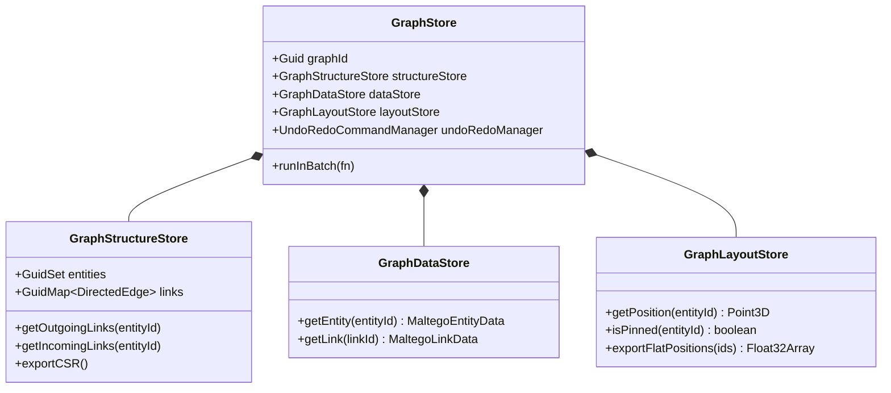
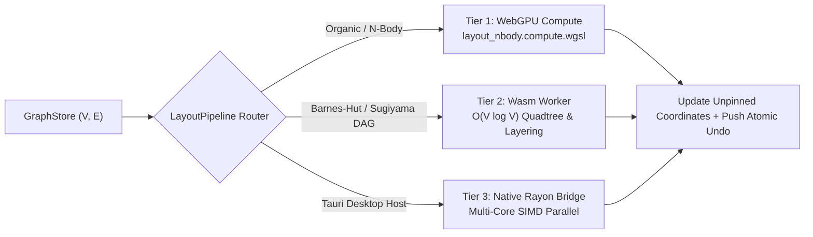

# 🦀 CANGREJO — Engineering Architecture Specification

This document details the internal systems architecture of **CANGREJO** across its 7 workspace packages (`@cangrejo/*`).

---

## 1. Tripartite Graph Engine (`@cangrejo/core`)

To eliminate object-allocation bottlenecks during layout and rendering of graphs with $10^5$ vertices and edges, `GraphStore` strictly separates graph state into three synchronized stores:

### Key Invariants
1. **64-Bit Non-Zero Cryptographic Identity (`Guid`)**: Every entity and link is identified by a 64-bit unsigned integer (`bigint`) guaranteed non-zero (`value !== 0n`), formatted in two's complement hexadecimal.
2. **Cascade Deletion & Atomic Batching**: Removing an entity from `GraphStore` automatically cascades removal of all incident links across `structureStore`, `dataStore`, and `layoutStore` inside a single reversible command on `UndoRedoCommandManager`.
3. **Topological Clustering (`CollectionNodeView`)**: Automatically collapses leaf nodes sharing identical entity types and neighbor signatures (`NeighbourRule`, `ChainingRule`, `StandAloneRule`) into stacked **Collection Plinths** while preserving pinned nodes.

---

## 2. Catatumbo WebGPU Renderer & GPU Buffer Layout (`@cangrejo/renderer`)

### 2.1 `64-Byte` Instanced Node Buffer (`InstancedNodeLayer`)
Each visible node occupies a fixed **64-byte (`16 × Float32`)** stride in GPU memory, enabling in-place selection halo updates without reallocating vertex buffers:

| Byte Offset | Field | Type | Description |
| :--- | :--- | :--- | :--- |
| `0..15` | `positionAndScale` | `vec4<f32>` | `(worldX, worldY, worldZ, radiusScale)` |
| `16..31` | `uvRect` | `vec4<f32>` | `(u0, v0, u1, v1)` inside the `4096×4096` `IconAtlasManager` |
| `32..47` | `selectionRgba` | `vec4<f32>` | Selection or Forensic Tier (*Platino/Oro/Plata/Bronce*) halo color |
| `48..63` | `flags` | `vec4<f32>` | `(pinnedFlag, collectionCount, weightNormalized, bookmarkIndex)` |

### 2.2 `48-Byte` Instanced Edge Buffer (`InstancedEdgeLayer`)
Each directed link occupies a **48-byte (`12 × Float32`)** stride containing `(srcX, srcY, dstX, dstY)`, RGBA color, thickness, dash pattern, and arrowhead reversal flag.

---

## 3. 3-Tier Layout Offloading Pipeline (`LayoutPipeline`)

---

## 4. *Bóveda Cero* Zero-Knowledge Encryption (`@cangrejo/transforms`)

When exporting a classified `.cgrj` investigation via **Bóveda Cero**:
1. A random 16-byte salt derives independent `256-bit` encryption ($K_{\text{enc}}$) and authentication ($K_{\text{mac}}$) keys via `PBKDF2-HMAC-SHA256` (`600,000` iterations).
2. Sensitive entity/link attributes are padded to **256-byte blocks (`PKCS#7`)** and encrypted with `AES-256-GCM`.
3. The entire graph topology (`sorted entity GUIDs + directed link triples`) is signed using `AES-GMAC`, ensuring that any server-side node injection, edge deletion, or ID swap is immediately detected and rejected upon decryption.
