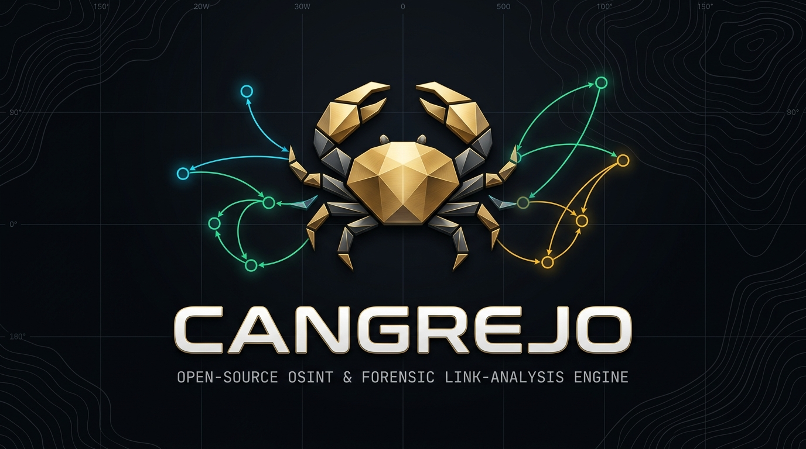
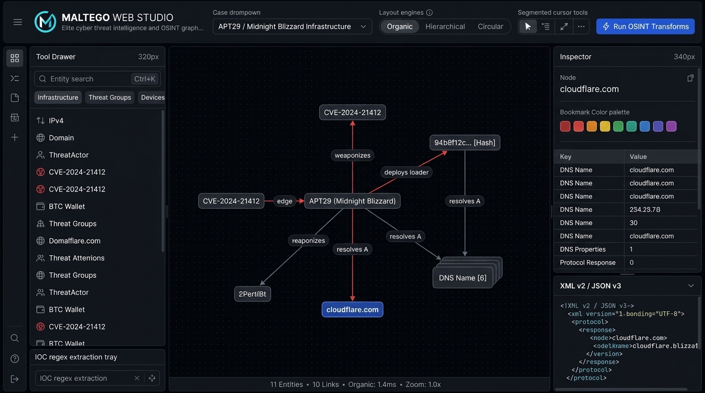
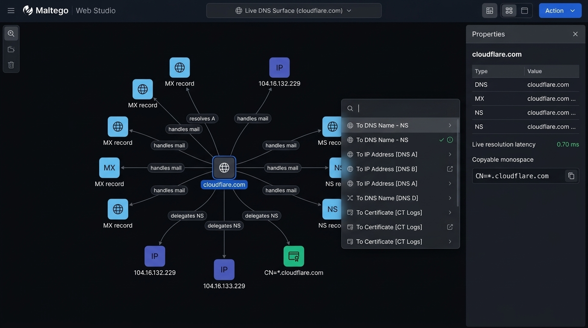
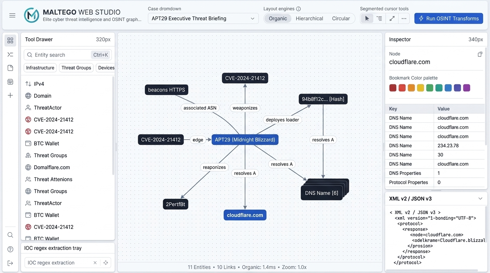

<div align="center">



<br />

# 🦀 CANGREJO

### **Desentraña el Caso Imposible**
*Plataforma Open-Source de Alto Rendimiento para Inteligencia OSINT, Ciberinteligencia de Amenazas (CTI) y Análisis Forense de Vínculos en Grafos*

[](./LICENSE)
[](./tsconfig.json)
[](./packages/renderer)
[](./packages/transforms)
[](./docs/brand/BRAND_IDENTITY.md)

**[English (Global README)](./README.md)** · **[Español](./README.es.md)** · **[Manifiesto de Identidad de Marca](./docs/brand/BRAND_IDENTITY.md)** · **[Guía de Contribución](./CONTRIBUTING.md)**

</div>

---

## 🇻🇪 El Origen del Nombre: *El "Caso Cangrejo" y el Cangrejo de Oro*

En la tradición de la criminalística científica venezolana —nacida a finales de **1971 y principios de 1972** en la histórica *Policía Técnica Judicial (PTJ)*, hoy *CICPC*, e inmortalizada en clásicos como *Cuatro Crímenes, Cuatro Poderes* de Fermín Mármol León—, los detectives acuñaron el término **«Caso Cangrejo»** para referirse a aquellas investigaciones extraordinariamente complejas, enredadas y laberínticas cuyas pistas parecen caminar hacia los lados y hacia atrás, haciendo casi imposible identificar a primera vista el origen del delito.

Para premiar la excelencia técnica, el rigor forense y la deducción científica capaz de resolver los *casos cangrejo* más enigmáticos del país, se instituyó el galardón más prestigioso de la investigación venezolana: el **Premio Cangrejo de Oro** (acompañado por los niveles de *Platino*, *Plata* y *Bronce*).

**CANGREJO** traslada esa filosofía investigativa al mundo moderno del **OSINT**, el **Threat Hunting** y la **Informática Forense**:
- **De Redes Laberínticas a Grafos Claros**: Cuando actores de amenazas (`APT29`, redes de ransomware, infraestructuras C2 o esquemas financieros ilícitos) se ocultan tras múltiples saltos DNS, prefijos BGP, mezcladores cripto y empresas fachada, **Cangrejo** destraba la red de vínculos en tiempo real.
- **Ingeniería de Clase Mundial**: Desarrollado desde cero (*clean-room*) en TypeScript estricto, shaders `WGSL` sobre WebGPU e indexación espacial capaz de sostener **100.000 nodos y 100.000 enlaces a 60 FPS**.

---

## 📖 Glosario Cultural y Forense Venezolano en CANGREJO

Para dotar al proyecto de una identidad propia e inconfundible dentro del ecosistema open-source internacional, **Cangrejo** adopta una nomenclatura técnica inspirada en la investigación científica y la geografía venezolana:

| Concepto en Cangrejo | Significado Técnico en la Plataforma | Inspiración Cultural Venezolana |
| :--- | :--- | :--- |
| **Caso Cangrejo** | Escenario o investigación de alta complejidad con múltiples capas de ofuscación. | Jerga clásica de la criminalística venezolana (1971) para casos laberínticos. |
| **Cangrejo de Platino / Oro / Plata / Bronce** | Niveles de prioridad de marcadores (*Bookmarks*) para clasificar hallazgos críticos en el grafo. | Los cuatro galardones anuales al mérito en investigación científica y criminalística. |
| **Expediente (`.cgrx` / `.cgrj`)** | Archivo contenedor del grafo forense (ZIP binario con GraphML o documento JSON validado). | El expediente técnico donde se asientan todas las actas, pruebas y vínculos del caso. |
| **Pesquisa (`@cangrejo/transforms`)** | Transformación automatizada OSINT en vivo (DNS, Certificados X.509, BGP/ASN, RDAP, Cripto). | Término clásico detectivesco para la indagación sistemática de evidencias. |
| **Motor Catatumbo (`@cangrejo/renderer`)** | Renderizador instanciado WebGPU a 60 FPS + pipeline de layouts en 3 niveles. | El *Relámpago del Catatumbo*, faro natural perpetuo que ilumina la oscuridad. |
| **Bóveda Cero** | Cifrado selectivo Zero-Knowledge (`AES-256-GCM` + `AES-GMAC`) de atributos sensibles manteniendo la topología consultable. | Protección criptográfica de conocimiento cero para expedientes clasificados. |

---

## ✨ Galería de la Interfaz (`Obsidian Studio` y `Daylight Report`)

<p align="center">
  
  <em><strong>Modo Obsidian Studio (Oscuro)</strong> — Barra de comando unificada de 52px, nodos cápsula micro-badge de 168×42px, plintos apilados para colecciones y radar minimapa.</em>
</p>

<p align="center">
  
  
</p>

---

## 🚀 Inicio Rápido

```bash
# 1. Instalar dependencias del monorepo
npm install

# 2. Verificar tipado estricto en los 7 paquetes (@cangrejo/*)
npm run typecheck

# 3. Ejecutar los 36 tests automatizados (Gates 0, 1, 2 y 3)
npm test

# 4. Iniciar la estación de trabajo interactiva en http://127.0.0.1:5173
npm run dev
```

---

## ⚖️ Independencia Legal y Licencia

**CANGREJO** es un proyecto open-source 100% independiente desarrollado bajo metodología *clean-room* a partir de estándares abiertos (`WebGPU`, `GraphML`, `JSON Schema Draft 2020-12`, `NIST AES-GCM/GMAC`, `RFC 7636`). No posee afiliación alguna con Maltego Technologies GmbH ni con organismos gubernamentales.

Distribuido bajo la licencia **[Apache License 2.0](./LICENSE)**.
