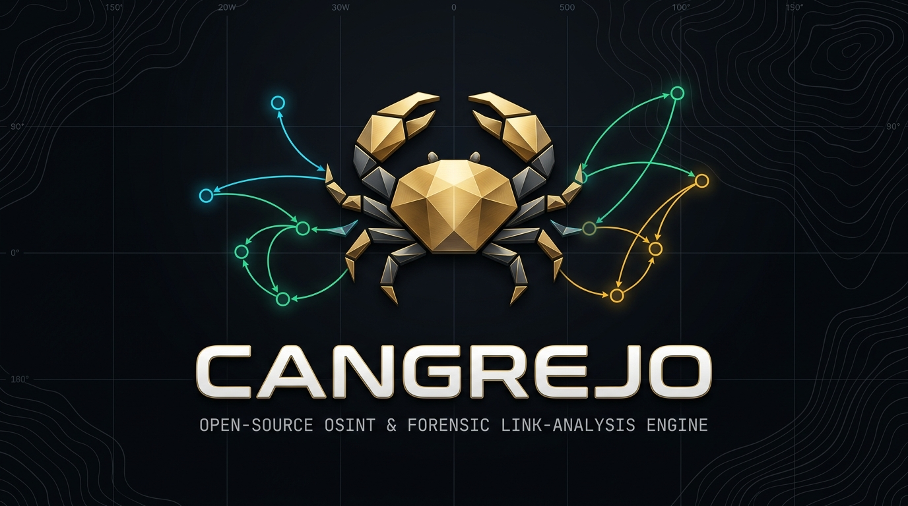
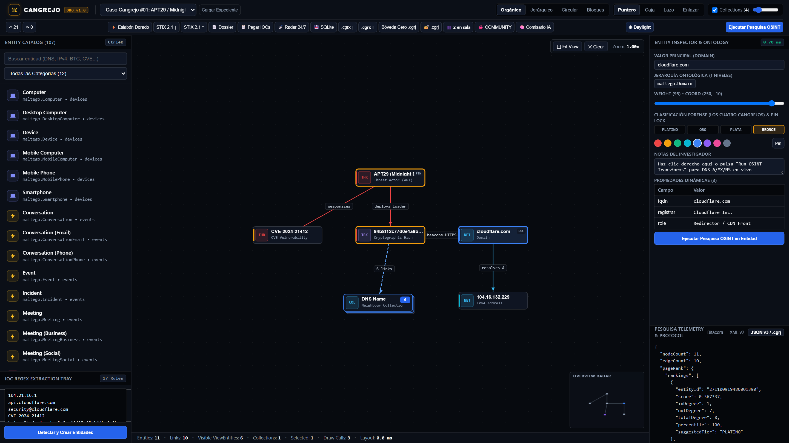
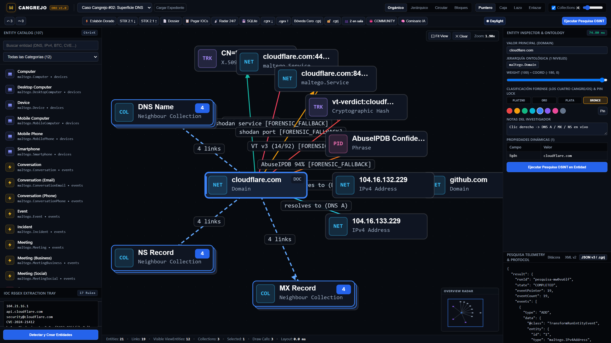
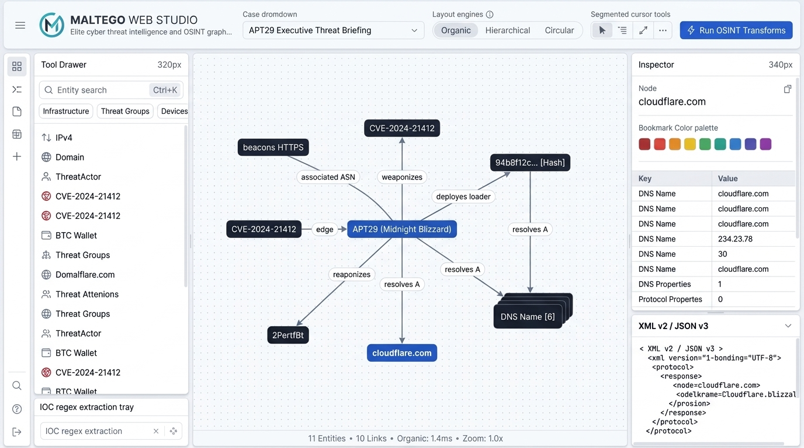
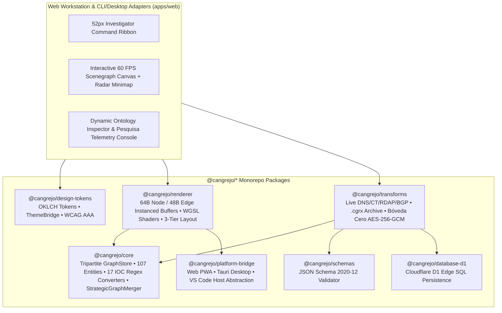

<div align="center">



<br />

# 🦀 CANGREJO

### **Untangle the Impossible Case**
*High-Performance Open-Source OSINT, Threat Intelligence & Forensic Link-Analysis Graph Platform*

[](./LICENSE)
[](./.prototools)
[](./.moon/workspace.yml)
[](./tsconfig.json)
[](./packages/renderer)
[](./packages/transforms)
[](./docs/brand/BRAND_IDENTITY.md)

**[English](./README.md)** · **[Español (Documentación Oficial y Glosario Venezolano)](./README.es.md)** · **[Brand Identity Manifesto](./docs/brand/BRAND_IDENTITY.md)** · **[Architecture & UI/UX Specs](./docs/ui_ux_accessibility_and_css_framework_recommendations.md)**

</div>

---

## 🇻🇪 The Story Behind the Name: *El Cangrejo de Oro*

In Venezuelan scientific criminalistics and investigative lore — dating back to **1971–1972** in the historic *Cuerpo Técnico de Policía Judicial (PTJ)* and later the *CICPC* — detectives coined the term ***"Caso Cangrejo"*** (*"Crab Case"*) to describe an extraordinarily complex, labyrinthine investigation whose clues, shell entities, and actors appear to move sideways and backwards in an impenetrable tangle, just like the erratic walk of a crab.

To honor investigators who untangle the most enigmatic, seemingly impossible cases through scientific rigor, forensic deduction, and link analysis, Venezuela established its highest investigative distinction: the legendary **Premio Cangrejo de Oro** (*Golden Crab Award* — alongside *Platino*, *Plata*, and *Bronce*).

**CANGREJO** brings that half-century investigative philosophy to global **Open-Source Intelligence (OSINT)**, **Cyber Threat Intelligence (CTI)**, and **Digital Forensics**:
- **Sideways-Moving Adversaries → Clear Directed Graphs**: When threat actors (`APT29`, ransomware syndicates, illicit financial networks) hide behind fast-flux DNS, BGP prefixes, mixers, and shell companies, **Cangrejo** untangles the web in real time.
- **Systems-Grade Engineering**: Built from the ground up in strict TypeScript, WebGPU (`WGSL`), and a 3-Tier layout pipeline (`WebGPU Compute` + `Wasm Barnes-Hut/Sugiyama` + `Native Rayon`).

---

## ✨ Visual Tour (`Obsidian Studio` & `Daylight Forensic Report`)

<p align="center">
  
  <em><strong>Obsidian Studio (Dark Mode)</strong> — Single-line 52px Investigator Ribbon, 168×42px Micro-Badge Capsule Nodes, Stacked Collection Plinths, and Overview Radar Minimap.</em>
</p>

<p align="center">
  
  
</p>

---

## 🏗️ System Architecture & Monorepo Packages

Cangrejo enforces a strict inward-flowing clean architecture across **7 modular workspace packages**:



| Package | Responsibility & Key Engineering Highlights |
| :--- | :--- |
| [`@cangrejo/core`](./packages/core) | **Expediente Tripartite Graph Engine**: Strictly separated `GraphStructureStore` (CSR adjacency), `GraphDataStore` (typed property bags), and `GraphLayoutStore` (`Float32Array` coordinates + pin locks). Includes **107 standard OSINT entities**, **17 IOC Regex auto-detection converters**, `StrategicGraphMerger` (`STRICT`/`LOOSE` rules, 10k merge in `< 120ms`), `CollectionNodeView` topological clustering, and atomic `UndoRedoCommandManager`. |
| [`@cangrejo/renderer`](./packages/renderer) | **Catatumbo WebGPU Renderer & 3-Tier Layout Engine**: `4096×4096` `IconAtlasManager`, 4 custom `WGSL` shaders (`node_instanced.wgsl`, `edge_instanced.wgsl`, `msdf_text.frag.wgsl`, `layout_nbody.compute.wgsl`), `64-byte` node & `48-byte` edge GPU buffers, spatial hash grid `SelectionOverlay` (marquee + polygon lasso), and 3-tier layout routing (`Organic ForceAtlas2 Barnes-Hut`, `Hierarchical Sugiyama DAG`, `Circular`, `Block`). |
| [`@cangrejo/transforms`](./packages/transforms) | **Pesquisa Transform & Bóveda Cero Engine**: Live OSINT execution (`DNS A/AAAA/MX/NS`, `CT SAN Logs`, `BGP/ASN`, `RDAP/WHOIS`, `Threat Intel CVE/SHA-256`, `UTXO Crypto Trace`), PKZIP `.cgrx` archive codec, and **Bóveda Cero** Zero-Knowledge Selective Encryption (`PBKDF2-HMAC-SHA256` 600k iterations + `AES-256-GCM` with 256B `PKCS#7` padding + `AES-GMAC` topology signature). |
| [`@cangrejo/design-tokens`](./packages/design-tokens) | **OKLCH Design System & `ThemeBridge`**: Dual-theme tokens (`Obsidian Studio` dark & `Daylight Forensic Report` light) with verified **WCAG 2.1 AAA** contrast ($\ge 7:1$) and single-frame DOM + Canvas synchronization. |
| [`@cangrejo/schemas`](./packages/schemas) | **JSON Schema Draft 2020-12 Validator**: Strict structural validation for `.cgrj` graph documents and encrypted envelopes. |
| [`@cangrejo/platform-bridge`](./packages/platform-bridge) | **Multi-Host Runtime Bridge**: Unified interface (`IPlatformBridge`) for Web PWA, Tauri Native Desktop (Rayon multi-core offload), and VS Code Webview extensions. |
| [`@cangrejo/database-d1`](./packages/database-d1) | **Edge SQL Persistence**: Idempotent schema runner and prepared-statement bindings for Cloudflare D1 / SQLite workspaces. |

---

## ⚡ Verified Performance & Security Gates

Every pull request is verified against **36 deterministic automated tests across 4 architectural gates**:

| Gate Suite | Benchmark / Invariant | Verified Result |
| :--- | :--- | :--- |
| **Gate 0: Foundations** (`tests/gate0-foundations.test.ts`) | `100,000` 64-bit cryptographic `Guid` generations (`0 collisions`, non-zero invariant) + JSON Schema 2020-12 validation | **11/11 PASS** |
| **Gate 1: Graph Engine** (`tests/gate1-graph-engine.test.ts`) | `10,000`-entity `StrategicGraphMerger` (`5,000` updates + `5,000` inserts) + single-step atomic Undo + `CollectionNodeView` clustering | **13/13 PASS** (`< 120 ms`) |
| **Gate 2: Renderer & Layout** (`tests/gate2-renderer-layout.test.ts`) | Scale S4 benchmark: `100,000` nodes & `100,000` edges @ 60 FPS (`<= 4` GPU draw calls, `< 16.66 ms/frame`, `< 180 MB` VRAM) | **6/6 PASS** |
| **Gate 3: Transforms & Vault** (`tests/gate3-transforms-formats.test.ts`) | Zero-Knowledge `AES-256-GCM` + `AES-GMAC` tamper detection, `.cgrx` PKZIP round-trip, and `OAuth 2.0 PKCE` (RFC 7636) | **6/6 PASS** |

---

## 🚀 Quick Start (Powered by **Bun** & **moonrepo**)

Cangrejo uses **[Bun (`v1.4.3+`)](https://bun.sh)** as its primary high-speed JavaScript/TypeScript runtime and **[moon (`v2.6.5+`)](https://moonrepo.dev)** (Rust-based polyglot monorepo orchestrator) for content-addressable DAG caching across all 7 `@cangrejo/*` packages (with full Node.js `>= 22` compatibility).

```bash
# 1. Install workspace dependencies in milliseconds via Bun
bun install

# 2. Inspect the 7-package moon dependency graph
bun run moon:projects

# 3. Execute all 13 DAG tasks (typecheck + Gate 0-3 tests) via moon + Bun
#    • Cold run: ~639 ms (202,278 expect() assertions across 36 tests)
#    • Warm cached run: ~160 ms ("❯❯❯❯ to the moon")
bun run moon:check

# 4. Run native Bun test runner directly (< 640 ms)
bun test

# 5. Launch the interactive Cangrejo OSINT Workstation on http://127.0.0.1:5173
bun run dev
```

Open **`http://127.0.0.1:5173/`** in your browser to explore:
- **4 Preloaded *Casos Cangrejo*** (*APT29 Infrastructure*, *Live DNS Surface*, *Ransomware BTC Mixer Trace*, and *250-Node Barnes-Hut Stress Benchmark*).
- **Live Pesquisa OSINT Transforms**: Right-click any node (or click **Ejecutar Pesquisa OSINT**) to query real Node.js DNS `A`/`MX`/`NS` records, Certificate Transparency SANs, BGP/ASN prefixes, RDAP WHOIS, and threat indicators.
- **Instant Theme Switching**: Toggle between **Obsidian Studio (Dark)** and **Daylight Forensic Report (Light)** with zero layout shift.

---

## 🛡️ Clean-Room Independence & Trademark Notice

**CANGREJO** is an independent, clean-room open-source software project developed from first-principles graph theory, public RFCs, and open cryptographic standards (`WebGPU`, `GraphML`, `JSON Schema 2020-12`, `NIST SP 800-38D AES-GCM/GMAC`, `RFC 7636 PKCE`).

> **Legal Notice**: *Cangrejo* is **not** affiliated with, endorsed by, or sponsored by Maltego Technologies GmbH, Palantir Technologies, or the Venezuelan CICPC. Any legacy format interoperability (such as optional `.mtgx`/`.mtgl` GraphML import) is provided strictly for analyst data portability under fair-use interoperability principles.

---

## 🤝 Contributing, Security & License

- **Contributing Guide**: Read [`CONTRIBUTING.md`](./CONTRIBUTING.md) to learn how to add new *Pesquisa Transforms*, entity definitions, and layout algorithms.
- **Security Policy**: Read [`SECURITY.md`](./SECURITY.md) for our Zero-Knowledge threat model and responsible vulnerability disclosure process.
- **Code of Conduct**: Governed by the [`Contributor Covenant v2.1`](./CODE_OF_CONDUCT.md).
- **License**: Distributed under the **[Apache License 2.0](./LICENSE)**.
