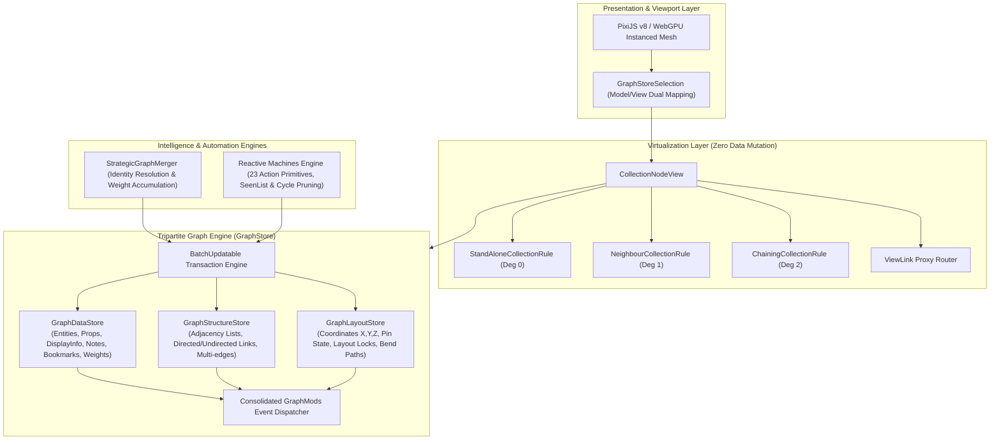
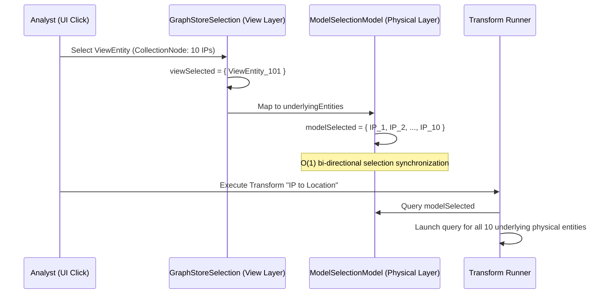
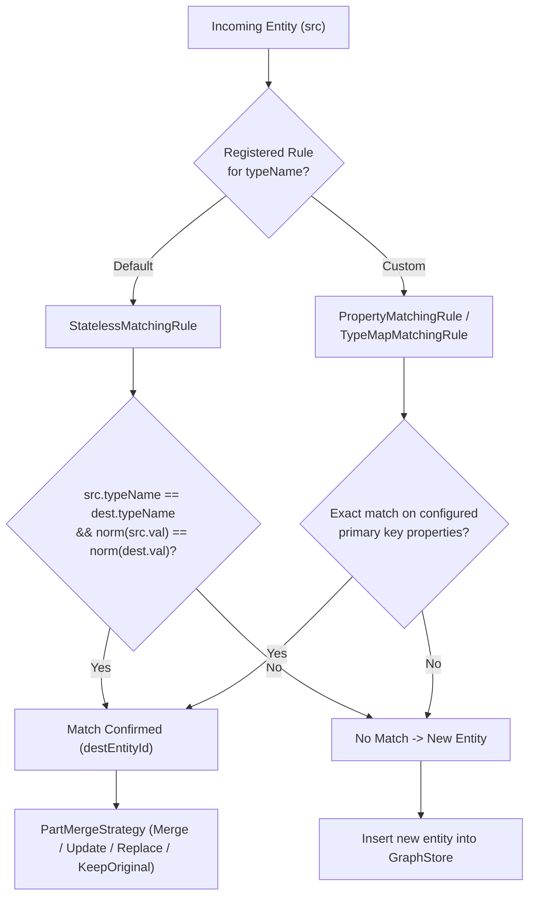
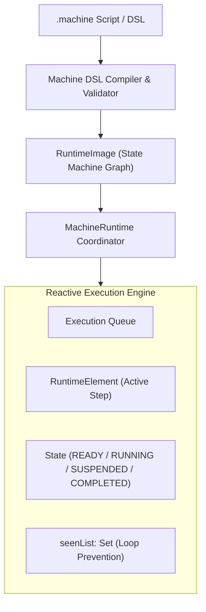

# 02. Clean-Room Core Graph Engine Specification

**Project**: Next-Generation Intelligence Graph & Link Analysis Workstation (`maltego_web_app`)  
**Document**: `docs/architecture/02_graph_engine_spec.md`  
**Classification**: Core Engine Specification & Algorithms  
**Date**: November 2026  
**Status**: APPROVED FOR IMPLEMENTATION  

---

## 1. Executive Summary & Engine Architecture

In link-analysis intelligence workstations, the graph engine is the central computational core. It must manipulate multi-thousand-node networks, enforce strict referential integrity, handle concurrent mutations from transforms, prevent UI render thrashing, and resolve conflicting entity identities without data loss.

This specification details the clean-room implementation of the **Tripartite Graph Engine**, reverse-engineered and modernized from the battle-tested paradigms of Maltego v4.13.0:
1. **Tripartite GraphStore**: Orthogonal decoupling of semantic data (`GraphDataStore`), topological adyacencies (`GraphStructureStore`), and spatial coordinates (`GraphLayoutStore`).
2. **Batch Transaction Engine**: Nested `BatchUpdatable` transaction scopes emitting consolidated, delta-optimized `GraphMods` mutation events.
3. **64-bit Non-Zero Identity & Dual Selection**: Cryptographic 64-bit `Guid` primitives paired with a bi-directional model/view selection coordinator (`GraphStoreSelection`).
4. **Virtual Collection Nodes**: Zero-mutation hierarchical aggregation (`CollectionNodeView`) utilizing 3 topological clustering heuristics to collapse dense hairball subgraphs.
5. **Strategic Graph Merger**: Multi-strategy identity resolution (`StrategicGraphMerger`) with mathematical link weight accumulation and provenance tracking.
6. **Reactive Machines Engine**: An automated state-machine runtime (`MachineRuntime`) featuring 23 action primitives, cycle-pruning DFS, and interactive modal prompts.



---

## 2. Tripartite GraphStore Architecture

### 2.1 Principle of Orthogonal Decoupling

In intelligence graph platforms, entities accumulate extensive analytical properties and forensic metadata. Concurrently, graph algorithms (community detection, shortest path, PageRank) require high-speed vectorized traversals over adjacency lists, while the rendering engine operates purely on geometric screen coordinates.

To eliminate performance bottlenecks and excessive serialization, storage is partitioned into three independent stores governed by a unified `GraphStore`:

```
GraphStore (Unified Coordinator)
 ├── GraphDataStore       -> Semantics, typed properties, weights, notes, bookmarks, provenance
 ├── GraphStructureStore  -> Directed adjacency matrix, multigraphs, reverse edges, endpoints
 └── GraphLayoutStore     -> Cartesian coordinates (X, Y, Z), bends (poly-line routes), position locks
```

---

### 2.2 Semantic Store: `GraphDataStore`

`GraphDataStore` manages all typed attributes and analyst annotations. It has no dependency on spatial coordinates or network topology.

```typescript
export interface MaltegoEntityData {
  id: EntityID;                      // 64-bit Guid
  typeName: string;                  // Canonical ontology type (e.g. "maltego.Domain")
  weight: number;                    // Analytical weight (integer >= 1, PageRank base)
  bookmark: number;                  // Bookmark color index (-1 = none, 0..23 = palette)
  notes: EntityNotes;                // Sticky analyst notes
  displayInfo: DisplayInformation[]; // Rich provenance blocks and formatted reports
  overlays: EntityOverlay[];         // Visual overlays over entity icons
  properties: PropertyBag;           // Polymorphic typed property bag
  attachments: AttachmentRef[];      // SHA-256 binary object references
}

export interface EntityNotes {
  value: string;                     // Note content (Markdown / Plaintext)
  show: boolean;                     // Visible on graph canvas
}

export interface DisplayInformation {
  title: string;                     // Section header (e.g., "WHOIS Records", "Passive DNS")
  content: string;                   // Formatted content (Sanitized HTML or text)
  type: "text/plain" | "text/html" | "text/markdown";  // MIME type
}

export interface EntityOverlay {
  propertyName: string;              // Property providing overlay value/icon
  position: "NW" | "N" | "NE" | "W" | "C" | "E" | "SW" | "S" | "SE";
  type: "text" | "image" | "color";
}

export interface PropertyBag {
  descriptors: Map<string, PropertyDescriptor>;
  values: Map<string, unknown>;
}

export interface PropertyDescriptor {
  name: string;                      // Canonical key
  type: "string" | "int" | "float" | "bool" | "datetime" | "bytes" | "string[]";
  displayName: string;               // Analyst-facing label
  nullable: boolean;
  hidden: boolean;
  readonly: boolean;
  specialRoles: ("VALUE" | "DISPLAY_VALUE" | "IMAGE_URL")[];
  matchingRule: "STRICT" | "LOOSE" | "NONE";
}

export interface MaltegoLinkData {
  id: LinkID;                        // 64-bit Guid
  typeName: string;                  // e.g. "maltego.link.transform-link", "maltego.link.manual"
  weight: number;                    // Relationship weight / consolidated transform count
  bookmark: number;                  // Link bookmark index (-1..23)
  notes: EntityNotes;
  displayInfo: DisplayInformation[];
  properties: PropertyBag;           // maltego.link.label, maltego.link.color, style, thickness
}
```

#### Roles of Special Properties (`specialRoles`):
- `VALUE`: Governs primary entity identity (e.g., `fqdn` for `maltego.Domain`, `ipv4-address` for `maltego.IPv4Address`).
- `DISPLAY_VALUE`: Expression or property (`$(firstnames) $(lastname)`) rendered as the label beneath the icon.
- `IMAGE_URL`: Overrides the default entity icon with a dynamic image or profile photo.

---

### 2.3 Topological Store: `GraphStructureStore`

`GraphStructureStore` maintains pure network topology and guarantees referential integrity:

```typescript
export interface GraphStructureStore {
  entities: Map<EntityID, StructureEntityNode>;
  links: Map<LinkID, StructureLinkEdge>;
  
  // High-Speed O(1) Adjacency Lookups
  getIncomingLinks(entityId: EntityID): ReadonlySet<LinkID>;
  getOutgoingLinks(entityId: EntityID): ReadonlySet<LinkID>;
  getIncidentLinks(entityId: EntityID): ReadonlySet<LinkID>;
  getNeighbors(entityId: EntityID): ReadonlySet<EntityID>;
  hasLinks(entityId: EntityID): boolean;
  
  // Topological Mutations
  addEntity(entityId: EntityID): void;
  removeEntity(entityId: EntityID): Set<LinkID>; // Atomic cascading deletion
  addLink(linkId: LinkID, source: EntityID, target: EntityID, isReversed?: boolean): void;
  removeLink(linkId: LinkID): void;
  setReversed(linkId: LinkID, reversed: boolean): void;
}

export interface StructureEntityNode {
  id: EntityID;
  incoming: Set<LinkID>;
  outgoing: Set<LinkID>;
}

export interface StructureLinkEdge {
  id: LinkID;
  source: EntityID;
  target: EntityID;
  isReversed: boolean; // Reverses arrow drawing without altering topological endpoints
}
```

#### Critical Structural Invariants:
1. **Dangling Link Prevention**: Invoking `addLink` with a `source` or `target` not registered in `entities` immediately throws `DanglingLinkException`.
2. **Atomic Cascading Deletions**: Calling `removeEntity(entityId)` automatically purges all incident links from `links` and from the adjacency sets of neighboring nodes.
3. **Directed Multigraph Support**: Parallel links between identical `(source, target)` pairs are fully supported; each link maintains unique identity `LinkID`.
4. **Reversal Semantics (`isReversed`)**: When `isReversed == true`, the renderer directs the arrowhead toward `source`. Graph traversal algorithms continue to respect physical `source -> target` flow.

---

### 2.4 Spatial Store: `GraphLayoutStore`

`GraphLayoutStore` manages spatial coordinates and bend-paths:

```typescript
export interface GraphLayoutStore {
  entityCoordinates: Map<EntityID, Point3D>;
  linkPaths: Map<LinkID, Point2D[]>;
  pinnedEntities: Set<EntityID>;

  getPosition(entityId: EntityID): Point3D;
  setPosition(entityId: EntityID, position: Point3D): void;
  setPositions(positions: Map<EntityID, Point3D>): void;

  getLinkPath(linkId: LinkID): Point2D[];
  setLinkPath(linkId: LinkID, bends: Point2D[]): void;

  isPinned(entityId: EntityID): boolean;
  setPinned(entityId: EntityID, pinned: boolean): void;
}

export interface Point2D { x: number; y: number; }
export interface Point3D extends Point2D { z: number; }
```

---

## 3. Transaction Model, Batches & Event Dispatching

### 3.1 `BatchUpdatable` Transactions

During bulk transform execution or graph merges, thousands of entities and links arrive simultaneously. Dispatching fine-grained mutation events per node would choke the WebGL render loop.

`GraphStore` implements the `AbstractBatchUpdatable` pattern:

```typescript
export abstract class AbstractBatchUpdatable {
  private nestCount: number = 0;
  private pendingMods: GraphModsAccumulator = new GraphModsAccumulator();
  private readonly listeners: Set<(mods: GraphMods) => void> = new Set();

  public beginUpdate(): void {
    this.nestCount++;
  }

  public endUpdate(): void {
    if (this.nestCount <= 0) {
      throw new Error("endUpdate() called without matching beginUpdate()");
    }
    this.nestCount--;
    if (this.nestCount === 0) {
      this.flushModifications();
    }
  }

  public runInBatch<T>(operation: () => T): T {
    this.beginUpdate();
    try {
      return operation();
    } finally {
      this.endUpdate();
    }
  }

  private flushModifications(): void {
    if (this.pendingMods.isEmpty()) return;
    const consolidated = this.pendingMods.consolidate();
    this.pendingMods.clear();
    for (const listener of this.listeners) {
      listener(consolidated);
    }
  }
}
```

### 3.2 Consolidated `GraphMods` Event Object

```typescript
export interface GraphMods {
  graphId: GraphID;
  timestamp: number;
  dataMods: {
    addedEntities: ReadonlyMap<EntityID, MaltegoEntityData>;
    updatedEntities: ReadonlyMap<EntityID, Partial<MaltegoEntityData>>;
    deletedEntities: ReadonlySet<EntityID>;
    addedLinks: ReadonlyMap<LinkID, MaltegoLinkData>;
    updatedLinks: ReadonlyMap<LinkID, Partial<MaltegoLinkData>>;
    deletedLinks: ReadonlySet<LinkID>;
  };
  structureMods: {
    connectedLinks: ReadonlyMap<LinkID, { source: EntityID; target: EntityID }>;
    disconnectedLinks: ReadonlySet<LinkID>;
  };
  layoutMods: {
    movedEntities: ReadonlyMap<EntityID, Point3D>;
    reroutedLinks: ReadonlyMap<LinkID, Point2D[]>;
    pinChangedEntities: ReadonlyMap<EntityID, boolean>;
  };
}
```

---

## 4. 64-Bit Non-Zero GUID & Dual Selection Mapping

### 4.1 64-Bit GUID Architecture (`Guid`)

Instead of 36-character UUID strings (which waste memory in indexes and buffers), the engine uses non-zero, cryptographically seeded 64-bit signed integers:

```typescript
export class Guid {
  private readonly value: bigint;
  public static readonly ZERO: Guid = new Guid(0n, true);

  constructor(value: bigint);
  private constructor(value: bigint, allowZero: boolean);
  private constructor(value: bigint, allowZero = false) {
    if (value === 0n && !allowZero) {
      throw new Error("Guid cannot be zero. Zero represents unassigned identity.");
    }
    this.value = BigInt.asIntN(64, value);
  }

  public static generate(): Guid {
    const buffer = new BigUint64Array(1);
    crypto.getRandomValues(buffer);
    let val = BigInt.asIntN(64, buffer[0]);
    if (val === 0n) val = 1n;
    return new Guid(val);
  }

  public static parse(text: string): Guid {
    let clean = text.trim();
    if (clean.startsWith("e_") || clean.startsWith("l_") || clean.startsWith("g_")) {
      clean = clean.substring(2);
    }
    return new Guid(BigInt(clean));
  }

  public toBigInt(): bigint { return this.value; }
  public toString(): string { return this.value.toString(); }
  public equals(other: Guid | null | undefined): boolean {
    return other != null && this.value === other.value;
  }
}

export type GraphID = Guid;
export type EntityID = Guid;
export type LinkID = Guid;
```

---

### 4.2 Model vs. View Dual Selection (`GraphStoreSelection`)

When virtual collection nodes are collapsed on canvas, a single visual node (`ViewEntity`) represents multiple physical entities in the underlying `GraphStore`.



- **Selection Invariants**:
  - Regular Entity: `modelSelection = { id }`, `viewSelection = { id }`.
  - Collection Node: `viewSelection = { collectionNodeId }`, `modelSelection = { e_1, e_2, ..., e_n }`.
  - If a transform modifies an underlying entity, the collection node visually updates its member count and status badge in real time.

---

## 5. Virtual Collection Nodes (`CollectionNodeView`)

### 5.1 Zero Data Mutation Principle

To solve the "hairball" problem in complex graphs, `CollectionNodeView` provides a non-destructive aggregation layer. Collapsing or expanding collection nodes **never alters the underlying `GraphDataStore` or `GraphStructureStore`**.

```mermaid
flowchart TD
    subgraph UnderlyingModel["Physical Underlying Model (Intact)"]
        D1["Domain: example.com"]
        IP1["IPv4: 1.1.1.1"]
        IP2["IPv4: 1.0.0.1"]
        IP3["IPv4: 8.8.8.8"]
        D1 -->|Link L1| IP1
        D1 -->|Link L2| IP2
        D1 -->|Link L3| IP3
    end

    subgraph CollectionProjection["Heuristic Projection (CollectionNodeView)"]
        V_D1["Domain: example.com"]
        Col_IP["ViewEntity: 3 IPv4Addresses\n[CollectionNode]"]
        V_Proxy["ViewLink (Proxy)\nunderlyingLinks: {L1, L2, L3}"]
        V_D1 -->|V_Proxy| Col_IP
    end

    UnderlyingModel -.->|Virtual Projection O(V+E)| CollectionProjection
```

---

### 5.2 The 3 Clustering Rules

1. **`StandAloneCollectionRule` (Degree 0 Orphans)**:
   - Evaluates nodes with $\text{inDegree} == 0 \land \text{outDegree} == 0 \land \text{pinned} == \text{false}$.
   - Groups by `Key = entity.typeName`.
   - If $\text{count}(\text{Key}) \ge \text{minRequiredEntitiesPerNode}$ (default: 3), generates a synthetic `ViewEntity`.
2. **`NeighbourCollectionRule` (Degree 1 Leaves & Clusters)**:
   - Evaluates nodes with distinct topological $\text{neighbors}.\text{size} == 1 \land \text{pinned} == \text{false}$. In multigraph scenarios (where multiple parallel edges connect a leaf entity to the same central neighbor), all edges between them count as a single neighbor connection, preserving degree-1 leaf clustering eligibility.
   - Groups by $\text{Key} = (e.\text{typeName},\, \text{neighborId},\, \text{direction},\, \text{linkTypeName})$.
   - If threshold met, hides leaf nodes and routes a synthetic `ViewLink` (proxy edge) from the common neighbor to the `ViewEntity`, tracking all underlying multigraph edges.
3. **`ChainingCollectionRule` (Degree 2 Parallel Bridges)**:
   - Evaluates nodes with $\text{inDegree} == 1 \land \text{outDegree} == 1 \land \text{pinned} == \text{false}$.
   - Groups by $\text{Key} = (e.\text{typeName},\, \text{srcNeighbor},\, \text{trgNeighbor},\, \text{inLinkType},\, \text{outLinkType})$.
   - Collapses parallel bridge entities into a `ViewEntity` with incoming and outgoing proxy `ViewLink` edges.

---

## 6. Strategic Graph Merger (`StrategicGraphMerger`)

### 6.1 Identity Resolution Pipeline

When transforms complete or subgraphs are imported, `StrategicGraphMerger` matches incoming entities against existing graph nodes:



### 6.2 Conflict Policies: `PartMergeStrategy`

| Field / Attribute | `KeepOriginal` | `Replace` | `Merge` / `Update` (Standard Default) |
|---|---|---|---|
| **Primary Value (`value`)** | Retains `dest` | Overwrites with `src` | Retains `dest` unless empty, then adopts `src`. |
| **New Properties** | Ignored | Inserts all | Inserts all missing properties into `dest`. |
| **Conflicting Properties** | Retains `dest` | Overwrites with `src` | Evaluates specificity heuristic; keeps richer value. |
| **Weight (`weight`)** | Retains `dest` | Adopts `src` | **Idempotent / Bounded**: For entities, `dest.weight = Math.max(dest.weight, src.weight)` to avoid runaway centrality inflation on repeated transforms; for links, `dest.weight += src.weight` (accumulative relationship strength). |
| **Notes (`notes`)** | Retains `dest` | Adopts `src` | **Historical concatenation**: Appends `src.notes` with timestamp. |
| **Bookmarks (`bookmark`)** | Retains `dest` | Adopts `src` | Preserves `dest` bookmark if $\ne -1$; otherwise adopts `src`. |
| **Provenance (`displayInfo`)** | Retains `dest` | Overwrites | **Set union**: Appends unique report sections from `src`. |
| **Overlays (`overlays`)** | Retains `dest` | Overwrites | **Union**: Fills unoccupied cardinal positions. |

---

## 7. Reactive Automation Engine: Maltego Machines

### 7.1 Architecture of `MachineRuntime`

Maltego Machines automate intelligence workflows via reactive finite-state automata:



---

### 7.2 The 23 Machine Action Primitives

| # | Action Primitive | Category | Parameters & Signature | Operational Semantics |
|---|---|---|---|---|
| 1 | `run(transform, params?, options?)` | Execution | `name: string, params?: object, options?: { ignoreSeen: boolean }` | Executes transform over active entities (default: `ignoreSeen: true`). |
| 2 | `type(entityTypes)` | Filter | `types: string \| string[]` | Retains only entities matching specified ontological types. |
| 3 | `value(regex, options?)` | Filter | `pattern: string, options?: { invert: boolean }` | Filters entities by regex matching against primary value. |
| 4 | `property(prop, regex, options?)` | Filter | `prop: string, pattern: string, options?: { invert: boolean }` | Filters entities by regex matching on property value. |
| 5 | `numeric(prop, op, threshold)` | Filter | `prop: string, op: ">" \| "<" \| "==" \| ">=" \| "<=", val: number` | Numerical comparison on integer/float properties. |
| 6 | `age(seconds, op)` | Filter | `seconds: number, op: ">" \| "<"` | Filters entities based on elapsed time since graph creation. |
| 7 | `all()` | Selection | `void` | Resets active set to all entities present in graph. |
| 8 | `incoming(op, count)` | Topology | `op: ">" \| "<" \| "==", count: number` | Filters entities by incoming degree (`inDegree`). |
| 9 | `outgoing(op, count)` | Topology | `op: ">" \| "<" \| "==", count: number` | Filters entities by outgoing degree (`outDegree`). |
| 10 | `degree(op, count)` | Topology | `op: ">" \| "<" \| "==", count: number` | Filters entities by total degree (`inDegree + outDegree`). |
| 11 | `rootAncestors()` | Topology | `void` | Replaces active set with root nodes that originated current branches. |
| 12 | `rootAncestorCount(op, count)` | Topology | `op: ">" \| "<" \| "==", count: number` | Filters entities based on topological distance to root. |
| 13 | `bookmarked(colorIndex)` | Tagging | `colorIndex: number` (-1 to 23) | Retains entities matching specified bookmark index. |
| 14 | `bookmark(colorIndex)` | Tagging | `colorIndex: number` (0 to 23) | Assigns bookmark color index to all active entities. |
| 15 | `clearBookmark()` | Tagging | `void` | Clears bookmark (`bookmark = -1`) on active entities. |
| 16 | `delete()` | Mutation | `void` | Deletes active entities and incident links from graph. |
| 17 | `deleteBranch()` | Mutation | `void` | Deletes active entities and all descendants; prunes cycles safely. |
| 18 | `userFilter(title, desc)` | Interaction | `title: string, description: string` | **Modal Pause**: Suspends Machine for interactive analyst selection. |
| 19 | `setLayout(layoutName)` | Visual | `layout: "hierarchical" \| "circular" \| "organic"` | Triggers automatic layout calculation over resulting subgraph. |
| 20 | `log(message, options?)` | Logging | `message: string, options?: { showEntities: boolean }` | Logs message to machine execution console. |
| 21 | `status(message)` | Logging | `message: string` | Updates status bar text in workstation UI. |
| 22 | `saveAs(filePath, format)` | Persistence | `filePath: string, format: "mtgx" \| "mtgj"` | Persists snapshot of current graph to disk or cloud. |
| 23 | `sendToURL(url, options?)` | Integration | `url: string, options?: { headers: object, format: "json" \| "xml" }` | Transmits current active subgraph to external webhook or SIEM. |

---

### 7.3 Infinite Loop Prevention & Cycle Pruning

1. **`seenList` Loop Prevention**: `MachineRuntime` maintains `seenList = new Set<EntityID>()`. When running recursive transforms, input is filtered: $\text{Input} = \text{Active} \setminus \text{seenList}$, preventing runaway recursion.
2. **Cycle Pruning in `deleteBranch()`**: A three-color DFS (`WHITE`, `GRAY`, `BLACK`) detects back-edges pointing to `GRAY` ancestor nodes. Cycles are cut cleanly without stack overflows.
3. **Safety Limit Watchdog**: If a machine generates $> 10,000$ entities or executes $> 1,000$ iterations, it pauses and prompts the user before proceeding.

---

## 8. TypeScript Interface Contracts

```typescript
export interface IGraphStore extends AbstractBatchUpdatable {
  readonly graphId: GraphID;
  readonly dataStore: GraphDataStore;
  readonly structureStore: GraphStructureStore;
  readonly layoutStore: GraphLayoutStore;

  subscribe(listener: (mods: GraphMods) => void): () => void;
  createSnapshot(): Promise<Uint8Array>;
}

export interface IStrategicGraphMerger {
  merge(
    targetStore: IGraphStore,
    incoming: { entities: MaltegoEntityData[]; links: MaltegoLinkData[] },
    strategy: "Merge" | "Replace" | "KeepOriginal"
  ): Promise<MergeResult>;
}

export interface ICollectionNodeView {
  readonly underlyingStore: IGraphStore;
  readonly isEnabled: boolean;
  setEnabled(enabled: boolean): void;
  recomputeCollections(): void;
  getViewEntities(): ReadonlyMap<EntityID, ViewEntity>;
  getViewLinks(): ReadonlyMap<LinkID, ViewLink>;
  uncollectNode(collectionEntityId: EntityID): void;
}

export interface IMachineRuntime {
  executeMachine(
    machineScript: string,
    targetStore: IGraphStore,
    initialEntities: Set<EntityID>
  ): Promise<void>;
  pause(): void;
  resume(userInput?: unknown): void;
  cancel(): void;
}
```
