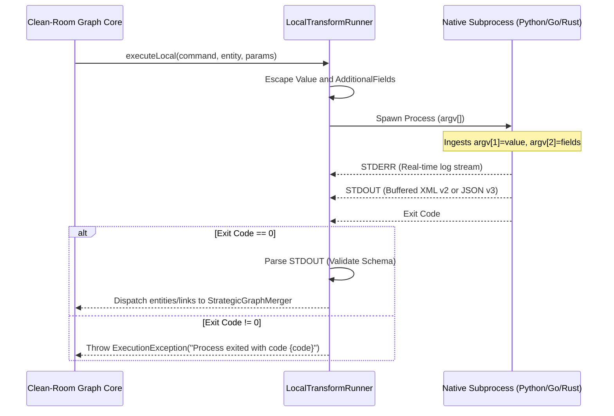

# 03. Transform Protocols, CLI Execution & File Format Specifications

**Project**: Next-Generation Intelligence Graph & Link Analysis Workstation (`maltego_web_app`)  
**Document**: `docs/architecture/03_transforms_and_protocols.md`  
**Classification**: Network Protocols, CLI Subprocesses & Serialization Formats  
**Date**: November 2026  
**Status**: APPROVED FOR IMPLEMENTATION  

---

## 1. Executive Summary

Transforms are the core data enrichment mechanism of the intelligence graph ecosystem. They ingest existing graph entities, query external OSINT providers, commercial threat telemetry, or local forensic tools, and return new entities and relationships to expand the graph.

This document establishes the authoritative specifications for:
1. **Transform Protocol v2**: Legacy XML protocol over HTTP/HTTPS/STDIO, governed by `MaltegoDomain.xsd`.
2. **Transform Protocol v3**: Asynchronous REST/JSON streaming protocol with delta events and human-in-the-loop prompts.
3. **Local CLI Subprocess Runner**: Cross-platform process execution with strict argument escaping, environment scrubbing, and timeout control.
4. **Interchange File Formats**: Full round-trip specifications for `.mtgx` (GraphML/ZIP), `.mtgj` (JSON Schema v2.0.0), and legacy `.mtgl` migration.
5. **Zero-Knowledge Cloud Cryptography**: Selective JSON path encryption (AES-256-GCM + RSA-OAEP + AES-GMAC).
6. **Transform Distribution Server (TDS) & Hub**: Catalog discovery and OAuth 2.0 PKCE integration.

---

## 2. Transform Protocol v2 (XML over HTTP / STDIO)

Transform Protocol v2 is the foundational protocol supported by thousands of community and enterprise Maltego transforms, implemented via Python (`canari`, `maltego-trx`), Bash, Go, and remote web services.

### 2.1 Request Envelope: `<MaltegoTransformRequestMessage>`

Dispatched via `POST <ServerURL>?Command=_RUN&TransformToRun=<TransformName>&Key=<ApiKey>`:

```xml
<?xml version="1.0" encoding="UTF-8"?>
<MaltegoMessage xmlns:xsd="http://www.w3.org/2001/XMLSchema">
    <MaltegoTransformRequestMessage>
        <Entities>
            <Entity Type="maltego.Domain">
                <Value>target-bank.com</Value>
                <Weight>100</Weight>
                <AdditionalFields>
                    <Field Name="domain-name" DisplayName="Domain Name" MatchingRule="strict">target-bank.com</Field>
                </AdditionalFields>
            </Entity>
        </Entities>
        <TransformFields>
            <Field Name="transform.local.api-key">SECRET_API_KEY_VALUE</Field>
            <Field Name="client.version">4.13.0</Field>
        </TransformFields>
        <Limits SoftLimit="12" HardLimit="255"/>
    </MaltegoTransformRequestMessage>
</MaltegoMessage>
```

---

### 2.2 Response Envelope: `<MaltegoTransformResponseMessage>`

Emitted by remote endpoints or piped to `STDOUT` by local subprocess scripts:

```xml
<?xml version="1.0" encoding="UTF-8"?>
<MaltegoMessage xmlns:xsd="http://www.w3.org/2001/XMLSchema">
    <MaltegoTransformResponseMessage>
        <Entities>
            <Entity Type="maltego.IPv4Address">
                <Value>198.51.100.5</Value>
                <Weight>200</Weight>
                <AdditionalFields>
                    <Field Name="ipv4-address" DisplayName="IP Address" MatchingRule="strict">198.51.100.5</Field>
                    <Field Name="country" DisplayName="Country">US</Field>
                    <!-- Link Attributes Injection -->
                    <Field Name="maltego.link.label">A Record</Field>
                    <Field Name="maltego.link.color">#0033CC</Field>
                    <Field Name="maltego.link.thickness">2</Field>
                    <Field Name="maltego.link.style">0</Field>
                </AdditionalFields>
                <IconURL>https://tas.example.com/icons/server.png</IconURL>
                <DisplayInformation>
                    <Label Name="Reverse DNS" Type="text/plain">mail.target-bank.com</Label>
                    <Label Name="BGP Prefix" Type="text/html"><![CDATA[<b>Prefix:</b> 198.51.100.0/24<br><b>ASN:</b> AS64496]]></Label>
                </DisplayInformation>
                <Overlays>
                    <Overlay propertyName="country" position="NW" type="image"/>
                    <Overlay propertyName="ipv4-address" position="S" type="text"/>
                </Overlays>
            </Entity>
        </Entities>
        <UIMessages>
            <UIMessage MessageType="Inform">Resolved 1 IPv4 address successfully.</UIMessage>
        </UIMessages>
        <AdditionalInfo>
            <Buttons>
                <Button id="btn_report" text="Open Dossier" url="https://intel.example.com/report/198.51.100.5"/>
            </Buttons>
        </AdditionalInfo>
    </MaltegoTransformResponseMessage>
</MaltegoMessage>
```

#### Link Styling Attributes:
- `maltego.link.label`: Text string displayed above or alongside the directed edge.
- `maltego.link.color`: Hexadecimal color string (`#RRGGBB` or `#AARRGGBB`).
- `maltego.link.style`: Line dash pattern (`0` = Solid, `1` = Dash, `2` = Dot, `3` = Dash-Dot).
- `maltego.link.thickness`: Line width in screen pixels (integer `1` to `5`).

---

### 2.3 Exception Envelope: `<MaltegoTransformExceptionMessage>`

When errors occur, remote servers return HTTP 200 with a formal exception payload:

```xml
<?xml version="1.0" encoding="UTF-8"?>
<MaltegoMessage xmlns:xsd="http://www.w3.org/2001/XMLSchema">
    <MaltegoTransformExceptionMessage>
        <Exceptions>
            <Exception code="401">API Key has expired or exceeded daily rate limit.</Exception>
        </Exceptions>
    </MaltegoTransformExceptionMessage>
</MaltegoMessage>
```

---

## 3. Transform Protocol v3 (REST / JSON Streaming)

Protocol v3 addresses the limitations of v2 by supporting arbitrary subgraphs as input, non-blocking asynchronous execution, streaming delta events, and interactive user prompts.

### 3.1 REST Endpoints

| Method | Endpoint | Description |
|---|---|---|
| `GET` | `/transforms` | Catalog discovery, input types, and public JWE keys |
| `POST` | `/transforms/{transformId}/run` | Initiates execution; returns `runId` and status `RUNNING` |
| `GET` | `/transforms/{transformId}/run/{runId}/results` | Paginated polling via `eventPointer` and `eventLimit` |
| `DELETE` | `/transforms/{transformId}/run/{runId}` | Cancels execution and frees server resources |
| `POST` | `/transforms/{transformId}/run/{runId}/prompts/{promptId}` | Submits user response to an interactive prompt |

---

### 3.2 Request Payload: `TransformRunRequest`

```json
{
  "input": {
    "graph": {
      "entities": [
        {
          "id": "e_domain_01",
          "type": "maltego.Domain",
          "weight": 100,
          "props": [
            {
              "name": "domain-name",
              "type": "string",
              "displayName": "Domain Name",
              "value": "threat-actor.org",
              "special": ["VALUE", "DISPLAY_VALUE"]
            }
          ]
        }
      ],
      "links": []
    }
  },
  "limit": 255,
  "transformSettings": [
    {
      "name": "apiKey",
      "value": "usr_live_sec_771829"
    }
  ],
  "runExecutionContext": {
    "graphId": "graph_881a7b",
    "runSource": "USER_INTERACTION"
  }
}
```

---

### 3.3 Streaming Delta Events: `TransformRunResponse`

Returned by `GET /transforms/{transformId}/run/{runId}/results?eventPointer=0&eventLimit=100`:

```json
{
  "result": {
    "runId": "run_01ha94b29f984c1",
    "state": "RUNNING",
    "eventPointer": 2,
    "eventCount": 2,
    "events": [
      {
        "type": "ADD",
        "data": {
          "@class": "TransformRunEntityEvent",
          "entity": {
            "id": "e_ip_01",
            "type": "maltego.IPv4Address",
            "weight": 150,
            "props": [
              {
                "name": "ipv4-address",
                "type": "string",
                "displayName": "IP Address",
                "value": "198.51.100.99",
                "special": ["VALUE", "DISPLAY_VALUE"]
              }
            ]
          }
        }
      },
      {
        "type": "ADD",
        "data": {
          "@class": "TransformRunLinkEvent",
          "link": {
            "id": "l_01",
            "sourceId": "e_domain_01",
            "targetId": "e_ip_01",
            "props": [
              {
                "name": "maltego.link.label",
                "type": "string",
                "displayName": "Label",
                "value": "Resolved A"
              }
            ]
          }
        }
      }
    ]
  },
  "status": {
    "code": 200,
    "uiMessages": [
      { "message": "Querying passive DNS telemetry...", "type": "INFO" }
    ]
  }
}
```

---

### 3.4 Interactive Prompts (`TransformRunChoicePromptEvent`)

When the remote server requires user input (e.g., selecting from multiple accounts or geolocations), it emits a prompt event:

```json
{
  "type": "PROMPT",
  "data": {
    "@class": "TransformRunChoicePromptEvent",
    "id": "prompt_select_country",
    "message": "Multiple locations identified. Select target region:",
    "timeout": 45,
    "defaultOptionId": "opt_us",
    "control": { "type": "DROPDOWN" },
    "options": [
      { "id": "opt_us", "displayName": "United States (US)" },
      { "id": "opt_eu", "displayName": "European Union (EU)" }
    ]
  }
}
```

The client UI pauses, renders a dialog modal, and posts the analyst's choice back to the server:
```json
// POST /transforms/{id}/run/{runId}/prompts/prompt_select_country
{
  "result": { "selected": "opt_us" },
  "reason": "USER_INPUT"
}
```

---

## 4. Local CLI Subprocess Execution Engine

Local transforms run directly on the analyst's workstation using native binaries (Python, Go, Bash, Rust).



### 4.1 Argument Escaping & Tokenization

Commands are passed to the OS process runner formatted as:
```
<command> [parameters] "<entityValue>" "<field1=val1#field2=val2...>"
```

#### Mandatory Sequential Escaping Rules:
To avoid delimiter collision with `=`, `#`, and `\`, `LocalTransformRunner` performs the following escapes sequentially:
1. Backslash: `\` $\to$ `\\`
2. Equals: `=` $\to$ `\=`
3. Hash: `#` $\to$ `\#`

#### Parameter Tokenization Regex:
Parameters are tokenized while preserving quotation using:
```regex
[^\s"']+|"([^"\\]|\\.)*"|'([^'\\]|\\.)*'
```

---

## 5. Storage Containers & File Formats

### 5.1 Classic `.mtgx` Container (PKZIP / GraphML)

The legacy archive format is a standard PKZIP archive structured as follows:

```
investigation.mtgx (ZIP)
├── version.properties                          # Software metadata & versions
├── Graphs/
│   └── Graph1.graphml                          # GraphML XML topology
├── Entities/                                   # Custom entity definitions
│   └── custom.ThreatActor.entity
├── Icons/                                      # Rasterized entity icons
│   └── Custom/
│       ├── Icon.png
│       └── Icon.xml
└── Files/                                      # Binary attachment payloads
    └── <sha256_hash>
```

#### `version.properties` Structure:
```properties
maltego.mtz.version=1.1
maltego.graph.version=1.3
maltego.pandora.version=1.4.7
maltego.client.name=Maltego
maltego.client.version=4.13.0
maltego.SaveWithAllEntities=false
```

#### GraphML Namespace Mapping (`Graphs/Graph1.graphml`):
- `d0`: 2D Node Geometry (`<y:ShapeNode><y:Geometry x="120.0" y="-45.0" width="32.0" height="32.0"/></y:ShapeNode>`).
- `d1`: Maltego Entity Data (`<mtgx:MaltegoEntity type="maltego.Domain"><mtgx:Weight>100</mtgx:Weight>...</mtgx:MaltegoEntity>`).
- `d2`: 2D Edge Geometry (`<y:PolyLineEdge><y:Path sx="0" sy="0" tx="0" ty="0"><y:Point x="120" y="-45"/></y:Path></y:PolyLineEdge>`).
- `d3`: Maltego Link Data (`<mtgx:MaltegoLink type="maltego.link.transform-link">...</mtgx:MaltegoLink>`).

---

### 5.2 Modern Streaming `.mtgj` Container (v2.0.0 JSON)

The canonical next-generation format is a ZIP archive containing validated JSON streams:

```
investigation.mtgj (ZIP)
├── properties.json                             # Container manifest
├── Graphs/
│   └── Graph1.json                             # Entity, link, collection schema (v2.0.0)
└── Files/
    └── Attachments/
        └── <sha256_hash>                       # Content-addressed binary attachments
```

#### `properties.json`:
```json
{
  "schemaVersion": "2.0.0",
  "mtgjVersion": "1.0.0",
  "graphCount": 1,
  "defaultGraph": "Graph1",
  "created": 1700000000000,
  "modified": 1700000050000
}
```

The graph structure inside `Graphs/Graph1.json` is strictly validated against `schemas/mtgj_schema_v2.0.0.json`.

---

## 6. Zero-Knowledge Selective Cloud Encryption

When cloud persistence is enabled with client-side zero-knowledge encryption:

```mermaid
flowchart TD
    UserPass["Analyst Passphrase"] --> PBKDF2["PBKDF2-HMAC-SHA256 (100k rounds, 16-byte salt)"]
    PBKDF2 --> MasterKey["MasterKey (256-bit AES)"]

    MasterKey -->|AES-GCM-256| DecryptRSA["Decrypt Analyst Private RSA Key"]
    DecryptRSA --> PrivateRSA["Private RSA Key"]

    EncCaseKey["Encrypted CaseKey (Metadata)"] -->|RSA-OAEP-256 (SHA-256 + MGF1)| CaseKey["CaseKey (256-bit AES)"]
    PrivateRSA --> CaseKey

    EncGraphKey["Encrypted GraphKey"] -->|AES-GCM-256| GraphKey["GraphKey (256-bit AES)"]
    CaseKey --> GraphKey

    GraphKey --> EncryptPayload["Selective JSON Encryption (AES-GCM-256 + PKCS7Padding)"]
    GraphKey --> SignGMAC["Structural Integrity Signature (AES-GMAC)"]
```

### 6.1 Path-Level Selective Encryption
To allow edge servers and layout engines to compute topological arrangements without decrypting confidential intelligence data:
- **Cleartext Fields (Topology & Geometry)**: `id`, `source`, `target`, `position`, `pinned`, `weight`.
- **Encrypted Fields (Intelligence Data)**: `.name`, `.metadata`, `.entities.props.value`, `.links.props.value`, `.notes.value`, `.displayInfo.content`.
- **PKCS7 Padding**: Applied prior to AES-GCM encryption on short strings to prevent ciphertext length analysis.
- **AES-GMAC Structural Tag**: Authenticates the entire JSON topology, preventing unauthorized edge addition or deletion.

---

## 7. Transform Distribution Server (TDS) & Hub Integration

```mermaid
flowchart LR
    Hub["Transform Hub (API)"] -->|JsonHubResponse Catalog| Client["Cangrejo App Client"]
    Client -->|Install Seed URL| TDS["Transform Distribution Server (TDS / TAS)"]
    TDS -->|GET /transforms (v3) / ?Command=_TRANSFORMS (v2)| Client
    Client -->|OAuth 2.0 PKCE / API Key Injected| TDS
    TDS -->|Execute Transforms| ExternalAPIs["OSINT Providers (Shodan, Censys, VT, Whois)"]
```

### 7.1 OAuth 2.0 PKCE Client Authentication
1. Client starts a local loopback HTTP listener (`http://127.0.0.1:<callbackPort>`).
2. Opens system browser to provider authorization endpoint with `code_challenge` (SHA-256).
3. Intercepts authorization code callback, exchanges it for `access_token` and `refresh_token`.
4. Vaults tokens locally in encrypted storage (Tauri Secure Storage / Web Crypto API) or passes them to Cloudflare Workers Transform Proxy for egress injection.
