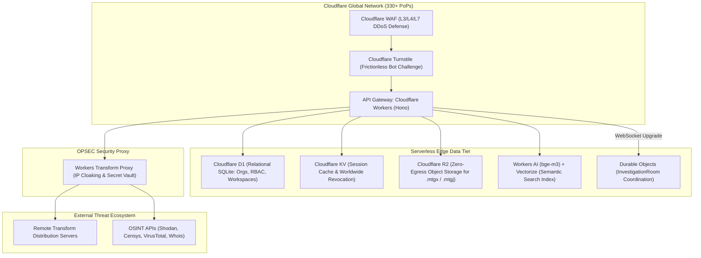
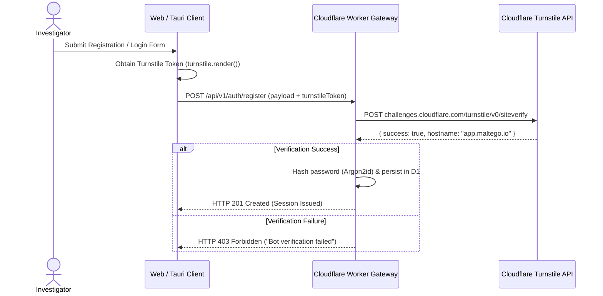
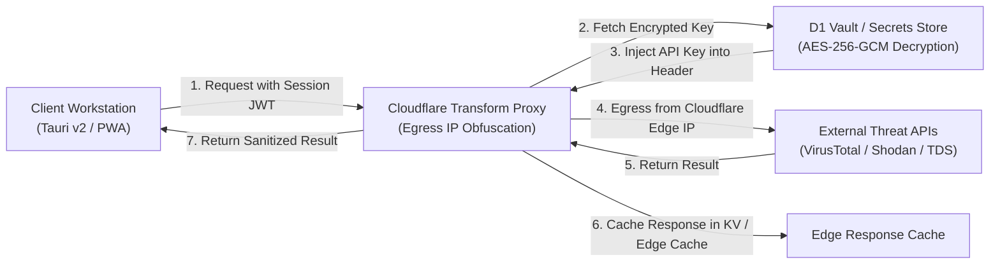
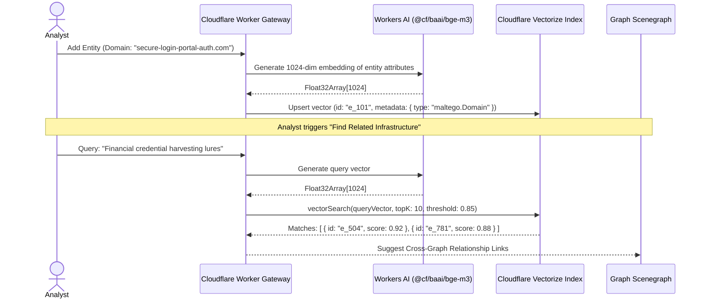

# 04. Cloudflare Edge Serverless Cloud Tier Architecture

**Project**: Next-Generation Intelligence Graph & Link Analysis Workstation (`maltego_web_app`)  
**Document**: `docs/architecture/04_cloudflare_cloud_tier.md`  
**Classification**: Cloud Infrastructure, Edge Services & Security Proxy  
**Date**: November 2026  
**Status**: APPROVED FOR IMPLEMENTATION  

---

## 1. Executive Summary & Edge Topology

Traditional intelligence backends rely on centralized hyperscaler architectures (AWS/GCP VMs, relational clusters, dedicated Redis caches) requiring complex multi-region deployments to minimize latency for distributed investigative teams.

The Cloudflare Edge Cloud Tier utilizes an **edge-native serverless architecture** deployed across 330+ points of presence worldwide. Every request terminates at the nearest edge PoP, providing sub-15ms round-trip latency, automated DDoS and bot mitigation, and a zero-egress cost model for multi-gigabyte investigation archives.



---

## 2. Edge API Gateway: Cloudflare Workers with Hono

The primary API gateway is implemented with **Cloudflare Workers** utilizing the **Hono** framework for zero-cold-start edge routing, type-safe RPC, declarative OpenAPI integration, and middleware:

```typescript
// server/src/index.ts
import { Hono } from 'hono';
import { cors } from 'hono/cors';
import { logger } from 'hono/logger';
import { secureHeaders } from 'hono/secure-headers';
import { authRouter } from './routes/auth';
import { workspacesRouter } from './routes/workspaces';
import { transformsProxyRouter } from './routes/transforms';
import { Env } from './types';

const app = new Hono<{ Bindings: Env }>();

// Edge Security Headers & Request Tracing
app.use('*', logger());
app.use('*', secureHeaders());
app.use('*', cors({
  origin: (origin) => 
    origin.endsWith('.maltego.io') || 
    origin === 'tauri://localhost' || 
    origin === 'http://tauri.localhost' || 
    origin === 'http://localhost:5173' 
      ? origin : null,
  credentials: true,
  allowMethods: ['GET', 'POST', 'PUT', 'DELETE', 'OPTIONS'],
}));

// Core API Routes
app.route('/api/v1/auth', authRouter);
app.route('/api/v1/workspaces', workspacesRouter);
app.route('/api/v1/transforms', transformsProxyRouter);

// WebSocket Upgrade to Durable Object Collaborative Room
app.get('/api/v1/rooms/:investigationId/ws', async (c) => {
  if (c.req.header('Upgrade') !== 'websocket') {
    return c.text('Expected WebSocket Upgrade', 426);
  }

  const investigationId = c.req.param('investigationId');
  const token = c.req.query('token');

  // Verify session token against Cloudflare KV (< 2 ms)
  const user = await validateSession(c.env, token);
  if (!user) return c.json({ error: 'Unauthorized' }, 401);

  // Obtain deterministic Durable Object handle for this investigation
  const roomId = c.env.INVESTIGATION_ROOM.idFromName(investigationId);
  const roomStub = c.env.INVESTIGATION_ROOM.get(roomId);

  // Delegate WebSocket handshake to Durable Object
  return roomStub.fetch(c.req.raw);
});

export default app;
```

---

## 3. Identity, RBAC & Bot Defense

### 3.1 Cloudflare Turnstile Bot Defense

To protect user registration, password resets, and invitation acceptance from credential stuffing and automated abuse without visual CAPTCHAs, Turnstile tokens are validated at the edge:



---

### 3.2 Relational Core: Cloudflare D1

All multi-tenant metadata, RBAC assignments, workspaces, and audit trails are persisted in **Cloudflare D1** (distributed SQLite). The schema is defined in `schemas/d1_relational_schema.sql`:

| Table Name | Primary Responsibility | Key Columns & Constraints |
|---|---|---|
| `organizations` | Multi-tenant root entity | `id`, `slug` (UNIQUE), `plan`, `max_collaborators`, `max_workspaces`, `max_entities_per_graph` |
| `users` | Global user accounts & credentials | `id`, `email` (UNIQUE NOCASE), `password_hash` (Argon2id), `totp_secret_encrypted`, `status` |
| `memberships` | Organization-scoped RBAC | `id`, `org_id`, `user_id`, `role` (`owner`, `admin`, `analyst`, `viewer`), `status` |
| `workspaces` | Logical investigative folders | `id`, `org_id`, `name`, `slug`, `created_by` |
| `investigations` | Graph cases & snapshots | `id`, `workspace_id`, `name`, `visibility` (`private`, `workspace`, `organization`), `r2_snapshot_key` |
| `investigation_collaborators`| Explicit case-level ACLs | `id`, `investigation_id`, `user_id`, `permission` (`read_only`, `read_write`, `admin`) |
| `rooms` | Durable Object session tracking | `id`, `investigation_id`, `active_connections`, `peak_connections`, `is_active` |
| `api_keys_vault` | Encrypted third-party API credentials| `id`, `org_id`, `provider` (VT, Shodan, etc.), `encrypted_key`, `key_fingerprint` |
| `audit_logs` | Immutable security audit ledger | `id`, `org_id`, `user_id`, `action`, `resource_type`, `resource_id`, `ip_address`, `metadata_json` |
| `turnstile_verification_logs`| Bot challenge audit trail | `id`, `ip_address`, `action`, `success`, `error_codes_json`, `created_at` |

---

### 3.3 Session Acceleration: Cloudflare KV

Cloudflare KV serves as a globally replicated, sub-millisecond session cache:
- **Session Lookup**: `session:<token_hash>` $\rightarrow$ `{ userId, orgId, role, expiresAt }` (15-minute TTL, sliding renewal).
- **Instant Revocation**: `revoked:<userId>` $\rightarrow$ Unix timestamp. When a compromised user account is suspended or logged out, writing to this key immediately invalidates all active sessions worldwide.

---

## 4. Transform Security & OPSEC Hub Proxy

Executing remote transforms directly from client machines creates operational security (OPSEC) risks:
1. **Investigator Deanonymization**: Direct HTTP requests to target domains or OSINT providers reveal the investigator's corporate IP address.
2. **Credential Compromise**: Storing commercial API keys on local client machines risks extraction via malware or unauthorized export.



### 4.1 Proxy Capabilities:
- **Egress IP Cloaking**: Requests originate from Cloudflare's edge IP blocks, masking investigator physical location.
- **Centralized Secrets Vaulting**: The client transmits only its session JWT. The Worker retrieves the organization's encrypted provider key from D1 (`api_keys_vault`), decrypts it in-memory via Cloudflare Secrets Store master keys, and injects it into outbound `Authorization` headers.
- **Edge Response Caching**: Repetitive queries (e.g., DNS records, WHOIS data, passive SSL certificates) are cached at the edge with configurable TTLs, reducing commercial API subscription costs.
- **Protocol Translation**: Translates between legacy Maltego v2 XML and modern v3 REST/JSON streams.

---

## 5. Cloudflare R2 & Vectorize: Storage & Semantic Intelligence

### 5.1 Cloudflare R2: Zero-Egress Object Storage

Large threat intelligence investigations generate multi-gigabyte files (complete graph snapshots with thousands of entities, packet captures, memory dumps, PDF reports). Standard cloud providers impose prohibitive egress bandwidth fees when teams download or backup these assets.

Cloudflare R2 eliminates egress fees:
- Investigation archives (`.mtgx`, `.mtgj`) and content-addressed binary attachments are stored under `s3://cangrejo-investigations/{orgId}/{investigationId}/`.
- Workers issue short-lived, pre-signed S3 upload URLs for direct client streaming of large attachments, bypassing Worker request body size limits.

---

### 5.2 Cloudflare Vectorize + Workers AI: Semantic Entity Discovery

In complex cyber threat intelligence (CTI) campaigns, threat actors continuously rotate infrastructure, personas, and tooling. Traditional string-matching fails to connect related entities that use different naming conventions (e.g., malware campaign lures, actor aliases, CVE descriptions).



- **Embedding Model**: Cloudflare Workers AI hosting `@cf/baai/bge-m3` (1024 dimensions, multilingual).
- **Vector Index**: **Cloudflare Vectorize** executes sub-10ms cosine similarity lookups across millions of indexed entities, uncovering non-obvious correlations across historical investigations.
