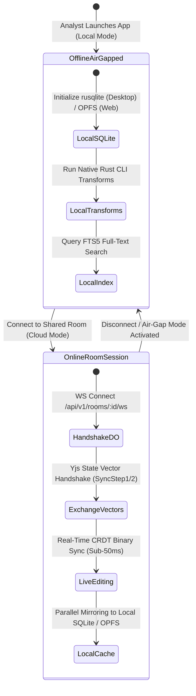

# 05. Real-Time Multi-User Collaboration, CRDT Synchronization & Room Coordination

**Project**: Next-Generation Intelligence Graph & Link Analysis Workstation (`maltego_web_app`)  
**Document**: `docs/architecture/05_realtime_collaboration.md`  
**Classification**: Real-Time Systems, CRDTs, Cloudflare Durable Objects  
**Date**: November 2026  
**Status**: APPROVED FOR IMPLEMENTATION  

---

## 1. Executive Summary & Collaboration Challenges

Collaborative threat intelligence analysis introduces severe synchronization challenges:
1. **Layout Thrashing**: When multiple analysts view the same graph, one analyst rearranging a cluster must not forcibly disrupt the screen or viewport coordinates of colleagues investigating a different part of the network.
2. **Concurrent Transform Ingestion**: Two analysts executing transforms simultaneously produce overlapping node and edge streams that must merge without split-brain anomalies or lost updates.
3. **Air-Gap Sovereignty vs. Live Cloud Rooms**: Intelligence agencies often require 100% offline air-gapped operation for sensitive red-team operations, while commercial SOCs require live, multi-analyst rooms.

This specification details the architecture of our **Dual-Mode Local-First Collaboration Engine**, pairing **Cloudflare Durable Objects with WebSocket Hibernation and embedded SQLite** with a **Yjs Conflict-Free Replicated Data Type (CRDT)** document partitioned into decoupled semantic and layout channels.

---

## 2. Dual-Mode Operation Paradigm



### 2.1 Mode 1: 100% Air-Gapped Offline Mode
- Hard network silence: Zero outbound HTTP or WebSocket connections.
- Graph state is persisted strictly in the workstation's local embedded database (SQLite in Tauri v2, Origin Private File System on Web).
- Transforms execute locally via the native Rust subprocess runner.

### 2.2 Mode 2: Live Synchronized Collaborative Room Mode
- Automatically provisions an edge coordination room powered by a dedicated Cloudflare Durable Object.
- Real-time bi-directional Yjs binary update streaming with sub-50ms peer propagation latency.
- Full presence awareness (collaborator cursors, active node selections, and viewport bounding boxes).

---

## 3. Cloudflare Durable Objects Room Coordinator

Each collaborative investigation room maps deterministically to exactly one Durable Object instance (`idFromName(investigationId)`), ensuring strong consistency and zero distributed locking overhead.

```mermaid
sequenceDiagram
    autonumber
    actor Analyst1 as Analyst A (Tauri Desktop)
    actor Analyst2 as Analyst B (Web PWA)
    participant Worker as Cloudflare Workers Gateway
    participant DO as Durable Object (InvestigationRoom)
    participant SQLite as Embedded DO SQLite
    participant R2 as Cloudflare R2 Storage

    Analyst1->>Worker: WS Connect /api/v1/rooms/inv_123/ws?token=...
    Worker->>DO: Forward WebSocket Upgrade
    DO->>DO: ctx.acceptWebSocket(ws) & serializeAttachment()
    DO-->>Analyst1: Sync Step 1 (Server State Vector) & Base Snapshot
    
    Analyst2->>Worker: WS Connect /api/v1/rooms/inv_123/ws?token=...
    Worker->>DO: Forward WebSocket Upgrade
    DO->>DO: ctx.acceptWebSocket(ws) & serializeAttachment()
    DO-->>Analyst2: Sync Step 1 (Server State Vector) & Base Snapshot

    Note over Analyst1,DO: Analyst A runs transform, adding 50 new entities
    Analyst1->>DO: Binary Message [Type: SYNC_UPDATE, Yjs Delta Blob]
    DO->>DO: Y.applyUpdate(ydoc, payload)
    DO->>SQLite: INSERT INTO yjs_updates (clock, user_id, blob)
    DO-->>Analyst2: Broadcast Binary [Type: SYNC_UPDATE, Yjs Delta Blob]
    DO->>DO: ctx.storage.setAlarm(Date.now() + 300_000)

    Note over DO,R2: 5 Minutes Inactivity / Alarm Triggered
    DO->>DO: alarm() Handler Invoked
    DO->>DO: Y.encodeStateAsUpdate(ydoc) -> Base Snapshot
    DO->>R2: PUT snapshots/inv_123/latest.yjs
    DO->>SQLite: DELETE FROM yjs_updates; INSERT INTO room_snapshots ...
```

---

### 3.1 Key Architectural Mechanisms:

1. **WebSocket Hibernation API**:
   Using `ctx.acceptWebSocket()` and event callbacks (`webSocketMessage`, `webSocketClose`), connections sleep in edge memory with **zero compute cost** while waiting for analyst interaction.
2. **Session Attachment Serialization**:
   User identity (`userId`, `role`, `sessionId`) is serialized directly into the WebSocket handle via `ws.serializeAttachment()`, persisting across hibernation wakeups without re-querying the database.
3. **Embedded SQLite Delta Log**:
   Incoming Yjs binary deltas are synchronously written to the DO's internal SQLite database (`ctx.storage.sql.exec`) before broadcasting to peers.
4. **Automated Compaction Alarms**:
   A scheduled DO alarm runs every 5 minutes during active collaboration, consolidating thousands of micro-updates into a single base snapshot, persisting it to Cloudflare R2 (`snapshots/{roomId}/{clock}.yjs`), and truncating the SQLite delta log.

---

### 3.2 Durable Object Room Implementation Reference

```typescript
// server/src/rooms/InvestigationRoom.ts
import { DurableObject } from 'cloudflare:workers';
import * as Y from 'yjs';

export interface RoomAttachment {
  userId: string;
  role: 'admin' | 'analyst' | 'viewer';
  sessionId: string;
}

export class InvestigationRoom extends DurableObject {
  private ydoc: Y.Doc;
  private isLoaded: boolean = false;
  private pendingUpdateCount: number = 0;

  constructor(ctx: DurableObjectState, env: Env) {
    super(ctx, env);
    this.ydoc = new Y.Doc();
    this.initDatabase();
  }

  private initDatabase() {
    this.ctx.storage.sql.exec(`
      CREATE TABLE IF NOT EXISTS yjs_updates (
        id INTEGER PRIMARY KEY AUTOINCREMENT,
        clock INTEGER NOT NULL,
        user_id TEXT NOT NULL,
        data BLOB NOT NULL,
        created_at INTEGER NOT NULL DEFAULT (unixepoch())
      );
      CREATE TABLE IF NOT EXISTS room_snapshots (
        id INTEGER PRIMARY KEY AUTOINCREMENT,
        snapshot BLOB NOT NULL,
        created_at INTEGER NOT NULL DEFAULT (unixepoch())
      );
    `);
  }

  async fetch(request: Request): Promise<Response> {
    const webSocketPair = new WebSocketPair();
    const [clientWs, serverWs] = Object.values(webSocketPair);

    // Accept and register for hibernation
    this.ctx.acceptWebSocket(serverWs);

    const url = new URL(request.url);
    const attachment: RoomAttachment = {
      userId: url.searchParams.get('userId') || 'anon',
      role: (url.searchParams.get('role') as any) || 'analyst',
      sessionId: crypto.randomUUID(),
    };
    serverWs.serializeAttachment(attachment);

    await this.ensureLoaded();

    // Send initial Sync Step 1 to new peer
    const stateVector = Y.encodeStateVector(this.ydoc);
    serverWs.send(this.buildSyncMessage(0, stateVector));

    return new Response(null, { status: 101, webSocket: clientWs });
  }

  async webSocketMessage(ws: WebSocket, message: ArrayBuffer | string) {
    if (typeof message === 'string') return;
    const attachment = ws.deserializeAttachment() as RoomAttachment;
    if (attachment.role === 'viewer') return; // Enforce read-only

    const buffer = new Uint8Array(message);
    const msgType = buffer[0];
    const payload = buffer.subarray(1);

    if (msgType === 2) { // Yjs Update Message
      try {
        Y.applyUpdate(this.ydoc, payload);

        // Persist delta to embedded SQLite
        this.ctx.storage.sql.exec(
          'INSERT INTO yjs_updates (clock, user_id, data) VALUES (?, ?, ?)',
          Date.now(),
          attachment.userId,
          payload
        );
      } catch (err) {
        console.error(`Malformed CRDT update rejected from user ${attachment.userId}:`, err);
        ws.close(4400, 'Invalid CRDT payload');
        return;
      }

      // Broadcast to all other peers
      for (const peer of this.ctx.getWebSockets()) {
        if (peer !== ws) {
          peer.send(message);
        }
      }

      // Prevent compaction alarm starvation: only schedule if no alarm is already pending
      const existingAlarm = await this.ctx.storage.getAlarm();
      if (existingAlarm === null) {
        await this.ctx.storage.setAlarm(Date.now() + 300_000);
      }

      // High-volume delta threshold trigger: >500 deltas forces immediate compaction
      this.pendingUpdateCount = (this.pendingUpdateCount || 0) + 1;
      if (this.pendingUpdateCount >= 500) {
        await this.alarm();
        this.pendingUpdateCount = 0;
      }
    }
  }

  async alarm() {
    this.pendingUpdateCount = 0;
    // Compact SQLite delta log into single R2 snapshot
    const snapshot = Y.encodeStateAsUpdate(this.ydoc);
    const snapshotKey = `snapshots/${this.ctx.id.toString()}/latest.yjs`;
    
    await this.env.INVESTIGATION_SNAPSHOTS.put(snapshotKey, snapshot);
    
    this.ctx.storage.sql.exec(`
      DELETE FROM yjs_updates;
      INSERT INTO room_snapshots (snapshot) VALUES (?);
    `, snapshot);
  }

  private async ensureLoaded() {
    if (this.isLoaded) return;
    const rows = this.ctx.storage.sql.exec('SELECT snapshot FROM room_snapshots ORDER BY id DESC LIMIT 1');
    for (const row of rows) {
      Y.applyUpdate(this.ydoc, new Uint8Array(row.snapshot as ArrayBuffer));
    }
    const updateRows = this.ctx.storage.sql.exec('SELECT data FROM yjs_updates ORDER BY id ASC');
    for (const row of updateRows) {
      Y.applyUpdate(this.ydoc, new Uint8Array(row.data as ArrayBuffer));
    }
    this.isLoaded = true;
  }

  private buildSyncMessage(type: number, payload: Uint8Array): Uint8Array {
    const msg = new Uint8Array(payload.length + 1);
    msg[0] = type;
    msg.set(payload, 1);
    return msg;
  }
}
```

---

## 4. Yjs CRDT Synchronization & Decoupled Channels

To eliminate layout thrashing, the shared Yjs document is partitioned into decoupled channels:

```typescript
// src/core/crdt/InvestigationYDoc.ts
import * as Y from 'yjs';

export class InvestigationYDoc {
  public readonly doc: Y.Doc;

  // 1. Semantic & Topological Channel (Synchronized across team)
  public readonly entities: Y.Map<Y.Map<any>>;   // EntityId -> PropertyBag
  public readonly links: Y.Map<Y.Map<any>>;      // LinkId -> EdgeAttributes
  public readonly bookmarks: Y.Map<string>;      // EntityId -> BookmarkColor

  // 2. Global Shared Layout Channel (Synchronized in 'Team View' mode)
  public readonly sharedLayout: Y.Map<Y.Map<any>>;// EntityId -> { x, y, pinned }

  // 3. Ephemeral Awareness (Live Cursors, Selection Halos, Viewport Bounds)
  public readonly awarenessStates: Map<string, any>;

  // 4. Local Private Layout (Non-replicated, private to analyst session)
  private readonly localPrivateLayout: Map<string, { x: number; y: number }>;

  constructor(doc: Y.Doc = new Y.Doc()) {
    this.doc = doc;
    this.entities = this.doc.getMap('graph:entities');
    this.links = this.doc.getMap('graph:links');
    this.bookmarks = this.doc.getMap('graph:bookmarks');
    this.sharedLayout = this.doc.getMap('graph:shared_layout');
    this.awarenessStates = new Map();
    this.localPrivateLayout = new Map();
  }

  public updateEntityPosition(
    entityId: string,
    x: number,
    y: number,
    isSharedLayout: boolean
  ) {
    if (isSharedLayout) {
      this.doc.transact(() => {
        let nodePos = this.sharedLayout.get(entityId);
        if (!nodePos) {
          nodePos = new Y.Map();
          this.sharedLayout.set(entityId, nodePos);
        }
        nodePos.set('x', x);
        nodePos.set('y', y);
      }, 'shared-layout-mutation');
    } else {
      // Local-only private viewport map (does not emit CRDT update to peers)
      this.localPrivateLayout.set(entityId, { x, y });
    }
  }
}
```

---

## 5. Security & Threat Model

| Threat / Vulnerability | Vector | Architectural Mitigation |
|---|---|---|
| **Investigator Deanonymization** | Outbound requests reveal investigator IP address. | Remote transforms route through Cloudflare Transform Proxy, cloaking IP behind edge egress IPs. |
| **Credential / Key Theft** | Malware extracts API keys from analyst disk. | Provider keys are vaulted centrally in Cloudflare D1 with AES-256-GCM encryption; client never holds keys. |
| **Malicious Transform Execution** | Rogue transform attempts local privilege escalation. | Tauri v2 declarative capabilities strictly whitelist executables, scrub env vars, and enforce timeouts. |
| **Air-Gap Leakage** | Classified investigation data leaks to cloud. | Explicit air-gapped mode disables all network socket initialization with hard network silence. |
| **Credential Stuffing / Abuse** | Automated bots attack registration/login. | Cloudflare Turnstile validates human interaction at edge entrypoints with zero visual friction. |
| **CRDT State Tampering** | Modified client sends malformed deltas to corrupt graph. | Durable Object validates Yjs update byte signatures and enforces RBAC permissions before applying. |

---

## 6. Verification & Benchmarking Mandates

The collaboration engine satisfies the following empirical requirements:
1. **Convergence**: Divergent concurrent graph edits across multiple offline clients converge to an identical state vector upon reconnection without manual conflict resolution.
2. **Zero Message Loss**: Zero dropped updates across client disconnects; immediate rehydration from DO SQLite on cold wake.
3. **Sub-50ms Latency**: Peer-to-peer CRDT propagation latency under 50ms across global edge connections.
4. **Compaction Durability**: Clean periodic consolidation into Cloudflare R2 zero-egress storage every 5 minutes.
