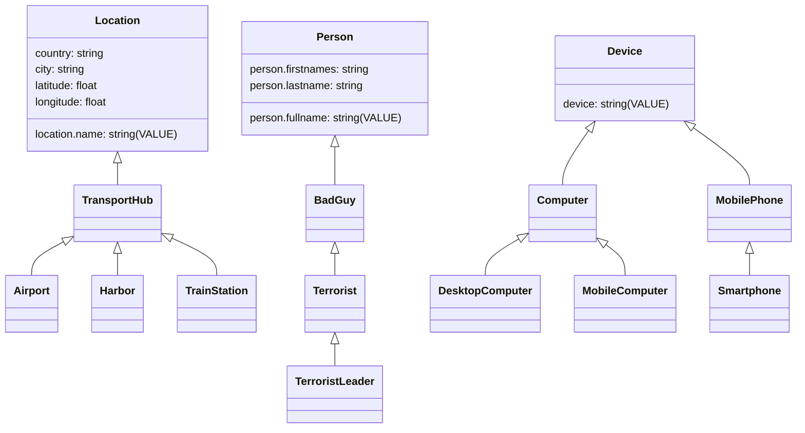

# 06. Entity Taxonomy, Standard Catalog & Dynamic Extensibility

**Project**: Next-Generation Intelligence Graph & Link Analysis Workstation (`maltego_web_app`)  
**Document**: `docs/architecture/06_entity_catalog_and_schema.md`  
**Classification**: Ontology, Data Models & Schema Extensibility  
**Date**: November 2026  
**Status**: APPROVED FOR IMPLEMENTATION  

---

## 1. Executive Summary & Ontological Principles

In intelligence link analysis, entities represent real-world actors, digital infrastructure, physical assets, or investigative events. To maintain complete interoperability with existing Maltego transforms and investigators' workflows, our platform adopts the clean-room **Maltego Standard Taxonomy**:
1. **107 Built-in Entities** spanning 12 domain categories.
2. **32 Ontological Roots** providing clean single-inheritance hierarchies.
3. **12 Autodetection Regex Converters** for automatic clipboard and CSV text entity generation.
4. **Declarative Extensibility**: Dynamic schema support for user and community entities via XML `.entity` definitions and modern JSON schemas.

---

## 2. Complete Inventory: 107 Standard Entities

The standard taxonomy contains exactly 107 built-in entities partitioned across 12 analytical categories:

```
Canonical 107 Entity Taxonomy:
├── infrastructure (10):
│   AS, DNSName, Domain, IPv4Address, MXRecord, Netblock, NSRecord, URL, Website, WebTitle
├── personal (12):
│   Alias, Document, EmailAddress, File, GPS, Image, Person, PhoneNumber, PhoneNumberMobile, 
│   PhoneNumberOffice, PhoneNumberResidential, Phrase
├── people (19):
│   BadGuy, BusinessLeader, Businessman, Child, DrugDealer, Female, GangLeader, GangMember, 
│   GoodGuy, GovernmentOfficial, Judge, LawOfficer, Lawyer, Male, MilitaryOfficer, 
│   SexOffender, Terrorist, TerroristLeader, Unsub
├── locations (15):
│   Airport, Church, CircularArea, City, Country, CrimeScene, Harbor, Home, Location, 
│   Office, Prison, Region, Shop, TrainStation, TransportHub
├── weapons (11):
│   Ammunition, BioWeapon, Blade, ChemicalWeapon, Explosive, Gun, IED, Missile, NuclearWeapon, 
│   Weapon, WMD
├── events (8):
│   Conversation, ConversationEmail, ConversationPhone, Event, Incident, Meeting, 
│   MeetingBusiness, MeetingSocial
├── tracking (7):
│   BankAccount, FlightNumber, IdentificationNumber, MacAddress, PassportNumber, 
│   VehicleRegistration, VinNumber
├── transportation (7):
│   Bike, Boat, Bus, Car, Plane, Train, Transport
├── groups (7):
│   Company, EducationInstitution, Gang, OnlineGroup, Organization, PoliticalMovement, 
│   ReligiousGroup
├── devices (6):
│   Computer, DesktopComputer, Device, MobileComputer, MobilePhone, Smartphone
├── socialnetwork (4):
│   Affiliation, AffiliationFacebook, AffiliationLinkedIn, AffiliationTwitter
└── common (1):
    Unknown
```

---

## 3. The 32 Ontological Roots & Inheritance Hierarchies

Out of the 107 entities, **exactly 32 are root entities** (`baseEntity == null`). All other entities inherit properties and primary value semantics from one of these roots:

### 3.1 The 32 Root Entities:
1. `maltego.Device`
2. `maltego.Conversation`
3. `maltego.OnlineGroup`
4. `maltego.Organization`
5. `maltego.AS`
6. `maltego.DNSName`
7. `maltego.Domain`
8. `maltego.IPv4Address`
9. `maltego.Netblock`
10. `maltego.URL`
11. `maltego.WebTitle`
12. `maltego.CircularArea`
13. `maltego.Location`
14. `maltego.Unknown` (Universal fallback)
15. `maltego.Alias`
16. `maltego.Document`
17. `maltego.EmailAddress`
18. `maltego.File`
19. `maltego.GPS`
20. `maltego.Image`
21. `maltego.Person`
22. `maltego.PhoneNumber`
23. `maltego.Phrase`
24. `maltego.Affiliation`
25. `maltego.BankAccount`
26. `maltego.FlightNumber`
27. `maltego.IdentificationNumber`
28. `maltego.MacAddress`
29. `maltego.VehicleRegistration`
30. `maltego.VinNumber`
31. `maltego.Transport`
32. `maltego.Weapon`

---

### 3.2 Representative Inheritance Trees



---

## 4. The 12 Autodetection Regex Converters

When an analyst pastes text or drops logs onto the investigation canvas, the engine evaluates the following prioritized regular expressions to automatically instantiate the correct entity type:

```typescript
export const AUTODETECTION_CONVERTERS: Array<{
  type: string;
  order: number;
  regex: RegExp;
}> = [
  {
    type: "maltego.IPv4Address",
    order: 10,
    regex: /^(?:(?:25[0-5]|2[0-4][0-9]|[01]?[0-9][0-9]?)\.){3}(?:25[0-5]|2[0-4][0-9]|[01]?[0-9][0-9]?)$/
  },
  {
    type: "maltego.Netblock",
    order: 15,
    regex: /^(?:(?:25[0-5]|2[0-4][0-9]|[01]?[0-9][0-9]?)\.){3}(?:25[0-5]|2[0-4][0-9]|[01]?[0-9][0-9]?)\/[0-9]{1,2}$/
  },
  {
    type: "maltego.Image",
    order: 18,
    regex: /^(http[s]?:\/\/([-\w.:]*)[-\w.:/]*\/[^\s?]+\.(bmp|jpg|jpeg|png|gif|svg|webp)(?:\?[^\s]*)?)$/i
  },
  {
    type: "maltego.Website",
    order: 20,
    regex: /^(http:\/\/|https:\/\/)[-\w.:]*\/?$/i
  },
  {
    type: "maltego.URL",
    order: 22,
    regex: /^(http[s]?:\/\/([-\w.:]*)[-\w.:/]*\/[^\s?]*(?:\?[^\s]*)?)$/i
  },
  {
    type: "maltego.DNSName",
    order: 38,
    regex: /^([a-zA-Z0-9-]{1,63}\.)+([a-zA-Z0-9-]{1,63}\.)+[a-zA-Z]{2,63}$/
  },
  {
    type: "maltego.Domain",
    order: 40,
    regex: /^([a-zA-Z0-9-]{1,63}\.)+[a-zA-Z]{2,63}$/
  },
  {
    type: "maltego.EmailAddress",
    order: 50,
    regex: /^([a-zA-Z0-9.!#$%&'*+/=?^_`{|}~-]+@[a-zA-Z0-9](?:[a-zA-Z0-9-]{0,61}[a-zA-Z0-9])?(?:\.[a-zA-Z0-9](?:[a-zA-Z0-9-]{0,61}[a-zA-Z0-9])?)+)$/
  },
  {
    type: "maltego.GPS",
    order: 60,
    regex: /^\s*([+-]?\d+(?:\.\d+)?)\s*,\s*([+-]?\d+(?:\.\d+)?)\s*$/
  },
  {
    type: "maltego.CircularArea",
    order: 65,
    regex: /^\s*([+-]?\d+(?:\.\d+)?)\s*,\s*([+-]?\d+(?:\.\d+)?)\s*,\s*(\d+)m?\s*$/
  },
  {
    type: "maltego.Person",
    order: 70,
    regex: /^(\p{Lu}\p{Ll}{1,20})\s+(\p{Lu}\p{Ll}{1,20}(?:\s+\p{Lu}\p{Ll}{1,20}){0,3})$/u
  },
  {
    type: "maltego.Phrase",
    order: 999, // Universal fallback
    regex: /^.+$/
  }
];
```

---

## 5. Dynamic Custom Entity Extensibility (`.entity`)

Custom entities created by users or distributed via Transform Hub are defined using the declarative XML specification:

```xml
<?xml version="1.0" encoding="UTF-8"?>
<MaltegoEntity id="custom.C2Server" displayName="C2 Server" displayNamePlural="C2 Servers"
               description="Command and Control Infrastructure Node" category="Infrastructure"
               smallIconResource="ServerMalicious" largeIconResource="ServerMalicious"
               allowedRoot="true" conversionOrder="35" visible="true">
  <BaseEntities>
    <BaseEntity>maltego.IPv4Address</BaseEntity>
  </BaseEntities>
  <Converter>
    <Value><![CDATA[^(?:(?:25[0-5]|2[0-4][0-9]|[01]?[0-9][0-9]?)\.){3}(?:25[0-5]|2[0-4][0-9]|[01]?[0-9][0-9]?)$]]></Value>
  </Converter>
  <Properties value="ipv4-address" displayValue="c2.framework">
    <Groups/>
    <Fields>
      <Field name="ipv4-address" type="string" nullable="false" hidden="false" readonly="false"
             description="IP Address" displayName="IP Address">
        <SampleValue>198.51.100.10</SampleValue>
      </Field>
      <Field name="c2.framework" type="string" nullable="true" hidden="false" readonly="false"
             description="Detected C2 Framework" displayName="Framework">
        <DefaultValue>Cobalt Strike</DefaultValue>
      </Field>
      <Field name="c2.port" type="int" nullable="true" hidden="false" readonly="false"
             description="C2 Listener Port" displayName="Port">
        <DefaultValue>443</DefaultValue>
      </Field>
    </Fields>
  </Properties>
</MaltegoEntity>
```

### 5.1 Key Descriptor Attributes:
- `value="property_name"`: Designates the primary identity property.
- `displayValue="property_name"`: Formats the canvas label.
- `BaseEntity`: Specifies parent type for inheritance.
- `Converter`: Embeds regex pattern for automatic clipboard detection.
- `smallIconResource` / `largeIconResource`: Resolves icon in the local spritesheet texture atlas.
