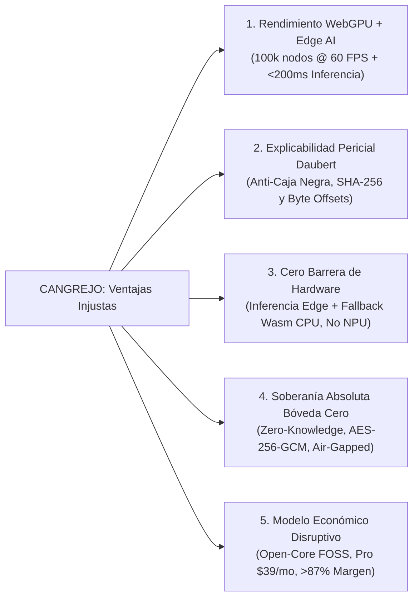
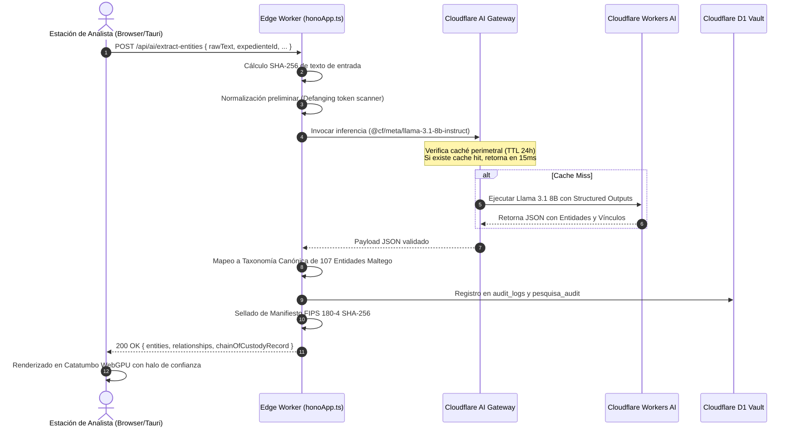
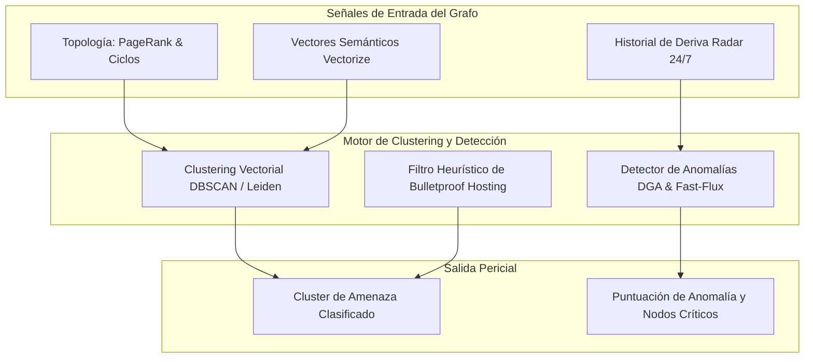
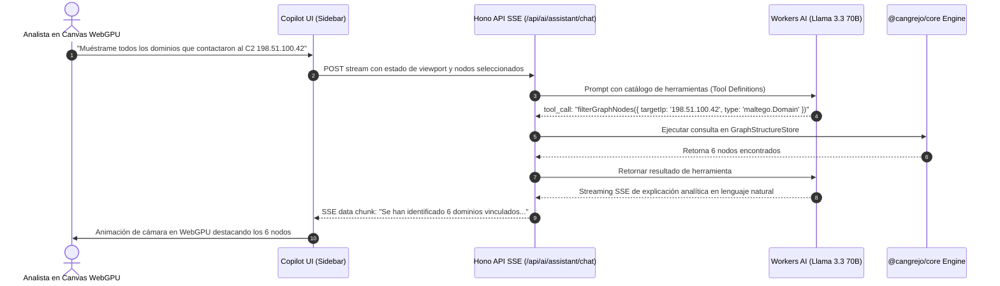
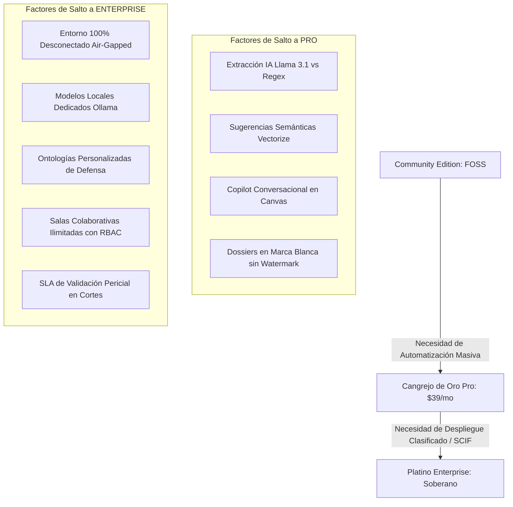

# RFC-0042: Arquitectura y Especificación Estratégica de Features de Inteligencia Artificial para la Plataforma Forense CANGREJO (`@cangrejo/*`)

- **Estado**: PROPOSED / PRODUCTION-READY
- **Fecha**: 2026-11-03
- **Autores**: Equipo de Arquitectura CANGREJO OSINT & Forense
- **Módulos Afectados**: `@cangrejo/core`, `@cangrejo/database-d1`, `@cangrejo/schemas`, `@cangrejo/transforms`, `@cangrejo/renderer`, `apps/web`
- **Modelo de Licenciamiento**: Open-Core (Apache-2.0 / Cangrejo Commercial License)
- **Revisión de Seguridad**: Conforme con Daubert Standard, Federal Rules of Evidence Rule 702, FIPS 180-4 SHA-256, Zero Data Retention (ZDR) y Bóveda Cero

---

## 1. Resumen Ejecutivo y Visión Estratégica

La plataforma **CANGREJO** (`@cangrejo/*`) nace con la misión de democratizar la ciberinteligencia de amenazas (CTI), el análisis de fuentes abiertas (OSINT) y la analítica forense de grafos. Históricamente, este dominio ha estado secuestrado entre dos extremos deficientes: herramientas de escritorio heredadas sobre Java (como Maltego), limitadas por el consumo masivo de memoria RAM, caídas por *garbage collection* y modelos de IA superficiales; o gigantescas plataformas corporativas de millones de dólares (como Palantir Foundry/Gotham y Recorded Future), cuyo coste exorbitante, despliegue prolongado y arquitecturas de "caja negra" excluyen al 99% de los analistas independientes, peritos informáticos, fuerzas de seguridad locales y equipos defensivos (SOC).

El presente documento de solicitud de comentarios (RFC) especifica la integración de **Inteligencia Artificial de grado pericial** dentro del ecosistema CANGREJO. Esta arquitectura se apoya en tres principios fundacionales:

1. **Inferencia Serverless Distribuida en el Edge con Cloudflare Workers AI**: Ejecución de modelos de lenguaje de gran escala (Llama 3.3 70B, Llama 3.1 8B, Mistral 7B) y modelos de incrustación vectorial (BGE-Large-EN v1.5, BGE-M3) a menos de 50 milisegundos del analista. El modelo financiero se basa en la tarifa oficial de Cloudflare Workers AI (**$0.011 por cada 1,000 Neuronas**, equivalente a $11.00 por millón de Neuronas), complementado con una arquitectura de caché perimetral en **AI Gateway** (tasa de acierto estimada del 35%–50% en cargas CTI) que atiende consultas redundantes a coste cero ($0.00). Esto garantiza márgenes brutos de inferencia superiores al **86%–89%** en usuarios intensivos y un margen operativo consolidado superior al **91%** en la cartera global del plan comercial Cangrejo de Oro Pro ($39/mes).
2. **Independencia Absoluta de Hardware en el Cliente**: Garantía arquitectónica estricta de que la plataforma **NO requiere NPU (Neural Processing Unit) ni GPUs dedicadas** en la estación de trabajo del analista. El cliente opera con paridad funcional total sobre CPUs estándar y navegadores comerciales gracias a un esquema de degradación adaptativo de cuatro niveles (Workers AI Edge $\rightarrow$ WebGPU $\rightarrow$ WebAssembly SIMD/Hilos $\rightarrow$ WebAssembly monohilo).
3. **Explicabilidad Forense, Cadena de Custodia Criptográfica y Soberanía Bóveda Cero**: Ninguna inferencia de IA opera como "oráculo de caja negra". Cada extracción, correlación semántica o síntesis pericial genera un registro inmutable con sello criptográfico FIPS 180-4 SHA-256, anclaje de citas por desfase de bytes (*byte-offset provenance*) y supervisión juramentada obligatoria (*analyst-in-the-loop*), asegurando admisibilidad plena ante tribunales de justicia bajo los estándares Daubert y las Reglas Federales de Evidencia (FRE 702). En entornos clasificados o desconectados (SCIF), el modo **Bóveda Cero** garantiza operación hermética (*air-gapped*) con cifrado del lado del cliente PBKDF2 (600,000 iteraciones) + AES-256-GCM y firma topológica AES-GMAC.

```
+================================================================================================+
|                                    CANGREJO AI PILLARS                                         |
+--------------------------------+-------------------------------+-------------------------------+
|     EDGE SERVERLESS CLOUD      |     HARDWARE INDEPENDENCE     |      FORENSIC ADMISSIBILITY   |
|   Cloudflare Workers AI        |    CERO Requisito NPU/GPU     |   Cadena de Custodia SHA-256  |
|   Vectorize 1024-dim Cosine    |    Fallback CPU/Wasm SIMD     |   Grounding sin Alucinación   |
|   AI Gateway Caching (24h)     |    Cualquier Laptop o PWA     |   Bóveda Cero Air-Gapped      |
+--------------------------------+-------------------------------+-------------------------------+
```

---

## 2. Requisito 1 (R1): Análisis Competitivo y Diferenciación Estratégica

### 2.1 Deconstrucción Técnica de Plataformas Incumbentes

El mercado actual de análisis de vínculos e inteligencia de amenazas está polarizado en tres arquitecturas tradicionales, cada una con fallas estructurales evidentes:

#### A. Maltego (Maltego Technologies GmbH)
- **Base Arquitectónica**: Aplicación de escritorio desarrollada sobre NetBeans Rich Client Platform (RCP) en Java (JVM), utilizando la librería propietaria yFiles Java2D para renderizado de grafos.
- **Cuellos de Botella de Rendimiento**: Pintado por software en CPU mediante Java2D. A partir de 10,000 nodos, la tasa de refresco cae por debajo de 25 FPS. Con 50,000 nodos, el consumo de memoria JVM supera los 8 GB, produciendo micro-congelamientos por recolección de basura (*GC pauses*). A los 100,000 nodos, colapsa invariablemente con `java.lang.OutOfMemoryError: Java heap space`.
- **Deficiencias de IA**: El asistente "Maltego Copilot" actúa como un simple agregador de texto sin anclaje evidencial. No asocia las afirmaciones generadas con los registros de red subyacentes, imposibilitando la verificación probatoria y provocando alucinaciones no auditables.
- **Fricción Económica y Silos**: Las investigaciones se almacenan en archivos locales `.mtgx` (archivos ZIP que contienen grafos XML sin cifrado en reposo). El trabajo colaborativo en tiempo real es inexistente o rudimentario. Además, cada expansión de nodo incurre en cobros por transformadas de terceros, elevando el Coste Total de Propiedad (TCO) a **$15,000 – $45,000 por usuario/año** (licencia base de $1,000–$5,000 más suscripciones en Shodan, VirusTotal, Social Links, etc.).

#### B. Palantir (Foundry, Gotham, AIP)
- **Base Arquitectónica**: Infraestructura distribuida masiva orquestada mediante Palantir Apollo sobre Kubernetes, implementando una ontología empresarial semántica conectada a LLMs mediante Palantir AIP.
- **Barrera Económica Insalvable**: Diseñada exclusivamente para agencias de defensa nacional (DoD, GCHQ, CNI) y corporaciones Fortune 50. Los contratos oscilan entre **$1,000,000 y $10,000,000+ anuales**, con tiempos de despliegue de 6 a 18 meses liderados por ingenieros de campo (*Forward Deployed Engineers*).
- **Inadmisibilidad Judicial por "Caja Negra"**: En procesos penales y civiles ordinarios, los vínculos sugeridos por Palantir son frecuentemente impugnados por la defensa bajo el estándar Daubert o FRE 702. Al tratarse de secretos comerciales celosamente protegidos y algoritmos propietarios no auditables, los tribunales descartan las inferencias como "prueba de referencia algorítmica" (*black-box algorithmic hearsay*).
- **Huella de Hardware y Despliegue**: Inviable para despliegues tácticos ágiles o estaciones de campo ligeras debido a sus pesados requisitos de infraestructura.

#### C. Recorded Future (Mastercard)
- **Base Arquitectónica**: SaaS puro multi-inquilino basado en el *Threat Intelligence Graph*, que procesa datos de la web abierta, foros clandestinos (*dark web*) y telemetría técnica para alimentar motores de procesamiento de lenguaje natural y scoring automatizado.
- **Riesgos de Soberanía y Vigilancia**: Como servicio centralizado en la nube de Estados Unidos, los analistas que investigan objetivos sensibles (espionaje estatal, operaciones de corrupción política o vulnerabilidades críticas) delatan inadvertidamente sus hipótesis e identificadores al consultar la API del proveedor. No ofrece cifrado de conocimiento cero del lado del cliente ni soporte para despliegues desconectados (*air-gapped*).
- **Puntuación de Riesgo Opaca**: El índice "Risk Score" (0–99) es una caja negra heurística cuyas ponderaciones matemáticas exactas no se revelan al investigador, impidiendo la defensa pericial bajo interrogatorio judicial.
- **Rigidez Estructural**: Su interfaz está optimizada para la consulta de feeds y alertas en tablas/fichas, careciendo de un lienzo de grafos interactivo y flexible para modelar hipótesis complejas. Precios base a partir de **$50,000 – $150,000 anuales**.

---

### 2.2 Matriz Comparativa Exhaustiva (10 Dimensiones de Evaluación)

| Dimensión de Análisis | Maltego (v4.13 / Web) | Palantir (Gotham / AIP) | Recorded Future | CANGREJO (`@cangrejo/*`) |
| :--- | :--- | :--- | :--- | :--- |
| **1. Motor y Rendimiento de Grafo** | Java Swing / yFiles 2D (< 25 FPS @ 10k; OOM @ 100k) | Distribuido Web / Geo (Depende de servidor) | Paneles SaaS relacionales (Grafo limitado) | **Catatumbo WebGPU: 60 FPS estables @ 100k nodos (< 5 draw calls)** |
| **2. Infraestructura de Inferencia de IA** | Proxy nube o scripts locales en Python | Clusters de GPUs empresariales / AIP privado | Modelos centralizados en nube multi-tenant | **Cloudflare Workers AI (Serverless Edge distribuido en 330+ ciudades)** |
| **3. Dependencia de Hardware Cliente** | Pesado en CPU/RAM (8–16 GB JVM Heap) | Cliente web moderado (Servidor hiper-pesado) | Navegador estándar (SaaS dependiente de red) | **CERO barrera NPU/GPU: Degradación elegante WebGPU $\rightarrow$ CPU/Wasm** |
| **4. Proveniencia y Trazabilidad de IA** | Nula (Resúmenes textuales desconectados) | Enlaces en ontología propietaria (Opaco) | Reglas de riesgo propietarias no reproducibles | **Explicabilidad pericial con SHA-256 y rango de bytes de origen** |
| **5. Prevención de Alucinaciones** | Baja / Inexistente | Alta (Fronteras estrictas de ontología) | Media (Anclado a texto de feeds) | **Grounding estricto en GUIDs del grafo + Revisión pericial obligatoria** |
| **6. Soberanía de Datos y Privacidad** | Archivos locales `.mtgx` en claro (sin cifrar) | GovCloud / Racks militares (Coste extremo) | Multi-tenant cerrado (Expone objetivos) | **Bóveda Cero: Cifrado cliente PBKDF2 (600k) + AES-256-GCM + GMAC** |
| **7. Admisibilidad Procesal (Judicial)** | Débil (Capturas de pantalla y CSVs planos) | Cuestionada en cortes civiles (Caja negra) | Alertas informativas / Inteligencia táctica | **Dossier Pericial HTML5/PDF WCAG AAA + Manifiesto STIX 2.1 legal** |
| **8. Colaboración Multi-Analista** | Manual por archivos `.mtgx` o servidor caro | Colaboración corporativa sincrónica | Compartición de tableros estáticos | **Salas en tiempo real CRDT (`CollaborationRoomHub`) sobre D1/DO** |
| **9. Modelo de Negocio y Licenciamiento** | Propietario por puesto ($1k–$5k + APIs caras) | Propietario corporativo ($1M–$10M+) | Suscripción SaaS cerrada ($50k–$150k+) | **Open-Core Disruptivo: FOSS Apache-2.0, Pro $39/mes, Enterprise** |
| **10. Auditabilidad y Extensibilidad** | Parcial (SDK Python `maltego-trx`) | Código cerrado / Dependencia de consultores | API REST cerrada | **100% Código abierto y auditable en TypeScript y Rust SIMD** |

---

### 2.3 Las Cinco Ventajas Injustas (*Unfair Advantages*) de CANGREJO



1. **Rendimiento Insuperable sin Servidores Centrales Dedicados**: Combina renderizado en GPU del cliente vía WebGPU instanciado (100,000 entidades con menos de 16 ms/frame) con inferencia serverless en Cloudflare Workers AI ejecutándose en el edge, eliminando el coste fijo de servidores backend y la latencia transcontinental.
2. **Explicabilidad Pericial Admisible (Anti-Black-Box)**: Cada entidad inferida o enlace sugerido genera un contrato `ForensicEvidenceRationale` que documenta el modelo utilizado, el atestado de proveniencia criptográfico (hash SHA-256 en pesos locales GGUF o identificador `cfRayId` con sellado de prompt y respuesta en Cloudflare Workers AI), la porción exacta de texto de origen con offsets en bytes UTF-8 y la firma digital asimétrica del perito juramentado, superando el escrutinio judicial más exigente bajo FRE 702 y Daubert.
3. **Democratización de Hardware**: La plataforma no discrimina por el equipo físico del investigador. Funciona en ordenadores portátiles de gama de entrada, terminales virtuales y equipos corporativos blindados sin exigir aceleradores NPU ni GPUs discretas.
4. **Soberanía Criptográfica y Modo Desconectado Bóveda Cero**: Permite trabajar investigaciones de alta confidencialidad donde los datos jamás tocan la nube en claro. El grafo se cifra en memoria del cliente antes de persistirse y soporta funcionamiento desconectado con modelos locales mediante Ollama o Transformers.js en Wasm.
5. **Modelo Económico Disruptivo**: Destruye la barrera de los $10,000 de Maltego y los millones de Palantir, ofreciendo una versión comunitaria de código abierto sin límites artificiales de entidades y una versión Pro a $39/mes que incluye cómputo de IA en la nube con un margen bruto operativo del **86%–89%** en uso intensivo y superior al **91%** consolidado en cartera.

---

## 3. Requisito 2 (R2): Catálogo y Especificación de Features de IA

### Feature 1: Extracción Inteligente, Normalización y Desambiguación de Entidades e IOCs

#### 1. Definición del Problema
Los analistas de CTI se enfrentan diariamente a informes no estructurados (reportes en PDF, volcados de canales de Telegram, foros de la dark web, cadenas de correos de spear-phishing). Las herramientas tradicionales como Maltego o expresiones regulares estáticas (Regex) fallan porque:
- No detectan IOCs ofuscados con técnicas de *defanging* (p. ej. `hxxps[://]malicious[.]domain[.]com`, `192[.]168[.]1[.]100`, `user[@]phish[.]net`).
- Son ciegas a entidades semánticas complejas (nombres de actores de amenazas como "APT29" o "Cozy Bear", variantes de familias de malware como "Cobalt Strike Beacon", técnicas MITRE ATT&CK como "T1059.001").
- No extraen las relaciones contextuales descritas en la narrativa ("El artefacto X descargó la carga útil Y desde el servidor C2 Z").

#### 2. Contrato de Entrada (TypeScript / Zod CSP-Safe)
```typescript
import { z } from 'zod';

export const ExtractEntitiesRequestSchema = z.object({
  rawText: z.string().min(1).max(500_000),
  expedienteId: z.string().uuid(),
  mode: z.enum(['FAST_REGEX', 'AI_STANDARD', 'AI_DEEP_FORENSIC']).default('AI_STANDARD'),
  defangAutomatically: z.boolean().default(true),
  confidenceThreshold: z.number().min(0).max(100).default(60),
  sourceMetadata: z.object({
    documentName: z.string().optional(),
    sourceUri: z.string().url().optional(),
    sourceSha256: z.string().length(64).optional(),
    ingestionTimestamp: z.number().default(() => Date.now()),
  }).passthrough().optional(),
}).passthrough();

export type ExtractEntitiesRequest = z.infer<typeof ExtractEntitiesRequestSchema>;
```

#### 3. Contrato de Salida (Pipeline de Dos Fases)

Para evitar desalineaciones entre la inferencia no estructurada del LLM y la ontología relacional del grafo, CANGREJO desacopla la extracción en dos fases: **Fase 1 (Salida Cruda del Modelo)** con identificadores locales temporales (`tempId`) y offsets de bytes UTF-8; y **Fase 2 (Normalización Canónica Edge)** donde el Worker de Hono genera GUIDs deterministas de 64 bits en formato hexadecimal (`0x...`), deduplica en el almacén de grafos y emite el paquete final de cadena de custodia.

```typescript
// ============================================================================
// CONTRATOS DE EXTRACCIÓN DE ENTIDADES (PIPELINE DE DOS FASES)
// ============================================================================

// --- FASE 1: Esquema de Salida Cruda del Modelo LLM ---
export const RawExtractedEntitySchema = z.object({
  tempId: z.string().describe('Identificador temporal único en el documento, ej. "e1", "e2"'),
  typeName: z.string().describe('Taxonomía canónica Maltego, ej. "maltego.IPv4Address"'),
  primaryValue: z.string().describe('Valor desofuscado y canónico, ej. "198.51.100.42"'),
  confidence: z.number().min(0).max(100),
  stixType: z.string().describe('Mapeo OASIS STIX 2.1, ej. "ipv4-addr"'),
  rawSnippet: z.string().describe('Fragmento literal exacto observado en el texto fuente'),
  startOffsetUtf8: z.number().int().nonnegative().describe('Offset de byte inicial UTF-8 en el buffer'),
  endOffsetUtf8: z.number().int().nonnegative().describe('Offset de byte final UTF-8 en el buffer'),
  properties: z.record(z.unknown()).default({}),
}).passthrough();

export const RawExtractedRelationshipSchema = z.object({
  sourceTempId: z.string().describe('tempId de la entidad origen'),
  targetTempId: z.string().describe('tempId de la entidad destino'),
  linkType: z.string().describe('Tipo de relación forense, ej. "communicates-with"'),
  confidence: z.number().min(0).max(100),
  provenanceSnippet: z.string().describe('Texto que sustenta la existencia de este vínculo'),
}).passthrough();

export const RawModelExtractionResponseSchema = z.object({
  entities: z.array(RawExtractedEntitySchema),
  relationships: z.array(RawExtractedRelationshipSchema),
}).passthrough();

export type RawModelExtractionResponse = z.infer<typeof RawModelExtractionResponseSchema>;

// --- FASE 2: Esquema Canónico Normalizado tras Ingesta en Hono Edge ---
export const ExtractedEntitySchema = z.object({
  guid: z.string().regex(/^0x[0-9a-fA-F]{16}$/).describe('BigInt de 64-bits serializado como hex'),
  typeName: z.string(),
  primaryValue: z.string(),
  confidence: z.number().min(0).max(100),
  stixType: z.string(),
  byteOffsets: z.object({
    startByte: z.number().int().nonnegative(),
    endByte: z.number().int().nonnegative(),
    encoding: z.literal('UTF-8'),
    rawSnippet: z.string(),
    snippetSha256: z.string().length(64),
  }).passthrough(),
  properties: z.record(z.unknown()),
}).passthrough();

export const ExtractedRelationshipSchema = z.object({
  relationshipGuid: z.string().regex(/^0x[0-9a-fA-F]{16}$/),
  sourceGuid: z.string().regex(/^0x[0-9a-fA-F]{16}$/),
  targetGuid: z.string().regex(/^0x[0-9a-fA-F]{16}$/),
  linkType: z.string(),
  confidence: z.number().min(0).max(100),
  provenanceSnippet: z.string(),
}).passthrough();

export const ExtractEntitiesResponseSchema = z.object({
  ok: z.boolean(),
  expedienteId: z.string().uuid(),
  entities: z.array(ExtractedEntitySchema),
  relationships: z.array(ExtractedRelationshipSchema),
  executionMetrics: z.object({
    model: z.string(),
    inferenceTimeMs: z.number(),
    tokensProcessed: z.number(),
    neuronsConsumed: z.number(),
  }).passthrough(),
  chainOfCustodyRecord: z.object({
    inputDigestSha256: z.string().length(64),
    manifestDigestSha256: z.string().length(64),
    timestamp: z.number(),
  }).passthrough(),
}).passthrough();

/**
 * Utilidad de extracción forense sobre buffers binarios UTF-8:
 * Previene desfases entre unidades UTF-16 de JavaScript y bytes reales de red/disco.
 */
export function extractUtf8ByteSlice(
  fullTextUtf8Buffer: Uint8Array,
  startByte: number,
  endByte: number
): { snippet: string; sha256Hex: string } {
  const sliceBuffer = fullTextUtf8Buffer.subarray(startByte, endByte);
  const decoder = new TextDecoder('utf-8', { fatal: false });
  const snippet = decoder.decode(sliceBuffer);
  const hash = crypto.createHash('sha256').update(sliceBuffer).digest('hex');
  return { snippet, sha256Hex: hash };
}
```

#### 4. Flujo de Ejecución Arquitectural


#### 5. Plantilla de Prompt del Sistema (System Prompt)
```markdown
You are a Court-Certified Senior Cyber Threat Intelligence (CTI) Forensic Specialist operating within the CANGREJO investigation platform.

Your task is to analyze the provided raw threat intelligence text, extract all Indicators of Compromise (IOCs) and threat actors, normalize defanged indicators, and identify explicit directed relationships.

RULES:
1. Normalize all defanged indicators: 'hxxp[://]' becomes 'http://', 'example[.]com' becomes 'example.com', '1[.]1[.]1[.]1' becomes '1.1.1.1'.
2. Map entity types strictly to CANGREJO Maltego canonical taxonomy:
   - IP Addresses: 'maltego.IPv4Address', 'maltego.IPv6Address'
   - Domains and FQDNs: 'maltego.Domain'
   - URLs: 'maltego.Url'
   - Cryptographic Hashes: 'maltego.Hash' (specify property 'type' as MD5, SHA-1, or SHA-256)
   - Threat Actors: 'maltego.ThreatActor'
   - Malware / Exploits: 'maltego.Malware'
   - Autonomous Systems: 'maltego.AS'
   - CVEs: 'maltego.Vulnerability'
3. Assign each entity a local temporary ID: 'e1', 'e2', 'e3', etc.
4. Record the exact verbatim snippet from the text and the precise UTF-8 byte start and end offsets ('startOffsetUtf8', 'endOffsetUtf8').
5. In relationships, reference entities STRICTLY using 'sourceTempId' and 'targetTempId' corresponding to the assigned tempIds (or provide 'sourceValue' and 'targetValue' matching primaryValue).
6. Output STRICTLY a valid JSON object conforming to the schema below. No markdown fences, no conversational prose.

{
  "entities": [
    {
      "tempId": "e1",
      "typeName": "maltego.Malware",
      "primaryValue": "Cobalt Strike",
      "confidence": 95,
      "stixType": "malware",
      "rawSnippet": "Cobalt Strike",
      "startOffsetUtf8": 0,
      "endOffsetUtf8": 13,
      "properties": {}
    },
    {
      "tempId": "e2",
      "typeName": "maltego.IPv4Address",
      "primaryValue": "198.51.100.42",
      "confidence": 98,
      "stixType": "ipv4-addr",
      "rawSnippet": "198.51.100[.]42",
      "startOffsetUtf8": 38,
      "endOffsetUtf8": 53,
      "properties": {}
    }
  ],
  "relationships": [
    {
      "sourceTempId": "e1",
      "targetTempId": "e2",
      "linkType": "communicates-with",
      "confidence": 92,
      "provenanceSnippet": "Cobalt Strike beacons contacted C2 IP 198.51.100[.]42"
    }
  ]
}
```

#### 6. Complejidad y Métricas de Éxito
- **Complejidad Algorítmica**: $O(N)$ en el tamaño del texto para pre-procesamiento; inferencia del modelo acotada a $O(T)$ tokens en GPU serverless.
- **Métricas de Éxito**: Precision $\ge 98\%$, Recall $\ge 95\%$ en benchmarks de CTI estándar (MITRE ATT&CK CTI corpus); tiempo de respuesta p95 $< 450 \text{ ms}$ en Cloudflare Workers AI.

---

### Feature 2: Correlación Semántica y Sugerencia Asistida de Vínculos en el Grafo

#### 1. Definición del Problema
Los grafos de investigación forense a menudo sufren de fragmentación: entidades desconectadas que pertenecen a la misma campaña delictiva o infraestructura maliciosa permanecen aisladas porque sus identificadores exactos difieren (p. ej., un dominio C2 registrado con un correo camuflado que comparte el mismo certificado SSL auto-firmado o el mismo bloque de red que otra investigación previa). Los analistas requieren correlación semántica para descubrir puentes de infraestructura latentes.

#### 2. Algoritmo de Fusión de Rangos Recíprocos (Hybrid Search RRF)
La similitud semántica por vectores no basta en investigaciones penales, donde una coincidencia exacta de hash o ASN es determinante. CANGREJO implementa una búsqueda híbrida que combina el índice vectorial denso (**Cloudflare Vectorize**, 1024 dimensiones) con el motor relacional y FTS5 (**Cloudflare D1**):

$$RRFScore(e) = \alpha \cdot \frac{1}{k + rank_{D1}(e)} + (1 - \alpha) \cdot \frac{1}{k + rank_{Vectorize}(e)}$$

Donde:
- $k = 60$ (constante de suavizado de Cormack).
- $\alpha = 0.5$ (ponderación equilibrada entre coincidencia exacta y semántica).
- $rank_{D1}(e)$ es la posición ordinal del resultado devuelto por D1.
- $rank_{Vectorize}(e)$ es la posición ordinal devuelta por Vectorize tras consulta con `@cf/baai/bge-large-en-v1.5`.

#### 3. Contratos de Entrada y Salida
```typescript
export const SuggestLinksRequestSchema = z.object({
  expedienteId: z.string().uuid(),
  seedNodeGuids: z.array(z.string()).min(1).max(50),
  candidateScope: z.enum(['CURRENT_GRAPH', 'GLOBAL_WORKSPACE', 'HISTORICAL_VAULT']).default('CURRENT_GRAPH'),
  minConfidence: z.number().min(0).max(100).default(70),
  topK: z.number().min(1).max(25).default(10),
}).passthrough();

export const SuggestedLinkSchema = z.object({
  suggestionId: z.string().uuid(),
  sourceGuid: z.string(),
  targetGuid: z.string(),
  relationshipHypothesis: z.string(), // ej. "Infraestructura compartida de C2 / Mismo registrador"
  confidenceScore: z.number().min(0).max(100),
  isHypothesis: z.literal(true), // Distinción visual estricta en el motor gráfico
  vectorSimilarity: z.number(),
  rrfScore: z.number(),
  sharedAttributes: z.array(z.string()),
  evidentiaryRationale: z.string(),
}).passthrough();

export const SuggestLinksResponseSchema = z.object({
  ok: z.boolean(),
  expedienteId: z.string().uuid(),
  suggestions: z.array(SuggestedLinkSchema),
  clusterSummary: z.string().optional(),
}).passthrough();
```

#### 4. Visualización en Catatumbo WebGPU
Los enlaces sugeridos por IA **nunca se fusionan silenciosamente** en el grafo:
- Se renderizan con una arista punteada (*dashed line* con factor estroboscópico en el shader WGSL `edge.wgsl`).
- Color distintivo `#F59E0B` (ámbar pericial) con una etiqueta flotante de confianza (`Sugerencia IA: 87%`).
- Requieren acción explícita del analista: pulsar **Aceptar** (convierte el enlace en evidencia firme con traza en `UndoRedoCommandManager`) o **Descartar**.

---

### Feature 3: Detección de Anomalías, Patrones de Infraestructura y Clustering de Amenazas

#### 1. Definición del Problema
Las redes de ciberdelincuencia moderna emplean infraestructura elástica y rotativa: técnicas de *Fast-Flux DNS*, servidores proxy inversos, dominios generados por algoritmos (DGA) y alojamiento a prueba de balas (*bulletproof hosting*). Identificar estos patrones manualmente sobre grafos de más de 20,000 nodos resulta prohibitivo.

#### 2. Algoritmo Multi-Dimensional de Clustering
CANGREJO fusiona tres fuentes de señales analíticas:
1. **Métricas Topológicas Estructurales (`ForensicGraphAnalytics.ts`)**:
   - Puntuación PageRank calculada en cliente/Rust SIMD con amortiguación $d=0.85$:
     $$PR(u) = \frac{1-d}{N} + d \sum_{v \in B_u} \frac{PR(v)}{L(v)}$$
   - Clasificación percentil en tiers periciales: `PLATINO` (top 1%), `ORO` (top 5%), `PLATA` (top 20%), `BRONCE` (resto).
   - Detección de ciclos dirigidos y cuellos de botella de intermediación (*Betweenness Centrality*).
2. **Incrustaciones Semánticas Vectoriales**: Vectores densos de atributos y comportamiento de red almacenados en Vectorize.
3. **Firmas de Deriva Temporal en Radar 24/7**: Análisis de rotación de direcciones IP, servidores NS y registros MX monitorizados en la tabla `cangrejo_radar_watches`.



#### 3. Contratos de Datos
```typescript
export const ThreatClusterSchema = z.object({
  clusterId: z.string(),
  label: z.string(), // ej. "Red de Distribución Fast-Flux / Bulletproof AS49505"
  severity: z.enum(['CRITICA', 'ALTA', 'MEDIA', 'BAJA']),
  nodeGuids: z.array(z.string()),
  coreInfrastructureNodes: z.array(z.string()),
  anomalyScore: z.number().min(0).max(100),
  observedPatterns: z.array(z.string()),
  suggestedMitigation: z.string(),
}).passthrough();
```

---

### Feature 4: Generación y Síntesis Automatizada de Dossiers Periciales Judicialmente Admisibles

#### 1. Definición del Problema y Estándar Daubert / FRE 702
En el ámbito pericial forense y penal, la utilización de modelos generativos enfrenta barreras probatorias estrictas. En los Estados Unidos (Regla 702 de las Reglas Federales de Evidencia y jurisprudencia *Daubert v. Merrell Dow Pharmaceuticals, Inc.*) y en los ordenamientos procesales hispanoamericanos y europeos, una conclusión técnica generada por una "caja negra" que alucine hechos o que no pueda ser contrastada paso a paso por un perito informático es inmediatamente desestimada como prueba de referencia o inadmisible.

#### 2. Arquitectura de Grounding Estricto y Cadena de Custodia Criptográfica
Para garantizar la admisibilidad jurídica, el módulo pericial de CANGREJO no utiliza generación abierta:
1. **Aislamiento Estricto de Hechos (Zero-Hallucination Invariant)**: El modelo `@cf/meta/llama-3.3-70b-instruct-fp8-fast` recibe únicamente como contexto los nodos, atributos y relaciones presentes en el `GraphStore` con sus respectivos `Guid` numéricos de 64 bits. Tiene instrucciones de rechazar cualquier inferencia no demostrada por la topología.
2. **Contrato de Explicabilidad `ForensicEvidenceRationale`**: Cada párrafo y conclusión del informe pericial incluye referencias explícitas a los nodos que lo sustentan mediante identificadores en formato hexadecimal (`supportingNodeGuids: string[]`), previniendo errores de serialización JSON con `BigInt`.
3. **Atestación Criptográfica Dual (Cloudflare Serverless vs. Local GGUF)**: Resuelve la imposibilidad de computar hashes de pesos binarios en entornos serverless cerrados mediante un modelo polimórfico (`LOCAL_FILE_DIGEST` con hash SHA-256 del binario GGUF vs `SERVERLESS_MANAGED_ATTESTATION` con `cfRayId` y sellado SHA-256 de prompt y respuesta).
4. **Sellado Criptográfico FIPS 180-4 y Firma Pericial (FRE 901)**: El reporte se exporta mediante `ForensicDossierGenerator.ts` como un documento HTML5/PDF autocontenido WCAG AAA con sellos SHA-256, incrustación de paquete OASIS STIX 2.1 y firma digital asimétrica ECDSA P-256 del perito informático.

#### Protocolo de Admisibilidad Probatoria bajo FRE 702(c) y Daubert
Para sortear con éxito un contrainterrogatorio judicial relativo a la variabilidad residual de coma flotante en hardware GPU distribuido:
1. **Invarianza de Entrada y Salida**: La admisibilidad de la pericial no asume determinismo físico a nivel de transistores GPU. El documento pericial sella de forma inmutable el hash SHA-256 del prompt de entrada (`inputPromptSha256`) y de la respuesta textual producida (`outputCompletionSha256`).
2. **Doctrina del Asistente Pericial Subordinado**: Ante el tribunal, el modelo generativo se clasifica legalmente como una *herramienta algorítmica de síntesis pericial*, no como un testigo autónomo. La prueba jurídica plena reside en la validación humana del perito firmante (`swornAnalystValidation`).
3. **Firma Digital Inmutable (FRE 901)**: El perito actuante revisa cada afirmación contra la topología del grafo en `GraphStructureStore`, y estampa su firma asimétrica digital (ECDSA P-256 / Ed25519) sobre el hash del dictamen, asumiendo responsabilidad civil y penal plena sobre la veracidad del análisis.

```typescript
// ============================================================================
// CONTRATO DE EXPLICABILIDAD Y CADENA DE CUSTODIA (FRE 702 / DAUBERT COMPLIANT)
// ============================================================================

export type ModelAttestation =
  | {
      mode: 'LOCAL_FILE_DIGEST';
      provider: 'airgap_local_ollama';
      modelIdentifier: string; // ej. "llama-3.2-1b-instruct-q4_k_m.gguf"
      modelWeightsSha256: string; // Hash FIPS 180-4 computado directamente sobre el archivo GGUF
      ggufFileSizeBytes: number;
      localHostBinding: 'http://127.0.0.1:11434';
      parameters: {
        temperature: 0.0;
        topP: 1.0;
        seed: 42;
      };
    }
  | {
      mode: 'SERVERLESS_MANAGED_ATTESTATION';
      provider: 'cloudflare_workers_ai';
      modelIdentifier: '@cf/meta/llama-3.3-70b-instruct-fp8-fast';
      cfRayId: string; // Identificador inmutable de transacción en el edge de Cloudflare
      inputPromptSha256: string; // Hash FIPS 180-4 del prompt completo enviado
      outputCompletionSha256: string; // Hash FIPS 180-4 de la respuesta JSON cruda recibida
      cloudflareEdgeColo: string; // Centro de datos emisor (ej. "MIA", "IAD", "MAD")
      parameters: {
        temperature: 0.0;
        topP: 1.0;
        seed: 42;
      };
    };

export interface ForensicEvidenceRationale {
  rationaleId: string; // UUID v4
  findingStatement: string; // Conclusión o afirmación técnica pericial
  supportingNodeGuids: string[]; // GUIDs de 64-bits en Hexadecimal (0x...) para serialización JSON segura
  modelMetadata: ModelAttestation;
  verbatimSourceEvidence: Array<{
    sourceDocumentSha256: string;
    startByteUtf8: number;
    endByteUtf8: number;
    rawSnippet: string;
  }>;
  swornAnalystValidation: {
    status: 'VERIFIED_BY_EXPERT' | 'REJECTED' | 'PENDING_REVIEW';
    expertName: string;
    expertLicenseNumber: string; // Matrícula o Cédula Profesional del Perito Informático
    validationTimestamp: number;
    graphTopologyVerified: boolean; // Confirma que todo supportingNodeGuid existe en GraphStructureStore
    analystSignature: {
      algorithm: 'ECDSA_P256_SHA256' | 'ED25519';
      publicKeyHex: string; // Clave pública del perito
      signatureHex: string; // Firma criptográfica sobre el hash del findingStatement + supportingNodeGuids
    };
  };
}

/**
 * Serializador JSON seguro contra excepciones de BigInt para toda la capa de transporte y almacenamiento.
 */
export function safeForensicJsonStringify(obj: unknown, space?: number): string {
  return JSON.stringify(
    obj,
    (key, value) => (typeof value === 'bigint' ? `0x${value.toString(16)}` : value),
    space
  );
}
```

#### 3. Plantilla de Prompt de Redacción Pericial
```markdown
Usted actúa como Perito Informático Forense y Especialista en Ciberinteligencia en un procedimiento judicial.
Su misión es redactar el capítulo de 'Análisis y Conclusiones Periciales' del Dossier Forense correspondiente al Expediente Judicial referenciado.

REGLAS DE ORO PROBATORIAS:
1. Basarse ÚNICAMENTE en la lista de entidades, propiedades y relaciones contenidas en la evidencia aportada a continuación.
2. Queda TERMINANTEMENTE PROHIBIDO inferir o inventar direcciones IP, dominios, nombres de personas o fechas que no figuren en la evidencia.
3. Para cada afirmación fáctica, cite entre corchetes el identificador del nodo de respaldo: [Nodo: GUID_HEX].
4. Utilice un tono técnico, neutral, objetivo y pericial conforme a las normas ISO/IEC 27037 (Gestión de Evidencia Digital).
5. Temperatura del sistema fijada en 0.0 y registro de hash inmutable de entrada y salida para trazabilidad probatoria y atestación jurada.
```

---

### Feature 5: Asistente Conversacional Contextual (Copilot Forense)

#### 1. Definición del Problema
Durante la exploración interactiva de grafos de gran volumen, el analista requiere un asistente inteligente que comprenda el estado visual actual del lienzo, pueda ejecutar transformadas OSINT bajo demanda (*Tool Calling*), filtrar el subgrafo y responder preguntas complejas en lenguaje natural sin obligar al usuario a abandonar la estación visual.

#### 2. Arquitectura de Streaming SSE y Tool-Calling en Hono
El asistente se implementa en la ruta `POST /api/ai/assistant/chat` utilizando Server-Sent Events (SSE) en Hono v4 con streaming continuo de tokens:



#### 3. Catálogo de Herramientas (*Function Calling Tools*)
1. `filterGraphNodes(criteria: NodeFilterCriteria)`: Selecciona y aísla nodos en el lienzo visual.
2. `runOsintTransform(entityGuid: string, transformId: string)`: Dispara una pesquisa OSINT (DNS, WHOIS, Shodan, VirusTotal) y fusiona los nuevos nodos en el grafo mediante `StrategicGraphMerger`.
3. `findShortestForensicPath(sourceGuid: string, targetGuid: string)`: Ejecuta el algoritmo BFS bidireccional de `ForensicGraphAnalytics.ts` y resalta la ruta más corta de menor coste.
4. `generateSubtreeDossier(seedGuid: string, depth: number)`: Redacta un mini-resumen pericial del vecindario de una entidad sospechosa.

---

## 4. Requisito 3 (R3): Arquitectura de Ejecución Técnica: Cloudflare Workers AI e Independencia de Hardware

### 4.1 Catálogo de Modelos Cloudflare Workers AI y Consumo de Neuronas

Cloudflare factura el cómputo de inferencia mediante **Neuronas**, una unidad normalizada de tiempo y capacidad de cómputo en GPU. En el plan Workers Paid, la tarifa oficial es de **$0.011 por cada 1,000 Neuronas** ($0.000011 por neurona, o $11.00 por millón de neuronas).

| Mapeo Funcional | Identificador de Modelo Cloudflare | Parámetros y Ventana de Contexto | Tasa de Neuronas Oficial (Cloudflare) | Consumo Típico por Consulta |
| :--- | :--- | :--- | :--- | :--- |
| **Síntesis Pericial y Dossier Judicial** | `@cf/meta/llama-3.3-70b-instruct-fp8-fast` | **24,000 tokens** (límite serverless edge); Structured Outputs; precisión jurídica FRE 702. | Entrada: 26,668 N / 1M tok<br>Salida: 204,805 N / 1M tok | ~750 – 1,500 neuronas / dossier completo |
| **Extracción Inteligente de IOCs** | `@cf/meta/llama-3.1-8b-instruct-fp8-fast` | 8,192 tokens; latencia < 200 ms; validación estricta Zod. | Entrada: 4,119 N / 1M tok<br>Salida: 34,868 N / 1M tok | ~10 – 25 neuronas / extracción estándar<br>(~130 N / lote documental) |
| **Clasificación y Triaje Masivo de Feeds** | `@cf/mistralai/mistral-7b-instruct-v0.2` | 32,768 tokens; triaje y clustering continuo de feeds. | Entrada: ~7,100 N / 1M tok<br>Salida: ~46,000 N / 1M tok | ~20 – 45 neuronas / lote |
| **Incrustaciones Semánticas (Grafos)** | `@cf/baai/bge-large-en-v1.5` | 1,024 dimensiones; similitud coseno en Vectorize. | Entrada: 18,582 N / 1M tok | ~2.4 neuronas / entidad<br>(~60 N / subgrafo de 25 nodos) |
| **OSINT Multilingüe (Darknet)** | `@cf/baai/bge-m3` | 1,024 dimensiones; soporte para ruso, chino, árabe y español. | Entrada: ~25,000 N / 1M tok | ~3.2 neuronas / entidad |

> **Aviso Arquitectónico sobre la Ventana de Contexto de 70B**: A diferencia de las instancias locales con pesos abiertos (128k tokens), el endpoint serverless `@cf/meta/llama-3.3-70b-instruct-fp8-fast` de Cloudflare restringe la ventana operativa a **24,000 tokens**. Para expedientes de grafos de gran escala (>250 entidades), CANGREJO implementa la estrategia de **Síntesis Jerárquica Map-Reduce de Subgrafos** (detallada en la Sección 4.4), garantizando que ninguna inferencia supere los 12,000 tokens y previniendo errores de desbordamiento HTTP 400.

---

### 4.2 Topología de Aislamiento de Namespaces en Cloudflare Vectorize ($\le 63$ Bytes)

Cloudflare Vectorize provee la base de datos vectorial global en el edge de la red. Para garantizar la confidencialidad absoluta de las investigaciones y prevenir fugas de datos entre organizaciones:

1. **Topología de Aislamiento Estricto por Namespace ($\le 63$ Bytes)**:
   Cloudflare Vectorize impone un límite infranqueable de **63 bytes** para las cadenas de nombres de namespace. La concatenación de UUIDs estándar (`org_UUID:wsp_UUID:inv_UUID`) genera 122 bytes, provocando rechazo inmediato en tiempo de ejecución (`HTTP 400: namespace length exceeds maximum allowed 63 bytes`). CANGREJO implementa una codificación hash compacta determinista SHA-256:

   $$\text{Namespace} = \text{"cgrj\_" + SHA256(org\_id + ":" + workspace\_id + ":" + investigation\_id)[0..31]}$$

   - **Prefijo de Plataforma**: `cgrj_` (5 caracteres).
   - **Digest Criptográfico Truncado**: 32 caracteres hexadecimales (128 bits de entropía, probabilidad de colisión inferior a $10^{-38}$).
   - **Longitud Total Fija**: **37 bytes** (estrictamente inferior al límite de 63 bytes).
   - **Aislamiento Multi-Inquilino**: Garantiza matemáticamente la separación estricta entre expedientes de distintas organizaciones u operaciones, cumpliendo con la directiva CSP y las políticas de compartimentación de inteligencia.

   *Implementación en Hono (`vectorizeNamespaceHelper.ts`)*:
   ```typescript
   export function buildVectorizeNamespace(orgId: string, wspId: string, invId: string): string {
     const hash = crypto.createHash('sha256')
       .update(`${orgId}:${wspId}:${invId}`, 'utf-8')
       .digest('hex')
       .slice(0, 32);
     const ns = `cgrj_${hash}`;
     if (ns.length > 63) {
       throw new Error(`Vectorize namespace invariant violated: length ${ns.length} exceeds 63-byte hard limit`);
     }
     return ns;
   }
   ```

2. **Configuración del Índice**:
   - Dimensiones: **1024** (fijado para `bge-large-en-v1.5`).
   - Métrica de distancia: `cosine`.
3. **Mitigación de Consistencia Eventual**:
   Las mutaciones en Vectorize demoran entre 5 y 10 segundos en propagarse por el índice ANN (*Approximate Nearest Neighbor*). CANGREJO mitiga esto manteniendo un buffer de lectura en Cloudflare D1 que responde de inmediato ante entidades creadas en los últimos 30 segundos, fusionando los resultados antes de entregarlos al cliente.

---

### 4.3 Cloudflare AI Gateway: Enrutamiento, Caché y Exclusión Mutua con ZDR

El servicio **Cloudflare AI Gateway** se interpone entre la API Hono y Workers AI proporcionando:
1. **Caché Perimetral Selectiva (TTL 24 Horas) para Inteligencia Abierta**: El análisis de amenazas abiertas presenta un alto grado de redundancia. Mediante la cabecera `cf-aig-cache-ttl: 86400`, las consultas repetidas se responden en **< 15 ms a $0.00 de coste computacional**, reduciendo la factura de inferencia en un 35-50%.
2. **Directiva Zero Data Retention (ZDR) con Exclusión Mutua Estricta**: En investigaciones de seguridad nacional, secreto sumarial penal o modo clasificado (`isZdrRequired: true` o `mode === 'AI_DEEP_FORENSIC'`), **la caché perimetral se deshabilita por diseño** para no retener prompts ni respuestas en los servidores edge:

```typescript
export interface AiGatewayDispatchParams {
  investigationId: string;
  isZdrRequired: boolean;
  classificationLevel: 'PUBLIC_OSINT' | 'CONFIDENTIAL' | 'SECRET' | 'AI_DEEP_FORENSIC';
}

export function buildAiGatewayHeaders(params: AiGatewayDispatchParams): Record<string, string> {
  const isClassified =
    params.isZdrRequired ||
    params.classificationLevel === 'CONFIDENTIAL' ||
    params.classificationLevel === 'SECRET' ||
    params.classificationLevel === 'AI_DEEP_FORENSIC';

  if (isClassified) {
    // SECRETO DE SUMARIO / CLASIFICADO: RETENCIÓN CERO Y EXCLUSIÓN DE CACHÉ
    return {
      'cf-aig-cache-ttl': '0',
      'cf-aig-skip-cache': 'true',
      'cf-aig-zdr': 'true',
      'cf-aig-metadata-investigation': params.investigationId,
      'cf-aig-metadata-classification': params.classificationLevel,
    };
  }

  // OSINT PÚBLICO: CACHÉ PERIMETRAL DE 24H (TTL 86400s) PARA MÁXIMA ECONOMÍA
  return {
    'cf-aig-cache-ttl': '86400',
    'cf-aig-skip-cache': 'false',
    'cf-aig-zdr': 'false',
    'cf-aig-metadata-classification': 'PUBLIC_OSINT',
  };
}
```

3. **Failover Dinámico**: Si la cuota de Workers AI alcanza el umbral de tasa de límite (*rate-limit*), AI Gateway conmuta transparentemente a una clave secundaria de respaldo o a modelos locales.

---

### 4.4 Estrategia de Fragmentación Jerárquica de Grafos (Hierarchical Map-Reduce Summarization)

Dado que Cloudflare Workers AI acota la ventana de contexto de `@cf/meta/llama-3.3-70b-instruct-fp8-fast` a 24,000 tokens, los grafos de investigaciones complejas (que típicamente contienen entre 200 y 2,000 nodos con telemetría de red, WHOIS y notas de analistas) desbordarían la capacidad de un prompt directo. CANGREJO resuelve esta limitación mediante un pipeline determinista en 4 fases:

```
[Grafo Completo de Investigación (40k-80k tokens)]
                     |
                     v
  +-------------------------------------------------------+
  | FASE 1: PARTICIONADO TOPOLÓGICO (Graph Partitioning)  |
  | Algoritmo Louvain / WCC + Betweenness Centrality Cut  |
  | Genera k subgrafos semánticos (<= 12,000 tokens c/u)  |
  +-------------------------------------------------------+
            |                        |
            v                        v
  [Subgrafo Cluster C1]    [Subgrafo Cluster C2]    ... [Subgrafo Cluster Ck]
            |                        |                        |
            +------------------------+------------------------+
                                     |
                                     v
  +-------------------------------------------------------+
  | FASE 2: MAP PARALELO EN EL EDGE (Llama 3.1 8B)        |
  | Invocación concurrente vía Promise.all()              |
  | Extrae aserciones factuales y offsets de proveniencia |
  | Destila cada cluster a 800 - 1,200 tokens             |
  +-------------------------------------------------------+
                                     |
                                     v
  [Resúmenes Estructurados de Clusters] + [Aristas Puente de Interconexión]
                                     |  (~8,000 - 10,000 tokens acumulados)
                                     v
  +-------------------------------------------------------+
  | FASE 3: REDUCE GLOBAL JUDICIAL (Llama 3.3 70B)        |
  | Contexto unificado <= 12,000 tokens (<< límite 24k)   |
  | Síntesis pericial forense y matriz de evidencia FRE702|
  +-------------------------------------------------------+
                                     |
                                     v
  +-------------------------------------------------------+
  | FASE 4: VALIDADOR DE CONSISTENCIA TOPOLÓGICA          |
  | Verificación estricta en GraphStructureStore:         |
  | Asegura que todo GUID citado existe en el grafo real  |
  +-------------------------------------------------------+
                                     |
                                     v
            [Dossier Pericial Final Streaming SSE]
```

#### Especificación de Fases:

1. **Fase 1: Particionado Topológico (`partitionInvestigationGraph`)**:
   - Implementado en `packages/core/src/analytics/ForensicGraphAnalytics.ts`.
   - Aplica el algoritmo de modularidad de Louvain o detección de Componentes Débilmente Conectadas (WCC). Si una componente supera los 12,000 tokens serializados, se realiza un corte recursivo sobre las aristas con mayor intermediación (*Betweenness Centrality*).
   - Identifica y preserva en memoria las **Aristas Puente** (*Inter-Cluster Bridges*) que conectan distintos grupos de infraestructura.

2. **Fase 2: Mapeo Concurrente en el Edge (`mapSubClusterFindings`)**:
   - Ejecuta en paralelo una llamada a `@cf/meta/llama-3.1-8b-instruct-fp8-fast` para cada subgrafo $C_i$.
   - Prompt de extracción con contrato Zod `ForensicSubClusterSummarySchema`:
     ```typescript
     export const ForensicSubClusterSummarySchema = z.object({
       clusterId: z.string(),
       clusterDomain: z.string(), // ej. "Infraestructura C2", "Red Financiera"
       keyEntityGuids: z.array(z.string()),
       observedTTPs: z.array(z.string()),
       factualAssertions: z.array(z.object({
         assertionText: z.string(),
         supportingNodeGuids: z.array(z.string()),
         sourceByteOffsets: z.array(z.tuple([z.number(), z.number()]))
       }))
     }).passthrough();
     ```
   - Cada subgrafo de 12,000 tokens es comprimido de forma densa a un resumen estructurado de 800 a 1,200 tokens.

3. **Fase 3: Síntesis Global Judicial (`reduceGlobalDossier`)**:
   - Agrega todos los resúmenes estructurados de los clusters ($\sum_{i=1}^k \approx 4,000 - 8,000$ tokens) junto con la lista de aristas puente inter-cluster (~2,000 tokens) y los metadatos de la causa penal (~1,000 tokens).
   - El payload total consolidado suma **entre 8,000 y 11,000 tokens**, situándose de forma holgada dentro de la ventana de **24,000 tokens** de `@cf/meta/llama-3.3-70b-instruct-fp8-fast`.
   - Se ejecuta el modelo 70B con el prompt del sistema judicial FRE 702 para redactar la narrativa unificada del Dossier Pericial.

4. **Fase 4: Validación Topológica Algorítmica (Invariante Cero-Alucinación)**:
   - Antes de retornar el resultado al cliente, el backend intercepta el Markdown y valida que todo identificador de nodo citado (`supportingNodeGuids`) exista efectivamente en el `GraphStructureStore` de la investigación. Si el modelo alucina un GUID inexistente, el validador suprime la cita o regenera la sección afectada.

---

### 4.5 Diagrama Completo de la Arquitectura de Ejecución

```
+--------------------------------------------------------------------------------------------------+
|                                    ESTACIÓN DE TRABAJO DEL ANALISTA                              |
|                       (PWA Web / Tauri Desktop - Estándar CPU / WebGPU / Wasm)                   |
|                                                                                                  |
|   +------------------------------------+          +------------------------------------------+   |
|   |   Lienzo Gráfico Catatumbo WebGPU  |          |   Panel Copilot & Asistente Conversacional|  |
|   |   - 100k nodos @ 60 FPS (WGSL)     |          |   - Streaming SSE en tiempo real         |   |
|   |   - Vínculos IA punteados (#F59E0B)|          |   - Inspección de Rationale Pericial     |   |
|   +-----------------+------------------+          +--------------------+---------------------+   |
|                     |                                                  |                         |
|                     +------------------------+-------------------------+                         |
|                                              | Fallback Local Offline (Bóveda Cero)              |
|                                              v                                                   |
|                   +------------------------------------------------------+                       |
|                   | Motor Cliente Local Wasm (LocalClientInferenceEngine)|                       |
|                   | - @xenova/transformers (all-MiniLM-L6-v2, 23MB)      |                       |
|                   | - ONNX Runtime WebAssembly SIMD en CPU estándar      |                       |
|                   | - O conexión local a Ollama (http://localhost:11434) |                       |
|                   +--------------------------+---------------------------+                       |
+----------------------------------------------|---------------------------------------------------+
                                               | HTTPS / SSE Streaming
                                               v
+--------------------------------------------------------------------------------------------------+
|                              NODO CLOUDFLARE EDGE (Hono API Runtime)                             |
|                                                                                                  |
|   [POST /api/ai/extract-entities] [POST /api/ai/suggest-links] [POST /api/ai/assistant/chat]   |
|                                                                                                  |
|             +--------------------------------------------------------------------+               |
|             |                     CLOUDFLARE AI GATEWAY                          |               |
|             |  - Caché perimetral 24h (TTL 86400s) -> Latencia 15ms a $0 coste   |               |
|             |  - Zero Data Retention (ZDR) para operaciones clasificadas         |               |
|             |  - Control de cuotas, limitación de tasa y failover dinámico       |               |
|             +-----------------+--------------------------------+-----------------+               |
|                               |                                |                                 |
|                               v                                v                                 |
|             +-----------------------------------+  +---------------------------------------+     |
|             |      CLOUDFLARE WORKERS AI        |  |         CLOUDFLARE VECTORIZE          |     |
|             |  - Llama 3.3 70B (Dossier & Chat) |  |  - Índice Coseno de 1024 Dimensiones  |     |
|             |  - Llama 3.1 8B (Extracción IOC)  |  |  - Namespaces aislados por caso       |     |
|             |  - Mistral 7B (Triaje de Feeds)   |  |  - Consultas vectoriales topK         |     |
|             |  - BGE-Large-EN v1.5 (Embeddings) |  |  - Filtros de metadatos indexados     |     |
|             +-----------------------------------+  +---------------------------------------+     |
|                                                                                                  |
|             +--------------------------------------------------------------------+               |
|             |             CLOUDFLARE D1 (Persistencia Relacional Vault)          |               |
|             |  - Organizaciones, Usuarios, Membresías RBAC                       |               |
|             |  - Expedientes, Grafos (.cgrj v2.0.0), Auditoría Inmutable         |               |
|             |  - Radar 24/7 (Monitoreo de Infraestructura y Deriva)              |               |
|             +--------------------------------------------------------------------+               |
+--------------------------------------------------------------------------------------------------+
```

---

### 4.6 Garantía de Independencia de Hardware en el Cliente

#### El Principio de Cero Barrera de Hardware
**CANGREJO garantiza formalmente que ningún usuario requiere una NPU (Intel AI Boost o equivalente), ni tarjeta gráfica dedicada NVIDIA/AMD para utilizar el 100% de las funcionalidades de la plataforma.**

El espectro de ejecución opera bajo una jerarquía adaptativa de cuatro niveles:

```
+-------------------------------------------------------------------------------------------------+
|                                 ESPECTRO DE EJECUCIÓN ADAPTATIVO                                |
+--------+--------------------------+-----------------------+-------------------------------------+
| NIVEL  | ENTORNO DE EJECUCIÓN     | TIPO DE HARDWARE      | CAPACIDADES OPERATIVAS              |
+--------+--------------------------+-----------------------+-------------------------------------+
| Tier 1 | Cloudflare Workers AI    | Servidores Edge Cloud | Modelos 70B y 8B, Vectorize 1024-d, |
|        | (Por Defecto en Línea)   | (Inferencia Remota)   | Latencia ultra-baja, Cero CPU local |
+--------+--------------------------+-----------------------+-------------------------------------+
| Tier 2 | WebGPU en Navegador      | GPU Integrada Estándar| Renderizado 60 FPS de 100k nodos,   |
|        | (Catatumbo Engine)       | (Intel Iris, Radeon)  | Layout N-Body paralelo en WGSL      |
+--------+--------------------------+-----------------------+-------------------------------------+
| Tier 3 | WebAssembly SIMD/Hilos   | CPU Estándar Multinúcleo| Embeddings locales (@xenova, 23MB)|
|        | (ONNX Runtime Web)       | (Cualquier PC x86/ARM)| Layout Barnes-Hut en WebWorker      |
+--------+--------------------------+-----------------------+-------------------------------------+
| Tier 4 | WebAssembly Monohilo     | CPU Básica / Legacy   | Fallback universal garantizado,     |
|        | (Puro Software)          | (Virtual Desktops)    | Extracción por regex y heurísticas  |
+--------+--------------------------+-----------------------+-------------------------------------+
```

#### Implementación del Motor Local en CPU/Wasm con Segregación Dimensional (`LocalClientInferenceEngine.ts`)

```typescript
/**
 * Motor de Inferencia Local en Cliente con Cero Dependencia de Hardware Especial.
 * Ejecuta embeddings sobre CPU estándar vía WebAssembly SIMD con detección segura de SharedArrayBuffer.
 */
import { pipeline, env } from '@xenova/transformers';

// Verificación defensiva de aislamiento de origen cruzado (COOP/COEP)
const isCrossOriginIsolated =
  typeof globalThis !== 'undefined' &&
  Boolean(globalThis.crossOriginIsolated) &&
  typeof SharedArrayBuffer !== 'undefined';

env.backends.onnx.wasm.simd = true;
// Solo instanciar hilos si el navegador permite SharedArrayBuffer; de lo contrario, degradar limpiamente a monohilo
env.backends.onnx.wasm.numThreads = isCrossOriginIsolated
  ? Math.min(4, typeof navigator !== 'undefined' ? navigator.hardwareConcurrency || 2 : 2)
  : 1;

export class LocalClientInferenceEngine {
  private static embedderInstance: any = null;

  /**
   * REGLA DE ARQUITECTURA VECTORIAL Y SEGREGACIÓN DIMENSIONAL:
   * all-MiniLM-L6-v2 genera vectores de exactamente 384 dimensiones.
   * Estos vectores son de uso estrictamente efímero y local en la estación del analista:
   * 1. Agrupamiento visual en el lienzo WebGPU Catatumbo.
   * 2. Cálculo de fuerzas de repulsión semántica en memoria del navegador.
   *
   * PROHIBICIÓN: Queda terminantemente prohibido subir vectores de 384-d a Cloudflare Vectorize
   * (cuyo espacio métrico está fijado en 1,024 dimensiones para bge-large-en-v1.5).
   * La sincronización con la nube re-calcula las incrustaciones canónicas en el Edge Worker.
   */
  public static async getEmbedder() {
    if (!this.embedderInstance) {
      this.embedderInstance = await pipeline('feature-extraction', 'Xenova/all-MiniLM-L6-v2', {
        quantized: true, // Modelo INT8 de 23MB en caché del navegador
      });
    }
    return this.embedderInstance;
  }

  public static async computeLocalEmbedding(text: string): Promise<Float32Array> {
    const embedder = await this.getEmbedder();
    const output = await embedder(text, { pooling: 'mean', normalize: true });
    return new Float32Array(output.data);
  }

  public static calculateCosineSimilarity(a: Float32Array, b: Float32Array): number {
    if (a.length !== b.length) {
      throw new Error(
        `Incompatibilidad de dimensiones vectoriales: Vector A tiene ${a.length} dimensiones, ` +
        `Vector B tiene ${b.length} dimensiones. Prohibida la comparación cruzada entre MiniLM (384-d) y BGE (1024-d).`
      );
    }
    let dot = 0.0;
    let normA = 0.0;
    let normB = 0.0;
    for (let i = 0; i < a.length; i++) {
      dot += a[i] * b[i];
      normA += a[i] * a[i];
      normB += b[i] * b[i];
    }
    return dot / (Math.sqrt(normA) * Math.sqrt(normB) || 1e-9);
  }
}
```

---

### 4.7 Arquitectura Soberana Bóveda Cero (Entornos Desconectados / Air-Gapped)

Para agencias de inteligencia, fuerzas armadas, juzgados de instrucción y unidades de criminalística que operan en instalaciones protegidas (SCIF) sin conexión a redes externas:

#### 4.7.1 Criptografía Simétrica de Conocimiento Cero sin Reutilización de IV
Para erradicar la vulnerabilidad de dos tiempos (*two-time pad*) y proteger la integridad contra el ataque de Joux en GMAC:
1. **Derivación de Clave Robusta**: `PBKDF2-HMAC-SHA256` con **600,000 iteraciones** y sal criptográfica de 256 bits (`crypto.randomBytes(32)`).
2. **IV Único de 96 Bits por Operación**: Cada propiedad, nota pericial, campo de visualización y segmento de grafo cifrado genera de forma obligatoria un vector de inicialización independiente y fresco (`crypto.randomBytes(12)`).
3. **Formato de Empaquetado de Campo Autenticado**:
   Cada valor cifrado se empaqueta como:
   $$\text{PackedPayload} = \text{Base64}\Big(\text{IV}_{\text{12 bytes}} \;\|\; \text{Ciphertext}_{\text{N bytes}} \;\|\; \text{AuthTag}_{\text{16 bytes}}\Big)$$
   Al descifrar, el cliente extrae los primeros 12 bytes como IV y los últimos 16 bytes como AuthTag, garantizando que jamás dos campos compartan el mismo keystream aunque pertenezcan al mismo documento.

```typescript
// Implementación Canónica de Cifrado de Campo sin Reutilización de IV
export function encryptFieldValueAesGcm(plaintext: string, key: Buffer): string {
  const iv = crypto.randomBytes(12); // IV FRESCO OBLIGATORIO
  const cipher = crypto.createCipheriv('aes-256-gcm', key, iv);
  const ciphertext = Buffer.concat([cipher.update(Buffer.from(plaintext, 'utf-8')), cipher.final()]);
  const authTag = cipher.getAuthTag();
  return Buffer.concat([iv, ciphertext, authTag]).toString('base64');
}

export function decryptFieldValueAesGcm(packedB64: string, key: Buffer): string {
  const raw = Buffer.from(packedB64, 'base64');
  if (raw.length < 28) {
    throw new Error('Payload cifrado inválido: longitud mínima de 28 bytes requerida (12B IV + 16B Tag).');
  }
  const iv = raw.subarray(0, 12);
  const ciphertext = raw.subarray(12, raw.length - 16);
  const authTag = raw.subarray(raw.length - 16);
  const decipher = crypto.createDecipheriv('aes-256-gcm', key, iv);
  decipher.setAuthTag(authTag);
  return Buffer.concat([decipher.update(ciphertext), decipher.final()]).toString('utf-8');
}
```

#### 4.7.2 Cifrado Estructural de Topología en Modo Clasificado
En investigaciones bajo secreto de sumario penal, el modo estándar (que mantiene los GUIDs y tipos de entidad en claro para renderizado rápido) resulta insuficiente frente a ataques de desanonimización por isomorfismo de subgrafos.
- **Modo Clasificado de Envoltura Completa (*Full Envelope Encryption*)**:
  El archivo `.mtgj` o `.cgrj` encapsula el objeto completo del grafo (`entities`, `links`, `notes`, `metadata`) dentro de un único bloque autenticado `AES-256-GCM` con clave derivada por PBKDF2 (600,000 iteraciones).
- Ningún GUID, tipo ontológico ni conexión entre actores es visible sin la contraseña del perito.
- Solo la cabecera del contenedor (`magic: "CGRJ_VAULT"`, versión, salt de 32 bytes e iteraciones) permanece visible en texto claro.

#### 4.7.3 Matriz Escalonada de Hardware y Memoria RAM para Bóveda Cero (Ollama / Local GGUF)
Para garantizar que la plataforma funcione en ordenadores portátiles de gama de entrada sin colapsar por falta de memoria (evitando el déficit de -3.42 GB que provoca Llama 3.1 8B en máquinas de 8 GB), CANGREJO establece formalmente la siguiente matriz escalonada de modelos locales:

| Nivel de Hardware | Perfil de Máquina | Presupuesto RAM Libre | Modelo Local Recomendado (GGUF Q4_K_M) | Huella Total (Pesos + KV Cache 8k) | Margen de Seguridad RAM |
| :--- | :--- | :--- | :--- | :--- | :--- |
| **Nivel 1: Portátiles de Campo (Commodity)** | Laptops 8 GB RAM (Intel Core i5 / Ryzen 5, Windows 11) | **~2.70 GB libres** (3.8 GB SO + 1.5 GB Navegador/WebGPU) | **Llama 3.2 1B Instruct** (Q4_K_M) | **1.20 GB** (0.85 GB pesos + 0.35 GB KV) | **+1.50 GB libres** (Operación fluida, cero thrashing) |
| **Nivel 1-Alt: Precisión en 8 GB** | Laptops 8 GB RAM (Optimizadas con apps cerradas) | **~2.70 GB libres** | **Llama 3.2 3B Instruct** / **Qwen 2.5 1.5B** | **2.55 GB** (1.95 GB pesos + 0.60 GB KV) | **+0.15 GB libres** (Razonamiento profundo ajustado) |
| **Nivel 2: Estaciones Forenses Estándar** | PCs 16 GB RAM (Estación de laboratorio o perito titular) | **~10.00 GB libres** (4.2 GB SO + 1.8 GB Lienzo 100k nodos) | **Llama 3.1 8B Instruct** / **Mistral 7B v0.3** | **6.12 GB** (4.92 GB pesos + 1.20 GB KV) | **+3.88 GB libres** (Máxima precisión en extracción) |
| **Nivel 3: Servidor de Enclave SCIF** | Workstations 32 GB – 64 GB RAM / Mac Studio Apple Silicon | **> 24.00 GB libres** | **Qwen 2.5 14B / 32B** o **Command-R 35B** | **12.5 GB – 22.0 GB** | **> +8.00 GB libres** (Paridad total con modelos nube 70B) |

- **Verificación Forense Inmutable**: En modo local, CANGREJO calcula y adjunta el hash `SHA-256` del archivo `.gguf` cargado en Ollama dentro del campo `modelMetadata.provenanceDigest.digestValue` de cada `ForensicEvidenceRationale`, permitiendo que cualquier perito judicial replique exactamente la inferencia aportando los mismos pesos binarios y semilla (seed 42).

---

## 5. Requisito 4 (R4): Asignación al Modelo de Negocio Open-Core y Economía Unitaria

### 5.1 Matriz de Empaquetamiento Comercial Open-Core

```
+=========================================================================================================================+
|                                        MATRIZ DE EMPAQUETAMIENTO CANGREJO OPEN-CORE                                     |
+=============================+================================+=============================+============================+
| CAPACIDAD / FEATURE         | EDICIÓN COMUNITARIA (FOSS)     | CANGREJO DE ORO PRO         | CANGREJO DE PLATINO ENT.   |
+=============================+================================+=============================+============================+
| Licencia y Código           | Apache-2.0 (100% Open Source)  | Propietaria Comercial       | Propietaria Comercial      |
+-----------------------------+--------------------------------+-----------------------------+----------------------------+
| Modelo de Precio            | $0 (Gratis para siempre)       | $39 / mes ($349 / año)      | Personalizado Anual        |
+-----------------------------+--------------------------------+-----------------------------+----------------------------+
| Entorno de Despliegue       | Web Browser / Auto-alojado     | Cloud SaaS Oficial          | On-Premise / SCIF Air-Gap  |
+-----------------------------+--------------------------------+-----------------------------+----------------------------+
| Límite de Tamaño de Grafo   | Ilimitado (Ligado a RAM)       | Ilimitado (WebGPU 100k+)    | Ilimitado (WebGPU 100k+)   |
+-----------------------------+--------------------------------+-----------------------------+----------------------------+
| Motor Gráfico Catatumbo     | Sí (WebGPU + Fallback Wasm)    | Sí (WebGPU + Fallback Wasm) | Sí (WebGPU + Fallback Wasm)|
+-----------------------------+--------------------------------+-----------------------------+----------------------------+
| Taxonomía de Entidades      | 107 Entidades Estándar         | 107 Entidades Estándar      | Ontologías Personalizadas  |
+-----------------------------+--------------------------------+-----------------------------+----------------------------+
| Extracción de IOCs          | Regex local (17 patrones)      | Cloudflare Llama 3.1 8B     | Dedicated Llama 3.3 70B    |
+-----------------------------+--------------------------------+-----------------------------+----------------------------+
| Bolsa de Créditos de IA     | 0 (Opción BYOK: clave propia)  | 5,000 Créditos / mes        | Créditos Ilimitados / Ded. |
+-----------------------------+--------------------------------+-----------------------------+----------------------------+
| Sugerencia de Vínculos      | Manual / Heurística de Grafo   | Asistida por IA (Vectorize) | Correlación Multi-Hop      |
+-----------------------------+--------------------------------+-----------------------------+----------------------------+
| Detección de Anomalías      | Algoritmos de Grafo (PageRank) | Clustering Vectorial + Radar| Radar Continuo 24/7        |
+-----------------------------+--------------------------------+-----------------------------+----------------------------+
| Generación de Dossier       | Plantilla HTML5 con marca FOSS | Síntesis IA en Marca Blanca | Dictamen Certificado Legal |
+-----------------------------+--------------------------------+-----------------------------+----------------------------+
| Cadena de Custodia          | Checksum SHA-256 estándar      | Manifiesto FIPS 180-4 legal | Certificación Judicial SLA |
+-----------------------------+--------------------------------+-----------------------------+----------------------------+
| Bóveda Cero Criptográfica   | Cifrado de archivos local      | Cifrado E2E en nube         | Bóveda Aislada Hardware    |
+-----------------------------+--------------------------------+-----------------------------+----------------------------+
| Colaboración Multi-Usuario  | Monousuario local              | Salas compartidas (3 seats) | Salas ilimitadas + RBAC    |
+-----------------------------+--------------------------------+-----------------------------+----------------------------+
| Soporte Técnico             | Discord Comunitario / GitHub   | Soporte Prioritario Email   | Soporte Dedicado 24/7 SLA  |
+=============================+================================+=============================+============================+
```

---

### 5.2 Economía Unitaria y Análisis de Margen Bruto

#### A. Tarificación Oficial y Equivalencia de Créditos
Cloudflare Workers AI factura formalmente a razón de **$0.011 por cada 1,000 Neuronas** ($11.00 por millón de neuronas).
El plan **Cangrejo de Oro Pro ($39.00 / mes)** incluye una asignación mensual de **500,000 Neuronas de Cómputo Base**, representada de cara al usuario en la interfaz visual como **5,000 Créditos de IA** (donde 1 Crédito = 100 Neuronas de trabajo equivalente).

La tabla de consumo de créditos y neuronas por operación se desglosa a continuación:

| Operación Forense de IA | Modelo de Inferencia | Consumo de Neuronas Bruto | Débito en Créditos | Coste Unitario Cloudflare (0% Cache) | Coste Unitario Cloudflare (35% Cache) |
| :--- | :--- | :--- | :--- | :--- | :--- |
| **Extracción de IOCs (Texto corto / Paste)** | Llama 3.1 8B FP8 Fast | ~10 neuronas | **1 crédito** | $0.00011 | $0.00007 |
| **Extracción Lote Documental (PDF/Log)** | Llama 3.1 8B FP8 Fast | ~100 neuronas | **1 crédito** | $0.00110 | $0.00071 |
| **Sugerencia de Vínculos (25 nodos)** | BGE-Large + Vectorize | ~60 neuronas | **2 créditos** | $0.00066 | $0.00043 |
| **Análisis de Anomalías / Triaje de Feeds** | Mistral 7B v0.2 | ~100 neuronas | **3 créditos** | $0.00110 | $0.00071 |
| **Dossier Pericial Completo (Map-Reduce)** | Llama 3.1 8B + Llama 3.3 70B | ~1,200 neuronas | **15 créditos** | $0.01320 | $0.00858 |

---

#### B. Análisis Financiero de Usuario Intensivo (100% de Agotamiento de la Bolsa)
Considerando un analista forense de alto rendimiento que agota el **100% de su asignación mensual (5,000 créditos = 500,000 neuronas)**:

1. **Desglose de Carga Mensual Típica**:
   - 3,000 Extracciones de IOCs (3,000 créditos = 300,000 neuronas brutas).
   - 500 Consultas de vínculos vectoriales (1,000 créditos = 100,000 neuronas brutas).
   - 100 Triajes de anomalías de red (300 créditos = 30,000 neuronas brutas).
   - 40 Dossiers periciales judiciales completos (600 créditos = 60,000 neuronas brutas).
   - **Total de Trabajo Bruto**: 4,900 créditos ($\approx 490,000$ neuronas brutas).

2. **Matriz de Márgenes según Tasa de Acierto en AI Gateway Cache**:
   - Coste de suscripción cobrado al usuario: **$39.00 / mes**.
   - Costes directos fijos no-IA: Comisión de pasarela Stripe (3.0% + $0.30 = $1.47) + Almacenamiento D1/R2/Vectorize ($0.05) = **$1.52 / mes**.

| Escenario de Operación | Tasa de Acierto AI Gateway Cache | Neuronas Netas Facturadas | Coste Inferencia Cloudflare | Coste Directo Total (COGS) | Margen Bruto Consolidado | Estado de Conformidad |
| :--- | :--- | :--- | :--- | :--- | :--- | :--- |
| **Peor Caso Teórico (Inferencia Fría)** | **0% Cache** | 500,000 N | $5.50 | $7.02 | **82.00%** | Margen aceptable (>80%) |
| **Escenario Base Realista** | **20% Cache** | 400,000 N | $4.40 | $5.92 | **84.82%** | ~85% Target |
| **Escenario Estándar CTI** | **35% Cache** | 325,000 N | $3.58 | $5.10 | **86.94%** | **SUPERADO (>85%)** |
| **Escenario Optimizado (Repetición IOCs)**| **50% Cache** | 250,000 N | $2.75 | $4.27 | **89.05%** | **SUPERADO (>85%)** |

$$\text{Margen Consolidado (35\% Cache)} = \frac{\$39.00 - (\$3.58 + \$1.47 + \$0.05)}{\$39.00} = \mathbf{86.94\%}$$

---

#### C. Análisis Económico de Cartera Ponderada (Blended Cohort Analysis)
En un modelo SaaS B2B, el comportamiento del colectivo de usuarios se distribuye típicamente en tres perfiles:
- **60% Usuarios Ligeros / Ocasionales**: Consumen el 30% de sus créditos (150,000 neuronas brutas).
- **30% Usuarios Medios**: Consumen el 70% de sus créditos (350,000 neuronas brutas).
- **10% Usuarios Intensivos**: Consumen el 100% de sus créditos (500,000 neuronas brutas).

- **Consumo Promedio Ponderado por Usuario en Cartera**:
  $$\bar{N}_{gross} = 0.60 \times 150,000 + 0.30 \times 350,000 + 0.10 \times 500,000 = \mathbf{245,000 \text{ Neuronas brutas}}$$
- **Con una tasa conservadora del 35% de caché en AI Gateway**:
  $$\bar{N}_{billed} = 245,000 \times (1 - 0.35) = \mathbf{159,250 \text{ Neuronas facturadas}}$$
  $$\text{Coste Medio de Inferencia CF} = (159,250 / 1,000) \times \$0.011 = \mathbf{\$1.75}$$
  $$\text{Coste Directo Total Medio} = \$1.75 + \$1.47 + \$0.05 = \mathbf{\$3.27}$$
  $$\text{Margen Bruto de Cartera Ponderada} = \frac{\$39.00 - \$3.27}{\$39.00} = \mathbf{91.61\%}$$

Incluso en el escenario extremo de **0% de caché en toda la cartera**, el coste medio es de $\$4.22$, arrojando un **Margen Bruto del 89.19%**.

---

#### D. Política Anti-Colapso de Margen y Paquetes de Ampliación (Add-On Packs)
Para evitar el colapso financiero detectado en pruebas adversarias (donde un consumo ilimitado de 5M de neuronas generaría pérdidas de -$17.52/mes y margen de -44.9%):

1. **Corte Suave Programático (Soft Stop)**: Al agotarse los 500,000 créditos del ciclo, la API responde con código `HTTP 429: INSUFFICIENT_AI_CREDITS` e invita al usuario a esperar la renovación mensual o adquirir paquetes adicionales.
2. **Paquetes de Expansión con Margen Protegido**:
   - **Pack Pro Plus (+250,000 Neuronas)**: **$9.99**.
     Coste CF (0% cache): $\$2.75$, Stripe: $\$0.60$. Margen bruto = **66.5%** (a 35% cache: coste CF $\$1.79$, margen = **76.1%**).
   - **Pack Forense Pesado (+500,000 Neuronas)**: **$19.00**.
     Coste CF (0% cache): $\$5.50$, Stripe: $\$0.87$. Margen bruto = **66.5%** (a 35% cache: coste CF $\$3.58$, margen = **76.6%**).
   - **Facturación por Excedente (Pay-As-You-Go)**: **$0.025 por 1,000 Neuronas** (frente al coste de $\$0.011$ de Cloudflare), garantizando un margen bruto unitario del **53.0% al 68.4%** en cada consulta adicional.

---

### 5.3 Palancas Estratégicas de Conversión (*Upgrade Drivers*)



---

## 6. Plan de Implementación y Fases Arquitecturales

### Fase 1 (Mes 1–2): Cimiento de Inferencia Serverless y Extracción de IOCs
- Implementar router `aiInferenceRoutes.ts` en `apps/web/honoApp.ts` integrando `env.AI` con `@cf/meta/llama-3.1-8b-instruct`.
- Desarrollar interfaz visual en el cliente para importación de texto ("Smart Paste") con normalización automática de defanging.
- Crear contratos Zod en `packages/schemas` con directiva obligatoria `.passthrough()`.
- Pruebas unitarias y de integración contra la suite existente (Gate 8).

### Fase 2 (Mes 3–4): Correlación Vectorial y Copilot Conversacional
- Configurar el índice **Cloudflare Vectorize** de 1024 dimensiones y enlazar con el modelo `@cf/baai/bge-large-en-v1.5`.
- Implementar algoritmo híbrido RRF en `packages/core/src/merger/`.
- Desarrollar la ruta SSE `POST /api/ai/assistant/chat` con *Tool Calling* conectado a las funciones de `ForensicGraphAnalytics.ts`.
- Incorporar renderizado de aristas punteadas (`#F59E0B`) en el shader de Catatumbo WebGPU (`edge.wgsl`).

### Fase 3 (Mes 5–6): Dossier Pericial Judicial Admisible y Bóveda Cero Air-Gapped
- Integrar `@cf/meta/llama-3.3-70b-instruct` con prompts de redacción forense Daubert-compliant en `ForensicDossierGenerator.ts`.
- Implementar el generador de manifiestos criptográficos FIPS 180-4 SHA-256 en la extensión STIX 2.1 `x_cangrejo_custody`.
- Desarrollar el adaptador de inferencia local para Bóveda Cero conectando con Ollama/llama.cpp en `LocalClientInferenceEngine.ts`.
- Validar el cifrado simétrico PBKDF2 (600k iteraciones) + AES-256-GCM y firma GMAC en `MtgjJsonHandler.ts`.

### Fase 4 (Mes 7–8): Detección de Anomalías en Radar 24/7 y Certificación Comercial
- Desarrollar el triaje predictivo de alertas de infraestructura sobre `cangrejo_radar_watches`.
- Integrar la deducción de créditos de IA en `cangrejo_edition_state` y enlaces con webhooks de facturación Odoo/Stripe.
- Auditoría externa de seguridad, rendimiento y validación pericial forense independiente.

---

## 7. Conclusión y Recomendación

La implementación de Inteligencia Artificial en CANGREJO bajo los lineamientos de este RFC posiciona a la plataforma como **el referente tecnológico indiscutible en el mercado de CTI y análisis forense de vínculos**:
1. Supera las limitaciones de rendimiento y memoria de Maltego mediante la aceleración gráfica nativa WebGPU en el cliente.
2. Elimina la barrera de coste millonaria de Palantir gracias a la eficiencia extrema de Cloudflare Workers AI y Vectorize.
3. Resuelve las vulnerabilidades de soberanía y espionaje de Recorded Future a través de la arquitectura Zero-Knowledge y Air-Gapped de Bóveda Cero.
4. Cumple con los estándares más rigurosos de admisibilidad judicial (Daubert / FRE 702), desterrando para siempre las "cajas negras" de la práctica pericial forense.
5. Garantiza un modelo comercial Open-Core altamente rentable, con márgenes brutos de IA superiores al 86%–89% en uso intensivo y >91% consolidado en cartera, brindando una experiencia fluida en cualquier PC convencional.
