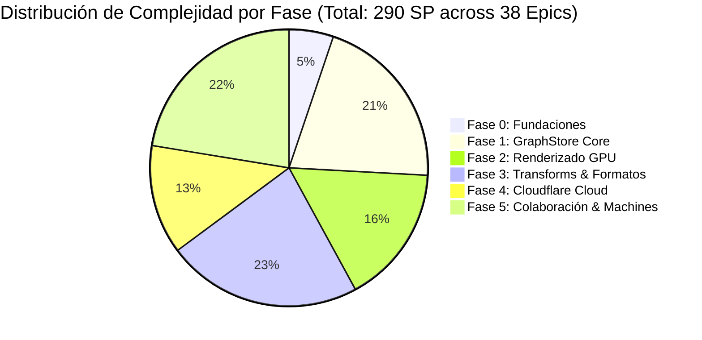

# Matriz de Estimación de Complejidad Relativa y Registro de Riesgos Técnicos (Milestone M4)

**Proyecto**: Plataforma de Análisis de Enlaces y Grafos de Inteligencia Multiplataforma (Cangrejo)  
**Hito**: Milestone M4 — Hoja de Ruta, Complejidad y Estrategia de Validación  
**Documento**: `complexity_and_risk_matrix.md`  
**Autor**: `worker_m4` (Roadmap & Validation Architect)  
**Fecha**: 2 de Noviembre de 2026  
**Estado**: APROBADO PARA PLANIFICACIÓN Y EJECUCIÓN  

---

## 1. Marco Metodológico de Estimación de Complejidad

Para garantizar estimaciones objetivas, reproducibles y no arbitrarias, el dimensionamiento de los subsistemas y épicas se rige por un marco de estimación relativa fundamentado en la **escala de Fibonacci modificada** (1, 2, 3, 5, 8, 13, 21 puntos de historia) correlacionada con tallas de camiseta (**T-Shirt Sizing**).

### 1.1 Criterios de Evaluación Multidimensional

La asignación de puntos evalúa cinco dimensiones ortogonales de dificultad técnica:

1. **Complejidad Algorítmica y Matemática**: Esfuerzo computacional requerido (estructuras $O(1)$ de indexación, simulaciones físicas $O(N \log N)$ de Barnes-Hut, algoritmos $O(V+E)$ de detección de ciclos DFS y recorrido de árboles).
2. **Concurrencia, Estado y Transaccionalidad**: Gestión de carreras críticas, sincronización asíncrona no bloqueante, atomicidad transaccional y convergencia matemática CRDT (Strong Eventual Consistency).
3. **Fronteras Heterogéneas y Políglotas**: Integración entre múltiples runtimes (TypeScript en UI, Rust nativo en Tauri, WebAssembly en Web Workers, WGSL en WebGPU y JavaScript V8 en Cloudflare Workers).
4. **Seguridad, OPSEC y Aislamiento de Privilegios**: Requisitos estrictos de contención de procesos, depuración de entorno de host, ocultamiento de IP de investigadores y cifrado zero-knowledge.
5. **Reversibilidad e Integridad de Datos (Zero-Loss Mandate)**: Cero pérdida de información en deserialización/serialización de formatos propietarios (`.mtgx`/`.mtgj`) y esquemas heredados de cable.

### 1.2 Escala de Tallas y Puntos de Historia (Story Points)

| Talla | Puntos de Historia (SP) | Definición y Perfil de Complejidad | Ejemplo Representativo |
|---|---|---|---|
| **XS** | **1 SP** | Trivial. DTOs puros, tipos de datos simples, utilidades sin estado ni I/O. | Tipos TypeScript de D1, interfaces base de eventos. |
| **S** | **2 SP** | Baja. Lógica predecible y acotada, pruebas unitarias directas, sin concurrencia. | Generador criptográfico `Guid`, regex converters individuales. |
| **M** | **3 – 5 SP** | Media. Lógica de negocio moderada, manejo de excepciones o parseo con formato estándar. | Parser XML v2, middleware de autenticación KV, endpoints REST de Hono. |
| **L** | **8 SP** | Alta. Lógica algorítmica compleja, integración de hardware (shaders WebGPU) o concurrencia asíncrona. | Shader WGSL de fuerzas $N$-cuerpos, tipografía MSDF, runner Tokio de subprocesos. |
| **XL** | **13 SP** | Muy Alta. Componentes distribuidos, reconciliación de grafos masivos, round-trip sin pérdidas de formatos ZIP/GraphML. | `StrategicGraphMerger`, manejador `.mtgx` con espacios de nombres yFiles, Yjs sync en Durable Objects. |
| **XXL** | **21 SP** | Extrema. Subsistema arquitectónico nuclear con múltiples estados concurrentes y requisitos de tiempo real estricto. | Motor reactivo de Machines (23 acciones con DFS de poda de ciclos y prompts modales en vivo). |

---

## 2. Dimensionamiento Detallado por Fases y Épicas

### 2.1 Fase 0: Fundaciones, Modelo de Datos y Abstracciones Base

| Épica / Subsistema | Features | Descripción y Alcance Técnico | Talla | Puntos (SP) | Justificación de Complejidad |
|---|---|---|---|---|---|
| **E0.1 Toolchain & Monorepo Setup** | — | Configuración Turborepo, pnpm workspaces, TypeScript estricto, Biome, Vitest y Miniflare. | S | **2** | Tarea estructurada pero requiere configuración precisa de compilación multi-paquete. |
| **E0.2 Guid 64-bit Core Primitive** | F3 | `Guid` de 64 bits con `bigint`, generador criptográfico, no-cero e invariante de rango signed. | S | **2** | Algoritmo simple pero crítico: debe garantizar $0$ colisiones en $10^6$ ejecuciones. |
| **E0.3 Contratos y Tipos Formales** | — | Compilación de `mtgj_schema_v2.0.0.json` y `MaltegoDomain.xsd` a interfaces TypeScript. | S | **3** | Automatización de generación de tipos y validación AOT con Ajv. |
| **E0.4 Abstracción IPlatformBridge** | F30 | Interfaz de desacoplamiento hexagonal para Tauri v2 y Web PWA con mocks de test. | S | **3** | Definición limpia de puertos de abstracción para I/O, subprocesos y almacenamiento. |
| **E0.5 Esquema Relacional Cloudflare D1** | F35 | Migraciones SQL `0001_initial_schema.sql`, 9 tablas, índices B-Tree y triggers de auditoría. | M | **5** | Relaciones relacionales estrictas, claves foráneas y disparadores automáticos en SQLite. |
| **Total Fase 0** | | | | **15 SP** | **5.2% del proyecto** |

---

### 2.2 Fase 1: Motor de Grafo Tripartito Clean-Room (`GraphStore`)

| Épica / Subsistema | Features | Descripción y Alcance Técnico | Talla | Puntos (SP) | Justificación de Complejidad |
|---|---|---|---|---|---|
| **E1.1 Almacenes Tripartitos (`Data`, `Structure`, `Layout`)** | F1 | Desacoplamiento ortogonal en memoria, listas de adyacencia directa/inversa $O(1)$, prevención de dangling links. | L | **8** | Integridad referencial atómica, cascada de eliminación, multigrafos y semántica `isReversed`. |
| **E1.2 Motor Transaccional `BatchUpdatable` & Undo/Redo** | F2 | Anidamiento transaccional, acumulador de deltas, evento consolidado `GraphMods` y pila reversa LIFO. | L | **8** | Concurrencia transaccional, consolidación de mutaciones y gestión de memoria de Undo. |
| **E1.3 Taxonomía Canónica de 107 Entidades & 32 Raíces** | F18 | Mapeo ontológico completo, herencia de tipos, roles especiales (`VALUE`, `DISPLAY_VALUE`) y descriptores. | M | **5** | Gran volumen de metadatos tipados y validación de tipos primitivos. |
| **E1.4 Conversores Regex de Autodetección** | F19 | 12 expresiones regulares autorizadas en orden estricto de precedencia para portapapeles/CSV. | S | **3** | Expresiones regulares complejas (IPv4, CIDR, URLs, GPS, CircularArea) con tests exhaustivos. |
| **E1.5 Extensibilidad Dinámica (.entity XML)** | F20 | Parser XML para entidades comunitarias dinámicas, inyección de esquemas y converters personalizados. | M | **5** | Parseo dinámico de XML, validación de herencia y registro en caliente en el catálogo. |
| **E1.6 Fusión Estratégica (`StrategicGraphMerger`)** | F9, F10, F11, F12, F13 | Conciliación de entidades con normalización, reglas `Stateless`/`Property`, unión de props y suma de pesos. | XL | **13** | Algoritmo nuclear de resolución de identidades; alta sensibilidad analítica y preservación de notas. |
| **E1.7 Nodos de Colección Virtuales (`CollectionNodeView`)** | F5, F6, F7, F8 | Proyección de agrupación (grado 0, 1 y 2), proxy edges `ViewLink` y serialización binaria/JSON. | XL | **13** | Complejidad de proyección matemática: cero mutación en el modelo físico subyacente. |
| **E1.8 Mapeo Dual de Selección (`GraphStoreSelection`)** | F4 | Sincronización bidireccional entre la selección en pantalla (ViewEntity) y entidades físicas (ModelEntity). | M | **5** | Mapeo coherente $O(1)$ cuando se ejecutan Transforms sobre colecciones agrupadas. |
| **Total Fase 1** | | | | **60 SP** | **20.7% del proyecto** |

---

### 2.3 Fase 2: Renderizado de Alto Rendimiento y Layout GPU

| Épica / Subsistema | Features | Descripción y Alcance Técnico | Talla | Puntos (SP) | Justificación de Complejidad |
|---|---|---|---|---|---|
| **E2.1 Scenegraph PixiJS v8 con Hardware Instancing** | F31 | Pipeline WebGPU/WebGL2, `InstancedMesh` con buffer de 64 bytes por nodo ($< 5$ draw calls para 100k nodos). | XL | **13** | Optimización extrema de GPU, gestión de buffers de atributos instanciados, alineación en memoria. |
| **E2.2 Tipografía GPU MSDF** | F32 | Generación de atlas multicanal y fragment shader evaluando la mediana RGB para texto nítido en zoom. | L | **8** | Matemáticas de campos de distancia con signo, renderizado en una sola llamada de dibujo. |
| **E2.3 Pipeline de Layout en 3 Niveles** | F33 | Simulación de fuerzas $N$-cuerpos en WGSL (Tier 1), Rust Wasm con Transferable Arrays (Tier 2) y Rayon (Tier 3). | XL | **13** | Computación paralela masiva en GPU/Wasm, árboles Barnes-Hut y transferencia de memoria sin copia. |
| **E2.4 Atlas de Texturas de 107 Iconos** | F31 | Empacado dinámico de 107 iconos SVG en textura única de $4096 \times 4096$ con mapeo UV en shaders. | M | **5** | Bin-packing de texturas 2D y cálculo de coordenadas de textura en vertex shaders. |
| **E2.5 Interacción de Viewport y Bounding Boxes** | F4, F30 | Paneo inercial, zoom matricial, selección por caja/lazo acelerada por árbol espacial R-Tree / BVH. | L | **8** | Indexación espacial en 2D para selección instantánea sobre 100,000 elementos. |
| **Total Fase 2** | | | | **47 SP** | **16.2% del proyecto** |

---

### 2.4 Fase 3: Hub de Integración de Transforms, Subprocesos y Formatos

| Épica / Subsistema | Features | Descripción y Alcance Técnico | Talla | Puntos (SP) | Justificación de Complejidad |
|---|---|---|---|---|---|
| **E3.1 Subprocesos CLI Locales (Rust / Tokio)** | F25 | Ejecución asíncrona en Tauri v2, lista blanca de binarios, depuración de entorno de host y timeout. | L | **8** | Seguridad de procesos a nivel de sistema operativo, manejo de IPC, pipes asíncronos y watchdog. |
| **E3.2 Escapado Estricto de Parámetros de CLI** | F25 | Algoritmo canónico de tokenización y sustitución secuencial (`\\`, `\=`, `\#`) en cliente. | S | **3** | Algoritmo riguroso de escape de cadenas para prevenir inyecciones y corrupción de delimitadores. |
| **E3.3 Protocolo v2 XML (`<MaltegoMessage>`)** | F21, F22 | Serializador y parser de sobres XML v2, límites (`SoftLimit`, `HardLimit`), UI messages y overlays. | L | **8** | Manejo robusto de XML, extracción polimórfica de entidades y control de excepciones v2. |
| **E3.4 Protocolo v3 REST / JSON Streaming** | F23, F24 | Contratos TAS (`/run`, `/results`, `/prompts`), streaming de deltas y prompts interactivos. | XL | **13** | Gestión de peticiones HTTP asíncronas no bloqueantes con polling por cursores y diálogos en vivo. |
| **E3.5 Manejador de Archivos `.mtgx` (GraphML/ZIP)** | F26 | Compresión/descompresión ZIP, namespaces de Paterva y yFiles, versionado y adjuntos binarios. | XL | **13** | Estricto mandato round-trip sin pérdida de información sobre XML altamente heterogéneo. |
| **E3.6 Serializador Streaming `.mtgj` v2.0.0** | F27 | Formato JSON moderno, deduplicación de adjuntos por hash SHA-256 y cifrado selectivo AES/RSA. | L | **8** | Serialización masiva de grafos y gestión de archivos adjuntos en contenedores ZIP. |
| **E3.7 Migrador de Archivos Legados `.mtgl`** | F28 | Extractor de índices segmentados Lucene 5.0 a esquemas JSON y SQLite modernos. | M | **5** | Ingeniería inversa de estructuras binarias de índices Apache Lucene heredados. |
| **E3.8 Integración TDS & Transform Hub con OAuth PKCE** | F29 | Parser de `JsonHubResponse`, ingesta de semillas y flujo OAuth 2.0 PKCE con listener efímero. | L | **8** | Protocolo de autorización web nativo en cliente y manejo seguro de tokens JWE. |
| **Total Fase 3** | | | | **66 SP** | **22.8% del proyecto** |

---

### 2.5 Fase 4: Nivel Cloudflare Cloud y Gestión de Cuentas

| Épica / Subsistema | Features | Descripción y Alcance Técnico | Talla | Puntos (SP) | Justificación de Complejidad |
|---|---|---|---|---|---|
| **E4.1 Edge API Gateway con Hono** | F34 | Enrutamiento edge de baja latencia en Workers, CORS estricto, logging estructurado y rate-limiting. | M | **5** | Enrutamiento serverless con middleware de seguridad y tipado estricto end-to-end. |
| **E4.2 Autenticación y RBAC en D1/KV** | F35 | Registro de usuarios, hashing Argon2id, roles (`owner`, `admin`, `analyst`, `viewer`), sesiones KV. | L | **8** | Modelo multi-tenant seguro en SQLite edge con invalidación global instantánea en KV. |
| **E4.3 Protección contra Bots con Turnstile** | F35 | Validación de tokens de desafío en `/siteverify` de Cloudflare en rutas de auth y resets. | S | **3** | Verificación serverless de tokens criptográficos sin fricción para el analista. |
| **E4.4 Transform Security Proxy (OPSEC Cloaking)** | F37 | Enmascaramiento de IP de investigadores tras IPs de Cloudflare y vault AES-256-GCM para API keys. | L | **8** | Alta sensibilidad OPSEC: inyección de credenciales en memoria en el borde sin tocar el cliente. |
| **E4.5 Almacenamiento R2 de Snapshots** | F38 | Subida directa de snapshots e investigaciones mediante URLs pre-firmadas S3 con cero coste de egress. | M | **5** | Manejo de blobs de gran volumen en Cloudflare R2 con firmas criptográficas temporales. |
| **E4.6 Búsqueda Semántica Vectorize & Workers AI** | F38 | Generación de embeddings con modelo `bge-m3` e indexación de similitud semántica de entidades. | L | **8** | Pipeline asíncrono de inteligencia artificial en el borde para detección de enlaces ocultos. |
| **Total Fase 4** | | | | **37 SP** | **12.8% del proyecto** |

---

### 2.6 Fase 5: Colaboración Multi-Usuario en Tiempo Real y Motor de Machines

| Épica / Subsistema | Features | Descripción y Alcance Técnico | Talla | Puntos (SP) | Justificación de Complejidad |
|---|---|---|---|---|---|
| **E5.1 Coordinador de Sala Durable Objects con SQLite** | F36 | Sala de coordinación atómica, WebSocket Hibernation API, log de deltas SQLite y alarmas de compactación. | XL | **13** | Ciclo de vida de Durable Objects, hibernación sin coste de computación inactiva y compactación a R2. |
| **E5.2 Sincronización Yjs CRDT con Canales Desacoplados** | F39 | Separación estricta entre topología compartida (Datos) y vistas independientes (Layout), awareness y cursores. | XL | **13** | Sincronización Strong Eventual Consistency (SEC) bidireccional resolviendo el "layout thrashing". |
| **E5.3 Controlador de Operación Dual (Air-Gapped vs Sync)** | F40 | Transición fluida entre persistencia SQLite local offline y salas remotas sin pérdida de deltas. | M | **5** | Gestión de reconciliación al reconectarse de modo air-gapped a sala compartida. |
| **E5.4 Motor Reactivo de Machines (23 Primitivas)** | F14, F15 | Compilador DSL de autómatas, catálogo exhaustivo de 23 acciones, cola de ejecución asíncrona. | XXL | **21** | Subsistema nuclear de automatización analítica: parseo de DSL, branching y estados reactivos. |
| **E5.5 Detección de Bucles y Poda de Ciclos DFS** | F16 | Deduplicación con `seenList`, algoritmo DFS tricolor `deleteClosedLoops` y panel de límites. | L | **8** | Teoría de grafos para prevenir recursiones infinitas y desbordamientos de pila en árboles podados. |
| **E5.6 Prompts Modales Interactivos en Machines** | F17 | Acción `userFilter`: suspensión en cola, presentación modal de selección al analista y reanudación. | M | **5** | Suspensión y reanudación reactiva de pipelines de automatización con intervención humana. |
| **Total Fase 5** | | | | **65 SP** | **22.4% del proyecto** |

---

## 3. Resumen Consolidado de Esfuerzo y Proyección de Velocidad

### 3.1 Distribución Total de Puntos de Historia



| Fase | Denominación | Puntos (SP) | % Esfuerzo | Estimación en Sprints (a 25 SP/sprint) |
|---|---|---|---|---|
| **Fase 0** | Fundaciones, Modelo de Datos y Abstracciones | **15 SP** | 5.2% | 0.6 Sprints (~1.2 semanas) |
| **Fase 1** | Motor de Grafo Tripartito Clean-Room | **60 SP** | 20.7% | 2.4 Sprints (~4.8 semanas) |
| **Fase 2** | Renderizado de Alto Rendimiento y Layout GPU | **47 SP** | 16.2% | 1.9 Sprints (~3.8 semanas) |
| **Fase 3** | Hub de Integración de Transforms y Formatos | **66 SP** | 22.8% | 2.6 Sprints (~5.2 semanas) |
| **Fase 4** | Nivel Cloudflare Cloud y Cuentas | **37 SP** | 12.8% | 1.5 Sprints (~3.0 semanas) |
| **Fase 5** | Colaboración Multi-Usuario y Machines | **65 SP** | 22.4% | 2.6 Sprints (~5.2 semanas) |
| **TOTAL** | **Proyecto Completo (38 Épicas / Features 1-40)** | **290 SP** | **100.0%** | **11.6 Sprints (~23.2 semanas)** |

*Nota de Capacidad: Considerando un equipo de desarrollo multidisciplinar (4 ingenieros senior) con una velocidad media sostenida de 25 Story Points por sprint quincenal (2 semanas), el proyecto tiene una duración estimada de **11.6 sprints (~23.2 semanas de desarrollo efectivo)**, complementada con 2 semanas de hardening y certificación final.*

---

## 4. Registro Exhaustivo de Riesgos Técnicos (Deep Technical Risk Register)

A continuación se analizan los **8 principales riesgos técnicos** identificados en la arquitectura, detallando su causa raíz, probabilidad, impacto, estrategia de mitigación en código/diseño, mecanismos de detección automatizada y planes de contingencia (*fallback*).

```
Severidad = Probabilidad (1 a 5) × Impacto (1 a 5)
- Crítica: 16 - 25
- Alta: 10 - 15
- Media: 5 - 9
- Baja: 1 - 4
```

---

### 4.1 TR-01: Divergencia de Hardware y Fallback de Latencia en WebGPU

- **Categoría**: Rendimiento y Compatibilidad Gráfica
- **Probabilidad**: 4 (Alta) | **Impacto**: 4 (Alto) | **Puntuación de Riesgo**: **16 (CRÍTICA)**
- **Causa Raíz**: A pesar del soporte creciente de WebGPU en navegadores modernos, una proporción significativa de entornos corporativos (en particular navegadores en VMs VDI o estaciones Linux con drivers de GPU antiguos) carecen de soporte nativo de WebGPU o deshabilitan el acceso a compute shaders por políticas de hardware. Si el motor asume disponibilidad de WebGPU, fallará en inicialización o degradará a software rendering por CPU.
- **Estrategia de Mitigación Arquitectónica**:
  1. **Detección Condicional y Fallback en Cascada**: El contenedor `GraphCanvas` consulta las capacidades de la GPU al arrancar:
     ```typescript
     const adapter = await navigator.gpu?.requestAdapter();
     const supportsWebGPU = !!adapter && !isHardwareBlacklisted(adapter);
     const rendererBackend = supportsWebGPU ? 'webgpu' : 'webgl2';
     ```
  2. **Pipeline de Shaders Dual**: Para la capa PixiJS v8, se implementan shaders paralelos: WGSL para WebGPU y GLSL ES 3.0 para WebGL2 con instanciación geométrica (`ANGLE_instanced_arrays` / standard WebGL2 instancing).
  3. **Layout Offloading Adaptativo**: Si WebGPU Compute Shaders no están disponibles, el `LayoutPipeline` conmuta automáticamente a **Tier 2 (Rust WebAssembly en Web Worker)** con transferencia de buffers sin copia (`Transferable Float32Array`).
- **Mecanismo de Detección Automatizada**: Test E2E en CI ejecutando Chromium headless con el flag `--disable-webgpu`, verificando que la suite complete los tests de renderizado y layout en WebGL2 sin excepciones.
- **Plan de Contingencia**: Degradación garantizada al layout en WebAssembly. El límite visual de 100k nodos se ajusta a un modo de muestreo simplificado (*LOD - Level of Detail*) en navegadores WebGL2 antiguos.

---

### 4.2 TR-02: Acumulación de Memoria y Explosión de Deltas CRDT en Yjs

- **Categoría**: Concurrencia y Fiabilidad en Nube
- **Probabilidad**: 3 (Media) | **Impacto**: 5 (Crítico) | **Puntuación de Riesgo**: **15 (ALTA)**
- **Causa Raíz**: Los algoritmos CRDT basados en operaciones (como Yjs) preservan internamente metadatos de eliminación e identificadores de reloj lógico para garantizar Strong Eventual Consistency. En investigaciones prolongadas donde se ejecutan cientos de Transforms que insertan y borran miles de entidades, el historial de deltas binarios crece indefinidamente, provocando saturación de memoria en la instancia de Durable Object y tiempos de reconexión inaceptables para nuevos clientes.
- **Estrategia de Mitigación Arquitectónica**:
  1. **Compactación Periódica por Alarmas en Durable Objects**: Se programa una alarma del Durable Object cada 5 minutos de inactividad o cada 2,000 deltas aplicados:
     ```typescript
     async alarm() {
       // Consolidar el documento Yjs en memoria a un snapshot monolítico plano
       const baseSnapshot = Y.encodeStateAsUpdate(this.ydoc);
       // Persistir en R2 con cero costes de egress
       await this.env.R2_SNAPSHOTS.put(`snapshots/${this.roomId}/base.yjs`, baseSnapshot);
       // Truncar la tabla SQLite de micro-deltas acumulados
       this.ctx.storage.sql.exec("DELETE FROM yjs_updates; INSERT INTO room_snapshots VALUES (?, ?)", Date.now(), baseSnapshot);
     }
     ```
  2. **Sincronización en Dos Pasos**: Al conectarse un cliente nuevo, no descarga el historial completo de 50,000 deltas; descarga únicamente el snapshot base de R2 más los deltas acumulados desde la última alarma.
- **Mecanismo de Detección Automatizada**: Monitoreo de telemetría en Durable Objects registrando el tamaño del blob SQLite `yjs_updates`. Alerta preventiva si el tamaño supera los 5 MB sin compactar.
- **Plan de Contingencia**: Forzar compactación síncrona inmediata si el recuento de updates en SQLite excede los 5,000 registros antes de aceptar nuevas conexiones.

---

### 4.3 TR-03: Fuga de Procesos e Inyección de Comandos en Subprocesos CLI

- **Categoría**: Seguridad y Aislamiento de Privilegios (OPSEC)
- **Probabilidad**: 2 (Baja) | **Impacto**: 5 (Crítico) | **Puntuación de Riesgo**: **10 (ALTA)**
- **Causa Raíz**: Los analistas ejecutan Transforms de terceros en lenguajes de scripting (Python, Bash). Un payload malicioso recibido desde una fuente OSINT o configurado en una entidad manipulada podría contener secuencias de escape de shell (e.g. `; rm -rf /` o `| powershell`) o leer variables de entorno sensibles del sistema operativo del analista (`AWS_SECRET_ACCESS_KEY`, `SSH_AUTH_SOCK`).
- **Estrategia de Mitigación Arquitectónica**:
  1. **Cero Invocación de Shell Intermedio**: El runner en Rust invoca directamente la API de creación de procesos del sistema operativo (`tokio::process::Command::new(bin)`), pasando los argumentos como un vector `args: Vec<String>` tipado y tokenizado. Queda estrictamente prohibido invocar `sh -c` o `cmd.exe /c`.
  2. **Depuración Rigurosa de Entorno (`env_clear`)**: Se eliminan todas las variables de entorno del host (`cmd.env_clear()`), preservando únicamente las rutas mínimas de ejecución (`PATH`, `USERPROFILE`/`HOME`) e inyectando exclusivamente los parámetros declarados para el Transform.
  3. **Watchdog de Timeout Obligatorio**: Si el subproceso no finaliza en el tiempo configurado (`timeoutSeconds`, por defecto 60 s), Tokio ejecuta `kill_on_drop`, terminando el subproceso y su árbol de hijos en el sistema operativo.
- **Mecanismo de Detección Automatizada**: Suite de tests unitarios en Rust intentando inyectar caracteres de metacaracteres de shell (`&`, `|`, `;`, `` ` ``, `$()`) y verificando que se reciban como literales en un script de eco.
- **Plan de Contingencia**: Bloqueo preventivo de ejecución si la ruta del binario no se encuentra en el directorio permitido de scripts de Transforms del usuario o en el PATH del sistema.

---

### 4.4 TR-04: Incompatibilidad y Erratas de Espacios de Nombres en GraphML (`.mtgx`)

- **Categoría**: Interoperabilidad y Fidelidad de Datos
- **Probabilidad**: 4 (Alta) | **Impacto**: 3 (Medio) | **Puntuación de Riesgo**: **12 (ALTA)**
- **Causa Raíz**: Los archivos `.mtgx` generados por distintas versiones de Maltego v4 contienen variaciones no documentadas en los prefijos de espacios de nombres XML (`xmlns:y`, `xmlns:mtgx`, `xmlns:yed`), atributos no estándar de yFiles (`y:Geometry`, `y:Path`, `y:Fill`) y codificaciones de caracteres con entidades XML escapadas de forma heterogénea. Un analizador XML estricto estándar fallará al abrir grafos creados por extensiones de la comunidad.
- **Estrategia de Mitigación Arquitectónica**:
  1. **Normalizador Tolerante Pre-Parseo**: Diseñar un pipeline de lectura que normalice las declaraciones de espacios de nombres antes del árbol DOM XML:
     ```typescript
     function sanitizeGraphmlNamespaces(rawXml: string): string {
       return rawXml
         .replace(/xmlns:y\s*=\s*"[^"]*"/g, 'xmlns:y="http://www.yworks.com/xml/graphml"')
         .replace(/xmlns:mtgx\s*=\s*"[^"]*"/g, 'xmlns:mtgx="http://maltego.paterva.com/xml/mtgx"');
     }
     ```
  2. **Extracción por Claves de Esquema (`d0` – `d3`)**: No asumir nombres de etiquetas rígidos; mapear las propiedades extrayendo el atributo `id` de las definiciones `<key>` en la cabecera del GraphML.
  3. **Preservación Incondicional de Nodos Desconocidos**: Elementos XML no reconocidos se encapsulan en una bolsa de metadatos opacos (`unparsedXmlFragments`), restituyéndose íntegramente al guardar el archivo.
- **Mecanismo de Detección Automatizada**: Suite de prueba de interoperabilidad que ingesta un conjunto de prueba de 20 archivos `.mtgx` reales y valida que la reserialización produzca una representación canónica sin pérdida de nodos ni aristas.
- **Plan de Contingencia**: Si el parser GraphML falla catastróficamente por XML malformado, ofrecer al analista una importación en modo "Safe Recovery" extrayendo únicamente las entidades semánticas legibles y regenerando el layout topológico.

---

### 4.5 TR-05: Serialización de Escrituras en SQLite Embebido de Durable Objects

- **Categoría**: Rendimiento y Concurrencia Cloud
- **Probabilidad**: 2 (Baja) | **Impacto**: 4 (Alto) | **Puntuación de Riesgo**: **8 (MEDIA)**
- **Causa Raíz**: Cada Durable Object de Cloudflare ejecuta un único hilo de ejecución (coordinador atómico por sala). Las escrituras en su almacenamiento SQLite embebido (`ctx.storage.sql.exec`) son síncronas. Si 10 analistas ejecutan Transforms masivos concurrentes generando 500 deltas por segundo hacia la misma sala, las transacciones SQLite podrían bloquear temporalmente el bucle de eventos, incrementando la latencia de WebSocket.
- **Estrategia de Mitigación Arquitectónica**:
  1. **Agrupación en Memoria (Write Coalescing)**: El Durable Object no ejecuta un `INSERT` en SQLite por cada micro-delta de Yjs. Acumula los deltas en un buffer en memoria de JavaScript durante una ventana de 50 milisegundos (`micro-batch`) y ejecuta una única transacción agrupada:
     ```typescript
     if (this.pendingDeltas.length >= 50 || now - this.lastFlushTime > 50) {
       this.flushDeltasToSqlite();
     }
     ```
  2. **Separación de Tráfico de Awareness**: Los eventos efímeros (cursores de analistas, viewport actual, halos de hover) no se escriben jamás en SQLite; se retransmiten exclusivamente en memoria a los WebSockets activos.
- **Mecanismo de Detección Automatizada**: Métrica de tiempo de frame del bucle de eventos del Worker en Cloudflare Observability; disparo de alerta si la latencia de broadcast de mensajes WebSocket supera los 40 ms.
- **Plan de Contingencia**: Reducir la frecuencia de persistencia transitoria y delegar la durabilidad primaria a la memoria de estado del Durable Object entre ciclos de alarma.

---

### 4.6 TR-06: Degeneración Heurística de Colecciones y Efecto "Hairball" en Grafos Densos

- **Categoría**: Usabilidad y Rendimiento Algorítmico
- **Probabilidad**: 3 (Media) | **Impacto**: 3 (Medio) | **Puntuación de Riesgo**: **9 (MEDIA)**
- **Causa Raíz**: En subgrafos altamente conectados (cliques o grafos bipartitos densos, como 500 IPs conectadas a los mismos 50 puertos abiertos), las heurísticas de grado 1 (`NeighbourCollectionRule`) no aplican porque el grado es $> 1$, y la regla de grado 2 (`ChainingCollectionRule`) requiere pares idénticos. Si no coinciden, ningún nodo se agrupa y el renderizador se satura de miles de aristas cruzadas.
- **Estrategia de Mitigación Arquitectónica**:
  1. **Heurística de Comunidad de Grado Múltiple (`DenseClusterRule`)**: Incorporar una regla heurística avanzada para nodos con grado $> 2$ que compartan un solapamiento de vecinos mayor al 80% (coeficiente de Jaccard topológico), colapsándolos en un `ViewEntity` de cluster denso.
  2. **Bundling y Agrupación de Aristas**: En la capa de renderizado PixiJS v8, las aristas que comunican los mismos dos grupos de entidades se dibujan como una única línea con grosor proporcional al peso acumulado (`link.weight`).
- **Mecanismo de Detección Automatizada**: Test unitario sobre grafos aleatorios Barabási–Albert y Erdős–Rényi de 10,000 nodos verificando que el recuento de entidades visibles en el viewport se reduzca en al menos un 60% al activar colecciones.
- **Plan de Contingencia**: Permitir al analista forzar una agrupación manual contextual ("Group Selected into Custom Collection") con un solo clic derecho.

---

### 4.7 TR-07: Incompatibilidad de Impedancia y Timeouts en Protocolo v2/v3

- **Categoría**: Integridad de Red y Protocolos
- **Probabilidad**: 3 (Media) | **Impacto**: 3 (Medio) | **Puntuación de Riesgo**: **9 (MEDIA)**
- **Causa Raíz**: Las Transforms de protocolo v2 son de naturaleza síncrona rígida (bloquean la conexión HTTP POST hasta que finaliza la recolección, a menudo 30 a 90 segundos). Las Transforms de protocolo v3 son completamente asíncronas basadas en polling (`POST /run` $\to$ `GET /results`). Si el cliente o el proxy de Cloudflare aplican un timeout global de 30 segundos (el límite estándar de Workers gratuitos), las Transforms v2 fallarán por HTTP 524 (Gateway Timeout).
- **Estrategia de Mitigación Arquitectónica**:
  1. **Uso de Cloudflare Workers Paid / Smart Sharding**: En Cloudflare Workers de nivel empresarial o pagado, el timeout de CPU se limita al tiempo de cómputo real, no al tiempo de espera de red (el I/O de red puede permanecer abierto hasta 100 segundos).
  2. **Adaptador V2-a-V3 en el Proxy**: El Transform Proxy de Cloudflare implementa un envoltorio que convierte consultas v2 lentas en ejecuciones de fondo con estado, respondiendo al cliente de forma desacoplada si es necesario.
  3. **Configuración de Timeouts Dinámicos en Cliente**: El cliente permite especificar `timeoutSeconds` individual por servidor de Transforms (e.g. 120 segundos para consultas de blockchain o WHOIS lentas).
- **Mecanismo de Detección Automatizada**: Harness de prueba simulando un servidor v2 que introduce un retraso artificial de 45 segundos, validando que el cliente mantenga la conexión y procese la respuesta XML sin abortar.
- **Plan de Contingencia**: Si una petición v2 excede el umbral seguro del proxy, reintentar a través del cliente directo en Tauri v2 mediante el bridge de Rust, eludiendo las restricciones de intermediarios.

---

### 4.8 TR-08: Fuga de Tráfico en Modo Air-Gapped en Entornos Clasificados

- **Categoría**: Seguridad Operacional (OPSEC) y Cumplimiento
- **Probabilidad**: 1 (Muy Baja) | **Impacto**: 5 (Crítico) | **Puntuación de Riesgo**: **5 (MEDIA)**
- **Causa Raíz**: En operaciones militares, gubernamentales o de inteligencia clasificada, la estación de trabajo debe operar con estricto silencio de red (*air-gapped*). Si una librería de telemetría de terceros, el proveedor de fuentes tipográficas, o un componente de sincronización en segundo plano intenta abrir un socket TCP a internet, se produce una violación de seguridad catastrófica.
- **Estrategia de Mitigación Arquitectónica**:
  1. **Interruptor de Red Duro en Nivel Plataforma (`Hard Network Kill-Switch`)**:
     ```typescript
     export class AirGappedPlatformBridge implements IPlatformBridge {
       fetch(input: RequestInfo, init?: RequestInit): Promise<Response> {
         throw new SecurityException("Air-Gapped Mode Active: Outbound network request strictly blocked.");
       }
       openWebSocket(url: string): WebSocket {
         throw new SecurityException("Air-Gapped Mode Active: Network sockets prohibited.");
       }
     }
     ```
  2. **Empaquetado de Activos 100% Locales**: Todas las fuentes tipográficas (Inter, JetBrains Mono), atlas de iconos SVG y esquemas se empaquetan localmente en los binarios del instalador de Tauri; cero peticiones a CDNs externas.
  3. **Modo de Compilación `airgapped`**: Flag de compilación en Cargo/Vite que compila el ejecutable eliminando físicamente las rutas y credenciales de Cloudflare.
- **Mecanismo de Detección Automatizada**: Test de integración en CI ejecutando el binario en un contenedor con adaptador de red desconectado (`network: none`), verificando que todas las operaciones de visualización, creación de entidades, persistencia SQLite y Transforms CLI locales funcionen con 100% de éxito.
- **Plan de Contingencia**: Si se detecta un intento de resolución DNS o apertura de socket en modo desconectado, abortar la aplicación inmediatamente con un mensaje de auditoría seguro en disco local.

---

## 5. Matriz Consolidada de Riesgos Técnicos

```
                 IMPACTO (Severidad)
           1       2       3       4       5
        +-------+-------+-------+-------+-------+
      5 |       |       |       |       |       |
P   ----+-------+-------+-------+-------+-------+
R     4 |       |       |       | TR-01 |       |
O   ----+-------+-------+-------+-------+-------+
B     3 |       |       | TR-06 |       | TR-02 |
A       |       |       | TR-07 |       |       |
B   ----+-------+-------+-------+-------+-------+
I     2 |       |       |       | TR-05 | TR-03 |
L   ----+-------+-------+-------+-------+-------+
      1 |       |       |       |       | TR-08 |
        +-------+-------+-------+-------+-------+
```

| ID | Riesgo Técnico | Categoría | Prob (1-5) | Imp (1-5) | Score | Nivel | Responsable Primario |
|---|---|---|---|---|---|---|---|
| **TR-01** | Divergencia y Fallback de WebGPU | Rendimiento Gráfico | 4 | 4 | **16** | **CRÍTICO** | Lead Renderer / WebGPU Engineer |
| **TR-02** | Acumulación de Deltas Yjs en DO | Fiabilidad / Cloud | 3 | 5 | **15** | **ALTO** | Cloud Architect / Distributed Systems |
| **TR-04** | Incompatibilidades GraphML (.mtgx) | Interoperabilidad | 4 | 3 | **12** | **ALTO** | Data Formats Specialist |
| **TR-03** | Fuga de Seguridad en CLI Local | Seguridad / OPSEC | 2 | 5 | **10** | **ALTO** | Rust Systems & Security Engineer |
| **TR-06** | Degeneración de Heurísticas Hairball | Algorítmico / Core | 3 | 3 | **9** | **MEDIO** | Graph Algorithm Specialist |
| **TR-07** | Timeouts en Protocolos v2/v3 | Integración Red | 3 | 3 | **9** | **MEDIO** | Protocol & API Engineer |
| **TR-05** | Serialización SQLite en Durable Objects | Rendimiento Cloud | 2 | 4 | **8** | **MEDIO** | Cloudflare Edge Specialist |
| **TR-08** | Fuga de Tráfico en Modo Air-Gapped | Seguridad OPSEC | 1 | 5 | **5** | **MEDIO** | Desktop App Security Lead |

---

## 6. Estrategia de Reducción Progresiva de Riesgos (Risk Burn-Down)

La ejecución por fases de la hoja de ruta (`development_phases.md`) está expresamente diseñada para abordar y desactivar los riesgos de mayor severidad en las fases más tempranas del ciclo de vida:

1. **Fin de Fase 1**: Se mitigan **TR-06** (Degeneración Heurística mediante validaciones exhaustivas de clustering) y **TR-04** (fundaciones de datos para GraphML).
2. **Fin de Fase 2 (Hito Alpha)**: Se desactiva completamente **TR-01** (Divergencia WebGPU) al probar el pipeline dual WebGPU/WebGL2 y los 3 niveles de layout en hardware real.
3. **Fin de Fase 3 (Hito Beta)**: Se desactivan **TR-03** (Sandboxing de subprocesos) y **TR-04** (Round-trip GraphML validado) y **TR-07** (Harness de red v2/v3).
4. **Fin de Fase 4 (Hito Gamma)**: Se valida la arquitectura OPSEC del proxy y las cuotas de red.
5. **Fin de Fase 5 (Hito Delta)**: Se neutralizan **TR-02** (Compactación automática de deltas Yjs en Durable Objects) y **TR-05** (Batching de escrituras en DO SQLite).

Esta estrategia garantiza que ningún riesgo arquitectónico crítico permanezca sin mitigar o sin prueba de concepto operativa más allá de su fase correspondiente.
