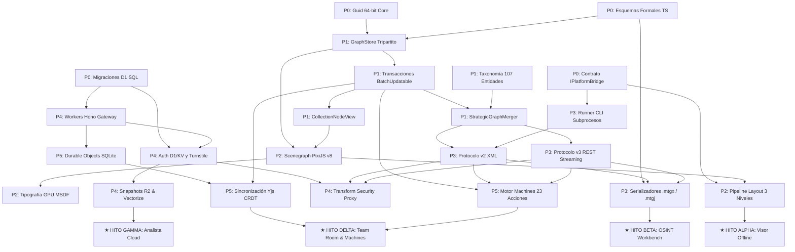

# Plan de Desarrollo Estructurado y Hoja de Ruta Técnica (Milestone M4)

**Proyecto**: Plataforma de Análisis de Enlaces y Grafos de Inteligencia Multiplataforma (Cangrejo)  
**Hito**: Milestone M4 — Hoja de Ruta, Complejidad y Estrategia de Validación  
**Documento**: `development_phases.md`  
**Autor**: Cangrejo Architecture & Engineering Team  
**Fecha**: 2 de Noviembre de 2026  
**Estado**: APROBADO PARA PLANIFICACIÓN Y EJECUCIÓN  

---

## 1. Resumen Ejecutivo y Estrategia de Entrega Phased

El desarrollo de una plataforma de análisis de grafos e inteligencia de amenazas que alcance paridad funcional con sistemas maduros (como Paterva Maltego v4.13.0) y a la vez traslade la solución a una arquitectura moderna (Tauri v2, PixiJS v8 WebGPU, Cloudflare Workers/Durable Objects, y sincronización CRDT en tiempo real) requiere un orden de construcción rigurosamente desacoplado.

Construir la interfaz de usuario o las características colaborativas antes de contar con un motor de almacenamiento transaccional probado en memoria (`GraphStore`) o antes de validar los esquemas de cable provoca retrabajos destructivos. Por tanto, esta hoja de ruta aplica una metodología de **ingeniería guiada por contratos formales (Contract-First Engineering)**, dividida en **6 fases lógicas (Fase 0 a Fase 5)** que conducen a **4 hitos de valor incremental verificables**:

```mermaid
timeline
    title Hitos de Entrega de Valor Incremental
    section Hito Alpha : Fin Fase 2
        Visor Offline de Alto Rendimiento : Ingesta .mtgx/.mtgj : Renderizado 100k nodos a 60 FPS : Navegación y Búsqueda Visual
    section Hito Beta : Fin Fase 3
        Estación de Trabajo OSINT Local : Ejecución Transforms CLI locales : Taxonomía 107 entidades : Fusión estratégica : Nodos de Colección
    section Hito Gamma : Fin Fase 4
        Analista Conectado a la Nube : Gateway Cloudflare : Auth D1/KV y Turnstile : Transform Proxy (IP Cloaking) : Snapshots R2
    section Hito Delta : Fin Fase 5
        Sala de Equipo Multi-Usuario : Sincronización Yjs CRDT : Durable Objects SQLite : Motor Reactivo Machines (23 acciones)
```

---

## 2. Mapa de Fases de Desarrollo

| Fase | Denominación Técnica | Enfoque Central | Features Cubiertas | Hito de Valor Asociado |
|---|---|---|---|---|
| **Fase 0** | **Fundaciones, Modelo de Datos y Abstracciones** | Monorepo, identidad 64-bit `Guid`, esquemas de tipos, migraciones D1, abstracción de plataforma `IPlatformBridge`. | F3, F30, F35 | Fundacional |
| **Fase 1** | **Motor de Grafo Tripartito Clean-Room** | `GraphStore` (Data, Structure, Layout), transacciones `BatchUpdatable`, 107 entidades, 12 regex converters, fusión y colecciones. | F1, F2, F4, F5, F6, F7, F8, F9, F10, F11, F12, F13, F18, F19, F20 | Core In-Memory Engine |
| **Fase 2** | **Renderizado de Alto Rendimiento y Layout GPU** | Pipeline PixiJS v8 WebGL2/WebGPU con instanciación geométrica, tipografía MSDF, pipeline de layout en 3 niveles (WGSL/Wasm/Rayon). | F31, F32, F33 | **Hito Alpha: Visor Offline** |
| **Fase 3** | **Hub de Transforms, Subprocesos y Formatos** | Subprocesos CLI locales en Rust, Protocolo v2 XML, Protocolo v3 REST/JSON, serializadores `.mtgx` / `.mtgj`, migrador `.mtgl`, TDS/Hub. | F21, F22, F23, F24, F25, F26, F27, F28, F29 | **Hito Beta: OSINT Workbench** |
| **Fase 4** | **Nivel Cloudflare Cloud y Gestión de Cuentas** | Edge Gateway con Hono, Auth D1/KV, Turnstile, Transform Security Proxy, almacenamiento R2 y búsqueda semántica con Vectorize. | F34, F35, F37, F38 | **Hito Gamma: Analista Cloud** |
| **Fase 5** | **Colaboración Multi-Usuario y Motor Machines** | Durable Objects con SQLite y WebSockets, Yjs CRDT con canales desacoplados, motor reactivo de Machines con 23 acciones y poda de bucles. | F14, F15, F16, F17, F36, F39, F40 | **Hito Delta: Colaboración & Machines** |

---

## 3. Desglose Pormenorizado por Fases

### 3.1 FASE 0: Fundaciones, Modelo de Datos y Abstracciones Base

#### 3.1.1 Objetivos y Alcance
Establecer la infraestructura de desarrollo monorepo (Turborepo), compilar los contratos de tipos canónicos a partir de los esquemas formales, implementar el generador de identidad `Guid` no nulo de 64 bits y diseñar los contratos de la capa de abstracción de plataforma (`IPlatformBridge`) y base de datos relacional D1.

#### 3.1.2 Features Cubiertas
- **Feature 3**: 64-bit Non-Zero Identity (`Guid`, `GraphID`, `EntityID`, `LinkID`).
- **Feature 30 (Fundación)**: Universal Client Architecture (`IPlatformBridge`).
- **Feature 35 (Fundación)**: Cloudflare D1/KV Relational Schema (`d1_relational_schema.sql`).

#### 3.1.3 Estructura de Paquetes y Módulos
```
cangrejo/
├── packages/
│   ├── core/                    # Tipos agnósticos, Guid, álgebra de errores Result<T, E>
│   ├── schemas/                 # mtgj_schema_v2.0.0.json, MaltegoDomain.xsd compilados a TS
│   ├── platform-bridge/         # Interfaz IPlatformBridge y adaptadores mock
│   ├── server-gateway/          # Workers Hono API core types
│   └── database-d1/             # Migraciones SQL y tipos de entidades D1
```

#### 3.1.4 Tareas Concretas de Implementación
1. **Configuración de Monorepo y Toolchain**:
   - Inicializar Turborepo con pnpm workspace. Configurar TypeScript 5.6+ en modo estricto (`strict: true`, `noImplicitAny: true`, `exactOptionalPropertyTypes: true`).
   - Configurar Oxlint y Biome para linting ultrarrápido y Vitest para pruebas unitarias.
2. **Implementación de Identidad de 64 Bits (`Guid`)**:
   - Archivo: `packages/core/src/identity/Guid.ts`.
   - Implementar clase `Guid` respaldada por `bigint` con verificación de no-cero e invariante de rango de 64 bits (`BigInt.asIntN(64, value)`).
   - Generador criptográfico mediante `crypto.getRandomValues(new BigUint64Array(1))`.
   - Métodos de serialización: `toBigInt()`, `toHex()` (`0x...`), `toString()`, `parse(string)`.
3. **Generación de Tipos y Validadores de Esquema**:
   - Archivo: `packages/schemas/src/mtgj/v2/`.
   - Generar tipos TypeScript estandarizados a partir de `mtgj_schema_v2.0.0.json` mediante `json-schema-to-typescript`.
   - Integrar validación en tiempo de ejecución con `Ajv` compilado en modo AOT.
4. **Definición de Puerto Hexagonal `IPlatformBridge`**:
   - Archivo: `packages/platform-bridge/src/IPlatformBridge.ts`.
   - Declarar contratos para operaciones de archivos, invocación de subprocesos locales, apertura de base de datos SQLite y telemetría de entorno.
5. **Esquema Relacional Inicial D1 (`d1_relational_schema.sql`)**:
   - Archivo: `packages/database-d1/migrations/0001_initial_schema.sql`.
   - Tablas: `organizations`, `users`, `memberships`, `workspaces`, `investigations`, `investigation_collaborators`, `rooms`, `api_keys_vault`, `audit_logs`.
   - Disparadores SQLite para auditoría de `updated_at`.

#### 3.1.5 Criterios de Aceptación y Puerta de Salida (Gate 0)
- [ ] 100% de tests unitarios pasando para `Guid` (1,000,000 generaciones aleatorias sin colisiones ni ceros detectados).
- [ ] Validación bidireccional de JSON de muestra contra `mtgj_schema_v2.0.0.json` con 0 errores de validación.
- [ ] Migración D1 ejecutada exitosamente en entorno local Miniflare sin violaciones de clave foránea ni errores de sintaxis SQLite.

---

### 3.2 FASE 1: Motor de Grafo Tripartito Clean-Room (`GraphStore`)

#### 3.2.1 Objetivos y Alcance
Construir el núcleo del motor de grafos en memoria sin dependencias de UI ni de red. Implementar la separación ortogonal tripartita (`GraphDataStore`, `GraphStructureStore`, `GraphLayoutStore`), el motor transaccional `BatchUpdatable`, el catálogo canónico de 107 entidades, el motor de fusión estratégica y la capa de proyección virtual de nodos de colección.

#### 3.2.2 Features Cubiertas
- **Feature 1**: Tripartite GraphStore (`DataStore`, `StructureStore`, `LayoutStore`).
- **Feature 2**: Batch Transaction Engine (`BatchUpdatable` y eventos `GraphMods`).
- **Feature 4**: Model vs View Dual Selection (`GraphStoreSelection`).
- **Feature 5**: Virtual Collection Nodes (`CollectionNodeView` con cero mutación de datos).
- **Feature 6**: Clustering Heuristics (`StandAloneCollectionRule`, `NeighbourCollectionRule`, `ChainingCollectionRule`).
- **Feature 7**: Virtual Proxy Edges (`ViewLink` proxy routing).
- **Feature 8**: Collection Node Persistence (`collection-nodes.data` y JSON).
- **Feature 9**: Strategic Graph Merger (`StrategicGraphMerger`).
- **Feature 10**: Entity Identity Resolution (`StatelessMatchingRule`, `PropertyMatchingRule`, `TypeMapMatchingRule`).
- **Feature 11**: Merge Conflict Policies (`PartMergeStrategy` - KeepOriginal, Replace, Merge).
- **Feature 12**: Provenance Tracking (`DisplayInformation`, analista, marcadores).
- **Feature 13**: Edge Weight Accumulation (fusión aditiva de pesos en enlaces coincidentes).
- **Feature 18**: 107 Standard Entities Catalog (12 categorías, 32 raíces).
- **Feature 19**: Autodetection Regex Converters (12 converters priorizados).
- **Feature 20**: Dynamic Entity Extensibility (`.entity` parser y registro dinámico).

#### 3.2.3 Estructura de Paquetes y Módulos
```
packages/core/src/
├── store/
│   ├── GraphStore.ts            # Orquestador unificado
│   ├── GraphDataStore.ts        # Propiedades, entidades semánticas y enlaces
│   ├── GraphStructureStore.ts   # Adyacencias O(1), multigrafos y aristas dirigidas
│   ├── GraphLayoutStore.ts      # Coordenadas X, Y, Z, polilíneas y pines
│   ├── BatchUpdatable.ts        # Transacciones atómicas anidadas
│   └── GraphMods.ts             # Eventos diferenciales consolidados
├── selection/
│   └── GraphStoreSelection.ts   # Mapeo vista <-> modelo
├── taxonomy/
│   ├── EntityRegistry.ts        # Catálogo de 107 entidades y 32 raíces
│   ├── Converters.ts            # 12 expresiones regulares de autodetección
│   └── DynamicEntityLoader.ts   # Parser de archivos .entity XML
├── merger/
│   ├── StrategicGraphMerger.ts  # Algoritmo de conciliación de identidades
│   ├── MatchingRules.ts         # Stateless, Property, TypeMap
│   └── PartMergeStrategy.ts     # Políticas de resolución de propiedades y pesos
└── collection/
    ├── CollectionNodeView.ts    # Proyección virtual sin mutación de modelo
    ├── StandAloneRule.ts        # Regla grado 0
    ├── NeighbourRule.ts         # Regla grado 1
    ├── ChainingRule.ts          # Regla grado 2
    └── ViewLinkRouter.ts        # Enrutador de enlaces proxy virtuales
```

#### 3.2.4 Tareas Concretas de Implementación
1. **Implementación de los Almacenes Tripartitos**:
   - `GraphDataStore`: Mapa de entidades `MaltegoEntityData` y aristas `MaltegoLinkData`. Bolsas de propiedades polimórficas (`PropertyBag`), soporte para roles `VALUE`, `DISPLAY_VALUE`, `IMAGE_URL`, notas analíticas y bloques de procedencia `DisplayInformation`.
   - `GraphStructureStore`: Listas de adyacencia directa e inversa (`incoming`, `outgoing`). Detección y bloqueo inmediato de enlaces colgantes (`DanglingLinkException`). Eliminación en cascada atómica. Flag `isReversed` sin alteración topológica física.
   - `GraphLayoutStore`: Almacén de coordenadas cartesianas 2D/3D (`Point3D`), rutas poli-línea de curvatura (`bends`) y flags de bloqueo posicional (`pinned`).
2. **Motor Transaccional `BatchUpdatable` y Gestor de Undo/Redo**:
   - Acumulador de modificaciones por nivel de anidamiento (`nestCount`).
   - Al invocar `endUpdate()`, consolidar y despachar evento único `GraphMods` conteniendo colecciones disjuntas (`added`, `updated`, `deleted`).
   - `GraphViewUndoRedoManager`: Registro LIFO/FIFO de mutaciones inversas acotado a 100 operaciones.
3. **Catálogo de Entidades y Converters**:
   - Mapear las 107 entidades canónicas y sus 32 raíces ontológicas extraídas del blueprint de Maltego v4.13.0.
   - Implementar el pipeline de autodetección con los 12 converters en orden estricto de precedencia (IPv4 $\to$ Netblock $\to$ URL $\to$ Image $\to$ Website $\to$ Domain $\to$ DNSName $\to$ Email $\to$ GPS $\to$ CircularArea $\to$ Person $\to$ Phrase).
4. **Fusión Estratégica (`StrategicGraphMerger`)**:
   - Implementar normalización de identificadores (`trim`, lowercase en dominios/hashes/correos, normalización canónica de ceros en IPv4).
   - `StatelessMatchingRule`: coincidencia por `(typeName, normalizedValue)`.
   - `PropertyMatchingRule`: verificación fail-closed de claves compuestas (e.g. `person.firstnames` + `person.lastname`).
   - Políticas de conflicto: unión de propiedades ausentes, acumulación aditiva de pesos (`dest.weight += src.weight`), concatenación cronológica de notas analíticas y preservación de marcadores de color.
5. **Proyección Virtual de Nodos de Colección (`CollectionNodeView`)**:
   - Algoritmo de agrupación sobre entidades `pinned == false`:
     * Grado 0: `StandAloneCollectionRule` agrupado por `typeName`.
     * Grado 1: `NeighbourCollectionRule` agrupado por `(typeName, neighborId, direction, linkType)`.
     * Grado 2: `ChainingCollectionRule` agrupado por `(typeName, srcNeighbor, trgNeighbor, inType, outType)`.
   - Generación de aristas proxy `ViewLink` y serialización dual (`collection-nodes.data` binario y JSON).

#### 3.2.5 Criterios de Aceptación y Puerta de Salida (Gate 1)
- [ ] Suite de 150+ tests unitarios sobre `GraphStructureStore` garantizando $O(1)$ en consultas de adyacencia y cero enlaces colgantes en inserciones/eliminaciones masivas.
- [ ] `StrategicGraphMerger` fusiona correctamente 10,000 entidades con solapamiento parcial en $< 120\text{ ms}$, acumulando pesos sin duplicar nodos coincidentes.
- [ ] `CollectionNodeView` colapsa y expande 5,000 nodos hoja sin mutar un solo byte de `GraphDataStore` ni alterar los IDs físicos subyacentes.

---

### 3.3 FASE 2: Renderizado de Alto Rendimiento y Motor de Layout GPU

#### 3.3.1 Objetivos y Alcance
Desarrollar la capa de visualización gráfica en cliente capaz de sostener **100,000 nodos y aristas a 60 FPS continuos**. Implementar el scenegraph en **PixiJS v8** con instanciación geométrica en WebGPU y fallback a WebGL2, tipografía MSDF procesada en shader y el pipeline de layout en 3 niveles (WGSL, Rust Wasm Web Worker y native Rayon). Al completar esta fase se alcanza el **Hito Alpha (Visor Offline)**.

#### 3.3.2 Features Cubiertas
- **Feature 31**: PixiJS v8 Hardware Instancing (`InstancedMesh`, $< 5$ draw calls para 100k nodos).
- **Feature 32**: GPU MSDF Typography (renderizado de texto nítido a cualquier factor de zoom).
- **Feature 33**: 3-Tier Layout Pipeline (WebGPU Compute Shaders + Rust Wasm + Rayon nativo).
- **Feature 4 (Visual)**: Dual Selection & Viewport Interaction (halos de selección, bounding box, paneo/zoom matricial).

#### 3.3.3 Estructura de Paquetes y Módulos
```
packages/renderer/src/
├── scenegraph/
│   ├── GraphCanvas.ts           # Contenedor PixiJS v8 y orquestador del viewport
│   ├── InstancedNodeLayer.ts    # InstancedMesh para geometría de nodos
│   ├── InstancedEdgeLayer.ts    # InstancedMesh para aristas y cabezas de flecha
│   ├── MSDFLabelLayer.ts        # Renderizador de etiquetas con Distance Field shader
│   └── SelectionOverlay.ts      # Halos de selección, marcadores y bounding boxes
├── shaders/
│   ├── node_instanced.vert.wgsl # Vertex shader para desempaque de buffers de nodo
│   ├── edge_instanced.vert.wgsl # Vertex shader para cálculo geométrico de líneas/flechas
│   ├── msdf_text.frag.wgsl      # Fragment shader evaluador de mediana RGB MSDF
│   └── layout_nbody.compute.wgsl# Compute shader para simulación de fuerzas N-cuerpos
├── layout/
│   ├── LayoutPipeline.ts        # Router adaptativo de 3 niveles
│   ├── WebGPULayoutRunner.ts    # Tier 1: Ejecutor de compute shaders en GPU
│   ├── WasmWorkerLayoutRunner.ts# Tier 2: Web Worker con Wasm y Transferable Array
│   └── NativeRayonBridge.ts     # Tier 3: Invocación de threadpool Rayon en Tauri
└── atlas/
    └── IconAtlasManager.ts      # Empacado de 107 iconos SVG en textura 4096x4096
```

#### 3.3.4 Tareas Concretas de Implementación
1. **Pipeline de Geometría Instanciada en PixiJS v8**:
   - Configurar `InstancedMesh` con estructura de datos de 64 bytes por nodo (`position: vec2`, `dimensions: vec2`, `colorRgba: vec4`, `selectionRgba: vec4`, `iconAtlasId: f32`, `collectionFlag: f32`, `padding: vec2`).
   - Crear capa de aristas instanciadas uniendo pares origen-destino con cálculo automático de grosor y orientación de flecha en el vertex shader.
   - Garantizar que toda la escena de 100,000 nodos y 120,000 enlaces se renderice en $\le 4$ llamadas de dibujo (draw calls).
2. **Generador y Shader MSDF**:
   - Precomputar atlas de distancias multicanal (RGB) para tipografías Inter y JetBrains Mono.
   - Escribir fragment shader para renderizado de glifos evaluando la mediana de canales (`median(r, g, b) - 0.5`) y antialiasing dependiente de la derivada de pantalla (`fwidth`).
3. **Pipeline de Layout en 3 Niveles**:
   - **Tier 1 (WebGPU)**: Escribir shader WGSL `layout_nbody.compute.wgsl` para cálculo de repulsión electrostática amortiguada con Barnes-Hut en memoria de trabajo compartida (*workgroup shared memory*).
   - **Tier 2 (Rust Wasm)**: Compilar crate Rust `cangrejo-layout-wasm` a `wasm32-unknown-unknown`. Implementar algoritmo Sugiyama y ForceAtlas2 con transferencia de arrays sin copia (`Transferable Float32Array`).
   - **Tier 3 (Rayon Nativo)**: Puente Rust en Tauri con ejecución multinúcleo en segundo plano.
4. **Interacción de Viewport y Mapeo de Selección**:
   - Matriz de transformación 2D con zoom continuo (0.01x a 20.0x) y paneo inercial a 60 FPS.
   - Primitivas de selección: clic simple, Ctrl/Cmd+clic (unión), selección por lazo (*lasso*) y cuadro delimitador (*marquee box*) con aceleración por árbol espacial R-Tree / BVH.

#### 3.3.5 Criterios de Aceptación y Puerta de Salida (Gate 2 - Hito Alpha)
- [ ] **Benchmark de 100k Nodos**: Carga sintética de 100,000 nodos y 100,000 enlaces rinde a 60 FPS sostenidos (tiempo de frame $< 16.6\text{ ms}$) durante paneo y zoom continuo en GPU moderna (Apple Silicon / NVIDIA / AMD).
- [ ] **Consumo de Memoria**: La escena de 100k nodos consume $< 180\text{ MB}$ de RAM de proceso en cliente.
- [ ] **Entrega de Hito Alpha (Visor Offline)**: El ejecutable de escritorio y la aplicación web abren archivos de grafo pregrabados, renderizan la topología y permiten navegación interactiva fluida.

---

### 3.4 FASE 3: Hub de Integración de Transforms, Subprocesos y Formatos de Archivo

#### 3.4.1 Objetivos y Alcance
Conectar el motor de grafos con el mundo real de OSINT. Implementar los analizadores y serializadores de archivos `.mtgx` (GraphML/ZIP) y `.mtgj` (JSON streaming v2.0.0), el migrador de archivos legados `.mtgl` (Lucene 5.0), el ejecutor de subprocesos CLI locales en Rust para Tauri v2, y los protocolos de red v2 (XML) y v3 (REST asíncrono con streaming). Al finalizar esta fase se alcanza el **Hito Beta (Local OSINT Workbench)**.

#### 3.4.2 Features Cubiertas
- **Feature 21**: Transform Protocol v2 (XML `<MaltegoMessage>`).
- **Feature 22**: Transform v2 UI & Limits (`SoftLimit`, `HardLimit`, `UIMessages`, Overlays).
- **Feature 23**: Transform Protocol v3 (REST/JSON contracts `POST /run`, `GET /results`, `DELETE`).
- **Feature 24**: Incremental Event Streaming (delta streaming de entidades y enlaces, prompts interactivos).
- **Feature 25**: Local CLI Transform Runner (subprocesos asíncronos con escape estricto de parámetros).
- **Feature 26**: `.mtgx` ZIP Archive Compatibility (compatibilidad total con GraphML, yFiles y Paterva namespaces).
- **Feature 27**: `.mtgj` JSON Streaming Format (esquema v2.0.0, adjuntos SHA-256, cifrado híbrido).
- **Feature 28**: Legacy `.mtgl` Migrator (conversor de índices Lucene 5.0 a JSON/SQLite).
- **Feature 29**: TDS & Transform Hub Integration (`JsonHubResponse`, `HubSeeds`, OAuth 2.0 PKCE).

#### 3.4.3 Estructura de Paquetes y Módulos
```
packages/transforms/src/
├── runners/
│   ├── LocalCliRunner.ts        # Invocación local vía IPlatformBridge
│   ├── ProtocolV2Client.ts      # Cliente HTTP XML POST para Transforms v2
│   └── ProtocolV3Client.ts      # Cliente REST asíncrono con streaming v3
├── parsers/
│   ├── XmlV2MessageParser.ts    # Parseo de <MaltegoTransformResponseMessage>
│   ├── JsonV3EventParser.ts     # Ingesta de TransformRunEntityEvent y Links
│   └── ArgvTokenizer.ts         # Tokenizador y escapado secuencial (\\, \=, \#)
├── formats/
│   ├── MtgxArchiveHandler.ts    # Empacado/desempacado ZIP GraphML
│   ├── MtgjJsonHandler.ts       # Serializador JSON streaming v2.0.0
│   └── MtglLegacyMigrator.ts    # Extractor de segmentos Lucene 5.0
└── hub/
    ├── HubClient.ts             # Descubrimiento de semillas y catálogo de Transforms
    └── OAuthPkceManager.ts      # Flujo de autenticación con listener efímero
```

#### 3.4.4 Tareas Concretas de Implementación
1. **Ejecutor de Subprocesos CLI Locales (Rust / Tokio)**:
   - Archivo en `src-tauri/src/transforms/runner.rs`.
   - Implementar invocación de binarios con lista blanca de seguridad, depuración de variables de entorno del host (eliminación de secretos ambientales), piping asíncrono en `STDIN`, temporizador de expiración (*watchdog timeout*) y captura de `STDERR` en tiempo real.
   - Algoritmo de escapado estricto en cliente: `\` $\to$ `\\`, `=` $\to$ `\=`, `#` $\to$ `\#`.
2. **Cliente y Parser de Protocolo v2 (XML)**:
   - Generación de sobres `<MaltegoTransformRequestMessage>` con inyección de parámetros, credenciales y límites configurados (`SoftLimit`, `HardLimit`).
   - Parseo tolerante de respuestas XML `<MaltegoTransformResponseMessage>`, extrayendo entidades, propiedades dinámicas, marcadores de color, `DisplayInformation`, `Overlays` y mensajes de UI (`Inform`, `Warning`, `Fatal`).
   - Manejo formal de sobres de error `<MaltegoTransformExceptionMessage>`.
3. **Cliente de Protocolo v3 (REST / JSON Streaming)**:
   - Implementar ciclo de vida asíncrono: `POST /run` $\to$ Polling con `eventPointer` en `GET /results` $\to$ `DELETE` al finalizar o cancelar.
   - Ingesta de eventos diferenciales `ADD`, `UPDATE`, `DELETE` despachados directamente al `StrategicGraphMerger` dentro de un bloque `BatchUpdatable`.
   - Manejo de prompts interactivos bidireccionales (`TransformRunChoicePromptEvent` $\to$ UI modal $\to$ `POST /prompts/{id}`).
4. **Formatos de Archivo e Interoperabilidad**:
   - `.mtgx`: Manejador ZIP con lectura/escritura de `version.properties`, `Graphs/Graph1.graphml` (respetando espacios de nombres `y:ShapeNode`, `y:PolyLineEdge`, `mtgx:MaltegoEntity`, `mtgx:MaltegoLink`), iconos y adjuntos binarios.
   - `.mtgj`: Serializador streaming con soporte para archivos adjuntos deduplicados por SHA-256 e integración con la suite de validación `mtgj_schema_v2.0.0.json`.
   - `.mtgl`: Migrador de índices segmentados Lucene 5.0 Pandora, extrayendo documentos de entidades y reconstruyendo la topología hacia SQLite/JSON.
5. **Cliente del Transform Hub y OAuth 2.0 PKCE**:
   - Parser de manifiesto `JsonHubResponse`. Ingesta de semillas de Transforms (`HubSeeds`).
   - Manejador OAuth 2.0 PKCE en cliente abriendo navegador y capturando el código en `http://127.0.0.1:<port>/callback`.

#### 3.4.5 Criterios de Aceptación y Puerta de Salida (Gate 3 - Hito Beta)
- [ ] **Suite Round-Trip de Formatos**: Importar 20 archivos `.mtgx` reales de Maltego v4.13.0, serializarlos de vuelta y verificar **cero pérdida** de nodos, enlaces, pesos, coordenadas, marcadores y notas analíticas.
- [ ] **Aislamiento de Subprocesos**: El ejecutor CLI local ejecuta scripts de Python de prueba en Windows, macOS y Linux; un script malicioso intentando leer variables de entorno del sistema recibe únicamente el entorno depurado.
- [ ] **Entrega de Hito Beta (Local OSINT Workbench)**: La aplicación de escritorio opera 100% desconectada (air-gapped), ejecuta Transforms locales de Python/Bash, agrupa nodos en colecciones y fusiona resultados automáticamente.

---

### 3.5 FASE 4: Nivel Cloudflare Cloud y Gestión de Cuentas

#### 3.5.1 Objetivos y Alcance
Desplegar la infraestructura cloud serverless en el borde de Cloudflare (330+ PoPs globales). Implementar el API Gateway con Hono en Cloudflare Workers, autenticación multi-tenant con D1 y KV, defensa contra bots con Cloudflare Turnstile, proxy de seguridad para Transforms (ocultamiento de IP de investigadores y vault de claves API) y almacenamiento de snapshots en R2 con embeddings semánticos en Vectorize. Al concluir se alcanza el **Hito Gamma (Analista Conectado a la Nube)**.

#### 3.5.2 Features Cubiertas
- **Feature 34**: Cloudflare Workers API Gateway (enrutamiento de borde con Hono).
- **Feature 35**: Cloudflare D1/KV Account Auth & RBAC (organizaciones, usuarios, roles, Turnstile).
- **Feature 37**: Cloudflare Transform Security Proxy (IP cloaking, API keys vault cifrado, cache edge).
- **Feature 38**: Cloudflare R2 & Vectorize Storage (snapshots .mtgx/.mtgj con cero coste de egress, búsqueda semántica AI `bge-m3`).

#### 3.5.3 Estructura de Paquetes y Módulos
```
packages/server-worker/src/
├── index.ts                     # Entrada principal Hono y bindings de Cloudflare
├── routes/
│   ├── auth.ts                  # Registro con Turnstile, login, refresh, TOTP
│   ├── workspaces.ts            # Gestión de espacios de trabajo e investigaciones
│   ├── transforms.ts            # Proxy de Transforms con IP cloaking y vault
│   └── storage.ts               # Pre-signed URLs para snapshots y adjuntos en R2
├── middleware/
│   ├── authMiddleware.ts        # Validación de sesiones en KV y permisos RBAC
│   ├── rateLimiter.ts           # Control de frecuencia de peticiones en el edge
│   └── turnstileValidator.ts    # Verificación de tokens de bot en /siteverify
├── services/
│   ├── VaultCrypto.ts           # Cifrado AES-256-GCM para api_keys_vault
│   ├── VectorizeService.ts      # Embeddings Workers AI (bge-m3) y búsquedas
│   └── AuditLogger.ts           # Inserción de eventos en audit_logs de D1
└── types/
    └── env.ts                   # Declaración de Bindings: D1, KV, R2, AI, Vectorize
```

#### 3.5.4 Tareas Concretas de Implementación
1. **API Gateway con Hono en Cloudflare Workers**:
   - Configuración de `server/src/index.ts` con middleware de cabeceras de seguridad, CORS restringido (`.cangrejo.io` y `tauri://localhost`) y control de excepciones uniforme.
2. **Autenticación Multi-Tenant y RBAC en D1/KV**:
   - Registro de usuarios con validación de tokens de Cloudflare Turnstile en el endpoint `https://challenges.cloudflare.com/turnstile/v0/siteverify`.
   - Hashing de contraseñas mediante Argon2id / Scrypt en Workers.
   - Creación de organizaciones y asignación de roles (`owner`, `admin`, `analyst`, `viewer`).
   - Aceleración de sesiones con Cloudflare KV (`session:<token_hash>` con TTL de 15 min) y revocación global instantánea (`revoked:<userId>`).
3. **Proxy de Seguridad de Transforms (OPSEC Proxy)**:
   - Los Transforms remotos se despachan a través del Worker Proxy: la IP real del analista queda enmascarada detrás del rango de IPs de salida de Cloudflare.
   - Desacoplamiento de claves API: el analista solo envía su token de sesión. El proxy consulta la clave cifrada del proveedor en D1 (`api_keys_vault`), la descifra en memoria con la clave maestra de Cloudflare Secrets y la inyecta en la cabecera `Authorization` hacia el proveedor OSINT.
   - Caché en el borde en KV para consultas repetitivas (WHOIS, DNS pasivo).
4. **Almacenamiento de Snapshots R2 y Búsqueda Semántica Vectorize**:
   - Generación de URLs pre-firmadas S3 para subida directa de archivos adjuntos y snapshots de grafos a Cloudflare R2 sin tarifas de egress.
   - Cola de procesamiento asíncrono para generar embeddings con Workers AI (`@cf/baai/bge-m3`, 1024 dimensiones) al registrar entidades complejas.
   - Indexación en Cloudflare Vectorize para descubrimiento de correlaciones semánticas transversales entre investigaciones no enlazadas explícitamente.

#### 3.5.5 Criterios de Aceptación y Puerta de Salida (Gate 4 - Hito Gamma)
- [ ] **Defensa contra Bots**: Peticiones de registro sin token Turnstile válido o con token reutilizado son rechazadas con HTTP 403 en $< 15\text{ ms}$.
- [ ] **OPSEC y Vault**: Verificación mediante analizador de tráfico de que las peticiones salientes a servicios OSINT externos contienen exclusivamente IPs de Cloudflare y que las claves API jamás tocan el disco del cliente.
- [ ] **Entrega de Hito Gamma (Analista Cloud)**: El usuario puede registrarse, autenticarse, sincronizar sus investigaciones privadas en R2 y ejecutar Transforms a través del proxy seguro sin revelar su identidad física.

---

### 3.6 FASE 5: Colaboración Multi-Usuario en Tiempo Real y Motor de Machines

#### 3.6.1 Objetivos y Alcance
Habilitar la colaboración en tiempo real entre múltiples analistas distribuidos y el motor de automatización de investigaciones reactivas. Desplegar los coordinadores de sala con **Cloudflare Durable Objects**, su almacenamiento SQLite embebido y la **WebSocket Hibernation API**. Implementar la sincronización **Yjs CRDT** con canales desacoplados (topología compartida vs viewport privado). Construir el motor reactivo de **Machines** con sus 23 acciones, algoritmos de poda de bucles y prompts modales en vivo. Al completar esta fase se alcanza el **Hito Delta (Multi-User Team Room & Automation)**.

#### 3.6.2 Features Cubiertas
- **Feature 14**: Reactive Machines Engine (`MachineRuntime`, `RuntimeImage`).
- **Feature 15**: 23 Machine Action Primitives (catálogo formal completo).
- **Feature 16**: Machine Loop/Cycle Pruning (`seenList`, DFS `deleteClosedLoops`, `WarnLimitPanel`).
- **Feature 17**: Modal Interactive Prompts (`UserFilterAction` interactivo).
- **Feature 36**: Cloudflare Durable Objects Sync (coordinación de sala con DO SQLite y WebSocket Hibernation).
- **Feature 39**: Yjs CRDT Synchronization (canales desacoplados de Datos y Layout).
- **Feature 40**: Dual-Mode Operation (transición transparente entre modo offline air-gapped y salas en vivo).

#### 3.6.3 Estructura de Paquetes y Módulos
```
packages/realtime/src/
├── durable-objects/
│   └── InvestigationRoom.ts     # Durable Object con SQLite, Hibernation y alarmas
├── crdt/
│   ├── InvestigationYDoc.ts     # Documento Yjs con mapas desacoplados
│   ├── YjsSyncProvider.ts       # Proveedor WebSocket binario para Tauri y Web
│   └── AwarenessManager.ts      # Presencia, cursores y viewports de analistas
└── machines/
    ├── MachineRuntime.ts        # Runtime del autómata de estados
    ├── MachineDslParser.ts      # Parser y compilador de scripts .machine
    ├── ActionRegistry.ts        # Registro e implementación de las 23 acciones
    ├── LoopDetector.ts          # Gestión de seenList y poda DFS de ciclos
    └── ModalPromptBridge.ts     # Comunicación interactiva con la UI del analista
```

#### 3.6.4 Tareas Concretas de Implementación
1. **Coordinador de Sala en Durable Objects con SQLite y Hibernación**:
   - Implementar clase `InvestigationRoom` utilizando `ctx.acceptWebSocket(ws)` y serialización de sesión en el WebSocket (`ws.serializeAttachment()`).
   - Almacenamiento síncrono de deltas binarios de Yjs en la base de datos SQLite embebida del DO (`ctx.storage.sql.exec`).
   - Programación de alarmas de compactación cada 5 minutos: consolidación de deltas en un snapshot base, subida a R2 y truncamiento de la tabla SQLite local.
2. **Sincronización Yjs CRDT con Canales Desacoplados**:
   - Implementar `InvestigationYDoc` con separación en 3 canales:
     * **Canal 1 (Estructural y Semántico)**: `entities`, `links`, `bookmarks`, `notes`. Sincronizado obligatoriamente entre todos los analistas.
     * **Canal 2 (Layout Global Compartido)**: `sharedLayout` para posiciones coordinadas.
     * **Canal 3 (Layout Local Privado)**: Permite a un analista reorganizar temporalmente el lienzo sin desordenar la pantalla de sus compañeros de equipo.
   - Sincronización en 2 pasos de Yjs (`sync-step-1`, `sync-step-2`, `update`) sobre WebSockets binarios.
3. **Motor Reactivo de Automatización (Maltego Machines)**:
   - Parser del DSL `.machine` a árbol de sintaxis abstracta (AST) y compilación a `RuntimeImage`.
   - Implementar formalmente las **23 acciones canónicas**:
     * Ejecución: `run` (con `ignoreSeenEntities`).
     * Filtros: `type`, `value`, `property`, `numeric`, `age`.
     * Selección: `all`.
     * Topología: `incoming`, `outgoing`, `degree`, `rootAncestors`, `rootAncestorCount`.
     * Clasificación: `bookmarked`, `bookmark`, `clearBookmark`.
     * Mutación: `delete`, `deleteBranch`.
     * Interacción: `userFilter` (pausa modal en estado `SUSPENDED`).
     * Visual: `setLayout`.
     * Diagnóstico: `log`, `status`.
     * Persistencia e Integración: `saveAs`, `sendToURL`.
4. **Prevención de Bucles y Poda de Ciclos**:
   - Conjunto `seenList` para deduplicar entidades antes de despachar Transforms recursivos.
   - Algoritmo DFS tricolor (Blanco, Gris, Negro) en `deleteBranch()` para cortar aristas de retroceso (*back-edges*) y podar ciclos cerrados sin desbordar la pila.
   - Panel de seguridad `WarnLimitPanel` con corte preventivo a las 10,000 entidades o 1,000 pasos automáticos.

#### 3.6.5 Criterios de Aceptación y Puerta de Salida (Gate 5 - Hito Delta)
- [ ] **Concurrencia CRDT**: 5 analistas concurrentes ejecutando Transforms y editando notas simultáneamente convergen al **mismo estado exacto** en $< 100\text{ ms}$ sin colisiones ni pérdida de datos.
- [ ] **Prevención de Bucles en Machines**: Un script de Machine con Transforms cíclicos (`Domain` $\leftrightarrow$ `DNSName`) se ejecuta durante 50 iteraciones; el motor corta recursiones infinitas mediante `seenList` y finaliza en estado `COMPLETED`.
- [ ] **Entrega de Hito Delta (Multi-User Team Room & Automation)**: Despliegue completo en producción de salas multi-usuario en Cloudflare con hibernación y motor de Machines interactivo.

---

## 4. Grafo de Dependencias entre Subsistemas y Ruta Crítica

### 4.1 Grafo de Dependencias Técnicas



### 4.2 Análisis de la Ruta Crítica (Critical Path Analysis)

La ruta crítica representa la secuencia más larga de dependencias técnicas que determina la duración mínima del proyecto. Cualquier retraso en estos componentes impacta directamente la fecha de finalización global:

$$\text{Ruta Crítica} = \mathbf{P0\_Guid/Schemas} \longrightarrow \mathbf{P1\_Tripartite/Batch} \longrightarrow \mathbf{P1\_Merger} \longrightarrow \mathbf{P3\_Protocols} \longrightarrow \mathbf{P4\_Proxy/Gateway} \longrightarrow \mathbf{P5\_DO/Yjs}$$

#### Justificación Técnica de la Ruta Crítica:
1. **Cuello de Botella Inicial**: El `Guid` de 64 bits y los esquemas son el fundamento del `GraphStore`. No se puede instanciar ninguna entidad ni arista sin este tipo primitivo.
2. **Motor Transaccional y Fusión**: El `StrategicGraphMerger` es el receptor universal tanto de los archivos locales (`.mtgx`/`.mtgj`) como de los Transforms v2/v3 y del motor de Machines. Sin él, ninguna ingesta de datos es posible.
3. **Protocolos de Cable a Cloud Proxy**: El proxy de Cloudflare depende de que los clientes de cable v2 y v3 estén formalizados para poder ejecutar el IP cloaking y la inyección de claves de bóveda.
4. **Sincronización en Borde**: Durable Objects y Yjs requieren que el modelo transaccional `BatchUpdatable` esté completamente cerrado para garantizar que los deltas binarios reflejen operaciones atómicas libres de conflictos.

#### Oportunidades de Paralelización (Fast-Tracking):
- **Canal de Renderizado (Track Visual)**: La Fase 2 (`PixiJS v8`, `MSDF` y `3-Tier Layout`) puede desarrollarse en paralelo con la Fase 3 (`Transforms y Formatos`), una vez estabilizado el contrato de `GraphStore` de la Fase 1.
- **Canal Cloudflare (Track Infra)**: La Fase 4 (`Workers`, `D1`, `KV`, `Turnstile`) puede comenzar en paralelo a la Fase 2 y 3, ya que la infraestructura de autenticación y base de datos relacional es independiente del motor gráfico de cliente.

---

## 5. Matriz de Trazabilidad Cruzada: Features vs Fases

| # | Característica / Feature | Fase | Módulo / Componente Clave | Hito |
|---|---|---|---|---|
| 1 | Tripartite GraphStore | Fase 1 | `GraphStore`, `DataStore`, `StructureStore`, `LayoutStore` | Core |
| 2 | Batch Transaction Engine | Fase 1 | `AbstractBatchUpdatable`, `GraphMods` | Core |
| 3 | 64-bit Non-Zero Identity | Fase 0 | `Guid.ts`, `BigInt.asIntN(64)` | Core |
| 4 | Model vs View Dual Selection | Fase 1, 2 | `GraphStoreSelection.ts`, `SelectionOverlay.ts` | Alpha |
| 5 | Virtual Collection Nodes | Fase 1 | `CollectionNodeView.ts` | Beta |
| 6 | Clustering Heuristics (3 Rules) | Fase 1 | `StandAloneRule`, `NeighbourRule`, `ChainingRule` | Beta |
| 7 | Virtual Proxy Edges | Fase 1 | `ViewLinkRouter.ts` | Beta |
| 8 | Collection Node Persistence | Fase 1 | `collection-nodes.data`, `.mtgj` collections | Beta |
| 9 | Strategic Graph Merger | Fase 1 | `StrategicGraphMerger.ts` | Beta |
| 10 | Entity Identity Resolution | Fase 1 | `StatelessMatchingRule`, `PropertyMatchingRule` | Beta |
| 11 | Merge Conflict Policies | Fase 1 | `PartMergeStrategy` (Merge, Replace, KeepOriginal) | Beta |
| 12 | Provenance Tracking | Fase 1 | `DisplayInformation`, notas analíticas, overlays | Beta |
| 13 | Edge Weight Accumulation | Fase 1 | Acumulación matemática en aristas paralelas | Beta |
| 14 | Reactive Machines Engine | Fase 5 | `MachineRuntime.ts`, `RuntimeImage.ts` | Delta |
| 15 | 23 Machine Action Primitives | Fase 5 | `ActionRegistry.ts` (catálogo exhaustivo de 23 acciones) | Delta |
| 16 | Machine Loop/Cycle Pruning | Fase 5 | `seenList`, DFS `deleteClosedLoops`, `WarnLimitPanel` | Delta |
| 17 | Modal Interactive Machine Prompts | Fase 5 | `UserFilterAction.ts`, `ModalPromptBridge.ts` | Delta |
| 18 | 107 Standard Entities Catalog | Fase 1 | `EntityRegistry.ts` (12 categorías, 32 raíces) | Beta |
| 19 | Autodetection Regex Converters | Fase 1 | `Converters.ts` (12 regex autorizadas) | Beta |
| 20 | Dynamic Entity Extensibility | Fase 1 | `DynamicEntityLoader.ts` (.entity XML parser) | Beta |
| 21 | Transform Protocol v2 (XML) | Fase 3 | `ProtocolV2Client.ts`, `<MaltegoMessage>` | Beta |
| 22 | Transform v2 UI & Limits | Fase 3 | `SoftLimit`, `HardLimit`, `UIMessages`, Overlays | Beta |
| 23 | Transform Protocol v3 (REST/JSON) | Fase 3 | `ProtocolV3Client.ts` (TAS REST async contracts) | Beta |
| 24 | Incremental Event Streaming | Fase 3 | Delta events streaming (`EntityEvent`, `LinkEvent`) | Beta |
| 25 | Local CLI Transform Runner | Fase 3 | `LocalCliRunner.ts`, Tokio async subprocess spawner | Beta |
| 26 | `.mtgx` ZIP Archive Compatibility | Fase 3 | `MtgxArchiveHandler.ts` (GraphML XML + Paterva/yFiles) | Beta |
| 27 | `.mtgj` JSON Streaming Format | Fase 3 | `MtgjJsonHandler.ts` (schema 2.0.0, SHA-256 files) | Beta |
| 28 | Legacy `.mtgl` Migrator | Fase 3 | `MtglLegacyMigrator.ts` (Lucene 5.0 to SQLite/JSON) | Beta |
| 29 | TDS & Transform Hub Integration | Fase 3 | `HubClient.ts`, `JsonHubResponse`, OAuth 2.0 PKCE | Beta |
| 30 | Universal Client Architecture | Fase 0, 2 | `IPlatformBridge.ts`, Tauri v2 + Web PWA | Alpha |
| 31 | PixiJS v8 Hardware Instancing | Fase 2 | `InstancedMesh`, $< 5$ draw calls para 100k nodos | Alpha |
| 32 | GPU MSDF Typography | Fase 2 | Distance field shader para texto nítido a 60 FPS | Alpha |
| 33 | 3-Tier Layout Pipeline | Fase 2 | WebGPU compute + Rust Wasm + Rayon nativo | Alpha |
| 34 | Cloudflare Workers API Gateway | Fase 4 | Hono framework en el edge | Gamma |
| 35 | Cloudflare D1/KV Account Auth | Fase 0, 4 | D1 relational schema, KV session cache, Turnstile | Gamma |
| 36 | Cloudflare Durable Objects Sync | Fase 5 | `InvestigationRoom.ts`, DO SQLite, Hibernation API | Delta |
| 37 | Cloudflare Transform Security Proxy | Fase 4 | Workers Proxy, IP cloaking, vault AES-256-GCM | Gamma |
| 38 | Cloudflare R2 & Vectorize Storage | Fase 4 | R2 zero-egress snapshots, Workers AI `bge-m3` | Gamma |
| 39 | Yjs CRDT Synchronization | Fase 5 | Canales desacoplados de Datos y Layout | Delta |
| 40 | Dual-Mode Operation | Fase 5 | 100% offline air-gapped vs live collaborative rooms | Delta |

---

## 6. Conclusión de la Hoja de Ruta

La hoja de ruta estructurada garantiza que cada hito entregue una capacidad completa y utilizable:
1. **Hito Alpha** valida la viabilidad del motor gráfico y de renderizado (100k nodos a 60 FPS).
2. **Hito Beta** proporciona un reemplazo funcional de escritorio para analistas OSINT aislados.
3. **Hito Gamma** traslada la gestión de cuentas y seguridad operacional al borde de Cloudflare.
4. **Hito Delta** desbloquea la colaboración multi-usuario de nueva generación y la automatización inteligente.

Este ordenamiento estricto minimiza riesgos de refactorización y permite una verificación formal paso a paso antes de acometer subsistemas dependientes.
