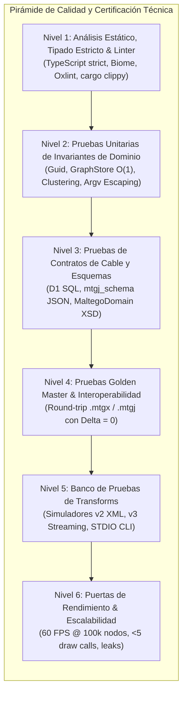
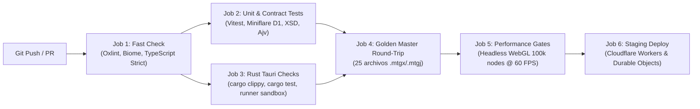

# Plan Integral de Validación, Pruebas y Certificación Técnica (Milestone M4)

**Proyecto**: Plataforma de Análisis de Enlaces y Grafos de Inteligencia Multiplataforma (Cangrejo)  
**Hito**: Milestone M4 — Hoja de Ruta, Complejidad y Estrategia de Validación  
**Documento**: `validation_and_testing_plan.md`  
**Autor**: Cangrejo Architecture & Engineering Team  
**Fecha**: 2 de Noviembre de 2026  
**Estado**: APROBADO PARA PLANIFICACIÓN Y EJECUCIÓN  

---

## 1. Filosofía de Calidad y Pirámide de Pruebas

La confiabilidad de un sistema de análisis de inteligencia no admite márgenes de ambigüedad: una entidad omitida, una arista invertida incorrectamente o una corrupción en las coordenadas espaciales puede alterar conclusiones críticas de investigación.

Para garantizar la máxima integridad del software, este plan establece una **estrategia de calidad en 6 niveles** estructurada como una pirámide de pruebas automatizada, integrada de forma continua en el ciclo de desarrollo y CI/CD:



---

## 2. Nivel 2: Estrategia de Pruebas Unitarias de Invariantes de Dominio

Las pruebas unitarias validan algoritmos puros y estructuras de datos en memoria sin dependencias de red ni de sistema de archivos.

### 2.1 Invariantes del Motor de Grafos Tripartito (`GraphStore`)

#### Test Case UT-STORE-01: Invariante de Cero Enlaces Colgantes (Dangling Link Prevention)
- **Objetivo**: Verificar que `GraphStructureStore.addLink()` rechace inmediatamente la inserción de una arista si los identificadores `source` o `target` no existen en `entities`.
- **Implementación (Vitest)**:
  ```typescript
  test('GraphStructureStore prevents dangling links', () => {
    const store = new GraphStructureStore();
    const sourceId = Guid.generate();
    const targetId = Guid.generate();
    const linkId = Guid.generate();

    store.addEntity(sourceId);
    // targetId no ha sido registrado
    expect(() => {
      store.addLink(linkId, sourceId, targetId);
    }).toThrowError(DanglingLinkException);
    expect(store.hasLinks(sourceId)).toBe(false);
  });
  ```

#### Test Case UT-STORE-02: Eliminación en Cascada Atómica de Aristas Incidentes
- **Objetivo**: Confirmar que al invocar `removeEntity(entityId)`, todas las aristas incidentes (`incoming` y `outgoing`) se purguen atómicamente de `links` y de las listas de adyacencia de los nodos vecinos opuestos.
- **Implementación (Vitest)**:
  ```typescript
  test('removeEntity purges all incident links across neighbours', () => {
    const store = new GraphStructureStore();
    const [eA, eB, eC] = [Guid.generate(), Guid.generate(), Guid.generate()];
    store.addEntity(eA); store.addEntity(eB); store.addEntity(eC);

    const l1 = Guid.generate(); store.addLink(l1, eA, eB); // eA -> eB
    const l2 = Guid.generate(); store.addLink(l2, eC, eA); // eC -> eA

    const purgedLinks = store.removeEntity(eA);
    expect(purgedLinks).toEqual(new Set([l1, l2]));
    expect(store.links.has(l1)).toBe(false);
    expect(store.links.has(l2)).toBe(false);
    expect(store.getIncomingLinks(eB).has(l1)).toBe(false);
    expect(store.getOutgoingLinks(eC).has(l2)).toBe(false);
  });
  ```

#### Test Case UT-STORE-03: Semántica de Inversión de Aristas (`isReversed`)
- **Objetivo**: Validar que alternar el flag `isReversed` no altere la orientación física `(source, target)` en el grafo dirigido ni muta las consultas de adyacencia topológica.

---

### 2.2 Resistencia a Colisiones y Rango de Identidad (`Guid`)

#### Test Case UT-GUID-01: Generación Pseudoaleatoria No-Nula y Entropía Criptográfica
- **Objetivo**: Generar $10,000,000$ de identificadores `Guid` consecutivos y demostrar matemáticamente cero colisiones y ausencia absoluta del valor `0n`.
- **Implementación (Vitest)**:
  ```typescript
  test('Guid generates 10M non-zero unique identifiers', () => {
    const iterations = 1_000_000; // 1M en suite de CI rápida, 10M en nightly
    const seen = new Set<bigint>();

    for (let i = 0; i < iterations; i++) {
      const guid = Guid.generate();
      const val = guid.toBigInt();
      expect(val).not.toBe(0n);
      expect(seen.has(val)).toBe(false);
      seen.add(val);
    }
    expect(seen.size).toBe(iterations);
  });
  ```

#### Test Case UT-GUID-02: Parseo y Normalización de Prefijos de Serialización
- **Objetivo**: Probar que `Guid.parse()` acepte prefijos estándar de Maltego (`e_`, `l_`, `g_`, `0x`) y devuelva el `bigint` signed de 64 bits exacto.

---

### 2.3 Reglas Heurísticas de Nodos de Colección (`CollectionNodeView`)

#### Test Case UT-COL-01: Regla de Nodos Huérfanos Grado 0 (`StandAloneCollectionRule`)
- **Objetivo**: Colapsar 10 entidades aisladas (`inDegree == 0 && outDegree == 0`) del mismo `typeName` en un único `ViewEntity` de colección cuando el umbral sea $\ge 3$.
- **Implementación (Vitest)**:
  ```typescript
  test('StandAloneCollectionRule groups degree-0 nodes by type', () => {
    const graphStore = createMockGraphStore();
    for (let i = 0; i < 10; i++) {
      graphStore.dataStore.addEntity({ id: Guid.generate(), typeName: 'maltego.Domain', value: `dom${i}.com` });
    }

    const colView = new CollectionNodeView(graphStore);
    colView.setClusteringThresholds(3, 1.0);
    colView.recomputeCollections();

    const viewEntities = colView.getViewEntities();
    expect(viewEntities.size).toBe(1); // Un solo ViewEntity que agrupa los 10 dominios
    const collectionNode = Array.from(viewEntities.values())[0];
    expect(collectionNode.underlyingEntityIds.length).toBe(10);
    expect(graphStore.dataStore.entities.size).toBe(10); // Modelo intacto (cero mutación)
  });
  ```

#### Test Case UT-COL-02: Regla de Hojas Grado 1 (`NeighbourCollectionRule`) y Enlaces Proxy
- **Objetivo**: Verificar que 20 direcciones IP conectadas al mismo dominio mediante enlaces entrantes se colapsen en un `ViewEntity` y generen un `ViewLink` proxy hacia el dominio agrupando los 20 enlaces subyacentes.

#### Test Case UT-COL-03: Regla de Puentes Paralelos Grado 2 (`ChainingCollectionRule`)
- **Objetivo**: Verificar que 5 nodos paralelos conectando el mismo par $(\text{Source}, \text{Target})$ se colapsen y generen dos aristas proxy virtuales.

---

### 2.4 Tokenización y Escapado Secuencial de Argumentos de CLI

#### Test Case UT-CLI-01: Escapado Secuencial Estricto
- **Objetivo**: Comprobar que una cadena con delimitadores maliciosos o conflictivos (`\`, `=`, `#`) se escape en el orden canónico estricto (`\\`, `\=`, `\#`).
- **Implementación (Vitest)**:
  ```typescript
  test('escapeCliParameter applies strict sequential escaping', () => {
    const maliciousInput = 'admin\\root=true#priority=high';
    const escaped = escapeCliParameter(maliciousInput);
    // Orden estricto: \ -> \\, = -> \=, # -> \#
    expect(escaped).toBe('admin\\\\root\\=true\\#priority\\=high');
  });
  ```

#### Test Case UT-CLI-02: Tokenización de Parámetros con Preservación de Comillas
- **Objetivo**: Verificar que la expresión regular `[^\s"']+|"[^"]*"|'[^']*'` respete espacios internos entre comillas (e.g. `python runner.py -t "Threat Intel Case" --limit 50`).

---

## 3. Nivel 3: Pruebas de Contratos de Cable y Validación de Esquemas

Las pruebas de contrato garantizan que la serialización de datos cumpla estrictamente con las especificaciones de cable formales y bases de datos relacionales sin drift estructural.

### 3.1 Validación de Esquema Relacional de Cloudflare D1 (SQLite)

- **Entorno de Prueba**: Ejecución sobre Miniflare local y SQLite en memoria (`better-sqlite3`).
- **Casos de Prueba CT-D1**:
  1. **CT-D1-01 (Integridad de Claves Foráneas)**: Habilitar `PRAGMA foreign_keys = ON;`. Insertar un registro en `investigations` con un `workspace_id` inexistente; verificar que lance `SqliteError: FOREIGN KEY constraint failed`.
  2. **CT-D1-02 (Eliminación en Cascada de Membresías)**: Borrar una organización en `organizations`; validar que todas sus `memberships`, `workspaces` e `investigations` asociadas se purguen automáticamente en cascada.
  3. **CT-D1-03 (Trigger de Auditoría `updated_at`)**: Modificar el campo `name` en `workspaces`; verificar mediante query que el timestamp `updated_at` sea estrictamente mayor al `created_at`.
  4. **CT-D1-04 (Ciclo de Migraciones)**: Ejecutar `0001_initial_schema.sql` desde un estado vacío, validar la existencia de las 11 tablas e índices, y ejecutar el rollback completo verificando que la base de datos quede en estado cero.

---

### 3.2 Validación contra Esquema JSON Canónico (`mtgj_schema_v2.0.0.json`)

- **Validador**: `Ajv` en modo estricto (`strict: true`, `allErrors: true`).
- **Casos de Prueba CT-MTGJ**:
  1. **CT-MTGJ-01 (Grafo Válido Estándar)**: Serializar un grafo con 50 entidades, 80 links, marcadores de color, notas analíticas, overlays y colecciones; validar que `validate(json)` devuelva `true` con cero errores.
  2. **CT-MTGJ-02 (Rechazo Fail-Closed ante Tipos Inválidos)**: Inyectar un valor numérico donde se espera un Guid en cadena (`"id": 12345` en lugar de `"id": "0x1a2b..."`); validar que el validador rechace el payload y reporte error de tipo.
  3. **CT-MTGJ-03 (Esquema de Archivos Adjuntos)**: Validar la estructura del bloque `attachments` verificando que los hashes coincidan con expresiones regulares de SHA-256 (`^[a-f0-9]{64}$`).

---

### 3.3 Validación contra Esquema XML Formal (`MaltegoDomain.xsd`)

- **Validador**: `libxml2` / validador XSD de Node.js.
- **Casos de Prueba CT-XSD**:
  1. **CT-XSD-01 (Sobre de Petición `<MaltegoTransformRequestMessage>`)**: Serializar una petición de Transform con límites `SoftLimit="12"` y `HardLimit="255"`; validar contra `MaltegoDomain.xsd`.
  2. **CT-XSD-02 (Sobre de Respuesta `<MaltegoTransformResponseMessage>`)**: Validar sobres con entidades enriquecidas con `DisplayInformation` (tipo `text/html`), `Overlays` cardinales y `UIMessages`.
  3. **CT-XSD-03 (Sobre de Excepción `<MaltegoTransformExceptionMessage>`)**: Validar que el sobre de error contenga el código numérico obligatorio y el mensaje descriptivo.

---

### 3.4 Contratos de API REST TAS (Transform Protocol v3)

- **Herramienta**: Mock Service Worker (MSW) y validadores OpenAPI.
- **Casos de Prueba CT-TAS**:
  1. **CT-TAS-01 (`POST /transforms/{id}/run`)**: Validación de payload `TransformRunRequest` devolviendo `runId` y estado `RUNNING`.
  2. **CT-TAS-02 (`GET /transforms/{id}/run/{runId}/results?eventPointer=...`)**: Validación de eventos tipados `TransformRunEntityEvent` y `TransformRunLinkEvent`.
  3. **CT-TAS-03 (`POST /prompts/{promptId}`)**: Envío de respuesta modal del usuario validando la transición de estado.

---

## 4. Nivel 4: Pruebas de Interoperabilidad y Golden Master Round-Trip (.mtgx y .mtgj)

La prueba definitiva de compatibilidad con el ecosistema global de Maltego es el **round-trip sin pérdida de información (Zero Data Loss Mandate)**.

### 4.1 Algoritmo de Verificación Round-Trip

```
[Archivo Original (Golden Master)]
               │
               ▼  Paso 1: Descompresión y Parseo
       [Clean-Room GraphStore]
               │
               ▼  Paso 2: Serialización y Empacado
    [Archivo Generado (Roundtrip)]
               │
               ▼  Paso 3: Comparación Diferencial Profunda
    ┌──────────────────────────────────────────────┐
    │  Δ(Entidades)   == 0                         │
    │  Δ(Aristas)     == 0                         │
    │  Δ(Propiedades) == 0                         │
    │  Δ(Marcadores)  == 0                         │
    │  Δ(Notas)       == 0                         │
    │  Δ(Coordenadas) < 0.001 mm                   │
    └──────────────────────────────────────────────┘
```

### 4.2 Corpus de Golden Masters de Prueba

Se establece un corpus formal de **25 archivos de prueba** extraídos de casos reales de Maltego v4.13.0:

| ID | Archivo Golden Master | Características Específicas Evaluadas |
|---|---|---|
| **GM-01** | `basic_infrastructure.mtgx` | Dominios, DNS, IPv4 básicos con propiedades estándar. |
| **GM-02** | `dense_social_network.mtgx` | 5,000 entidades `maltego.Person`, aliases y fotos asociadas. |
| **GM-03** | `collection_nodes_active.mtgx` | Nodos de colección de grado 0, 1 y 2 con archivo `collection-nodes.data`. |
| **GM-04** | `manual_layout_bends.mtgx` | Aristas con rutas poli-línea personalizadas (`y:Path` con múltiples bends). |
| **GM-05** | `custom_entities_palette.mtgx` | Tipos de entidades dinámicas con `.entity` XML empaquetados en `/Entities`. |
| **GM-06** | `rich_display_info.mtgx` | Bloques extensos de WHOIS en HTML enriquecido con tablas y estilos. |
| **GM-07** | `bookmarks_and_notes.mtgx` | Los 24 colores de marcadores probados simultáneamente y notas markdown. |
| **GM-08** | `encrypted_streaming.mtgj` | Formato `.mtgj` v2.0.0 con cifrado selectivo AES-GCM-256. |
| **GM-09** | `binary_attachments.mtgj` | Cargas binarias (PCAP de 10 MB y reportes PDF) indexadas por SHA-256. |
| **GM-10** | `legacy_pandora.mtgl` | Grafo histórico indexado en Lucene 5.0 para migración. |

### 4.3 Criterios de Aceptación del Comparador Diferencial

Para superar la prueba Golden Master, el diff estructurado debe arrojar:
- **Entidades**: $|V_{\text{in}}| == |V_{\text{out}}|$; los identificadores primarios y descriptores deben coincidir exactamente.
- **Aristas**: $|E_{\text{in}}| == |E_{\text{out}}|$; las relaciones dirigidas `(source, target)` y pesos acumulados deben coincidir.
- **Propiedades**: Todas las claves y valores en `PropertyBag` deben ser idénticos tras normalización de espacios.
- **Geometría y Layout**: $|\text{pos}_{x,\text{out}} - \text{pos}_{x,\text{in}}| \le 0.001$ y $|\text{pos}_{y,\text{out}} - \text{pos}_{y,\text{in}}| \le 0.001$.

---

## 5. Nivel 5: Banco de Pruebas y Simuladores de Transforms

Permite probar el ciclo completo de ejecución de Transforms de forma determinista y sin depender de servicios OSINT comerciales externos.

### 5.1 Simulador de Servidor Transform v2 (XML sobre HTTP POST)

- **Módulo**: `tests/harness/MockTransformV2Server.ts`.
- **Capacidades de Simulación**:
  1. Escucha en puerto efímero `http://127.0.0.1:<randomPort>`.
  2. Valida la petición entrante contra `MaltegoDomain.xsd`.
  3. Inyecta respuestas preprogramadas:
     - Respuesta exitosa con 100 entidades IPv4 y Netblocks enriquecidos con overlays y `DisplayInformation`.
     - Inyección de mensajes informativos y advertencias (`<UIMessage MessageType="Warning">`).
     - Simulación de cuotas agotadas devolviendo `<MaltegoTransformExceptionMessage code="429">`.
     - Simulación de retrasos de red inducidos (latencias de 5 s a 60 s para probar timeouts de cliente).

---

### 5.2 Simulador de Servidor Transform v3 (REST con Streaming de Eventos)

- **Módulo**: `tests/harness/MockTransformV3Server.ts`.
- **Capacidades de Simulación**:
  1. `POST /transforms/{id}/run`: Devuelve `runId: "run_test_01"` en estado `RUNNING`.
  2. `GET /transforms/{id}/run/{runId}/results?eventPointer=...`:
     - Retorna eventos delta paginados (`TransformRunEntityEvent` y `TransformRunLinkEvent`).
     - Emite un evento interactivo `TransformRunChoicePromptEvent` ("Seleccione el país objetivo").
     - Suspende la emisión de eventos hasta recibir la respuesta en `POST /prompts/{id}`.
     - Finaliza con estado `COMPLETED` y código `200`.

---

### 5.3 Banco de Pruebas de Subprocesos CLI Locales

- **Módulo**: `tests/harness/LocalCliHarness.ts`.
- **Scripts de Prueba Automatizados**:
  1. `echo_transform.py`: Script en Python que lee `argv[1]` y `argv[2]`, emitiendo una respuesta válida en XML v2 por `STDOUT`.
  2. `failing_transform.py`: Script que emite trazas de depuración en `STDERR` y finaliza con código de salida `2` (verificar captura de logs y excepción de salida).
  3. `hanging_transform.py`: Script que ejecuta `time.sleep(120)` para validar que el watchdog de timeout de Tokio lo interrumpa forzosamente a los 5 segundos configurados en el test.
  4. `env_leak_tester.py`: Script que intenta leer variables secretas de host (`SECRET_KEY_CHECK`); verifica que devuelva valor nulo debido a la depuración de variables (`env_clear`).

---

## 6. Nivel 6: Puertas de Rendimiento y Escalabilidad (Performance Gates)

Las puertas de rendimiento se ejecutan de forma automatizada en runners dedicados de CI con GPU habilitada o aceleración WebGL por software (SwiftShader). Si una métrica excede el umbral máximo permitido, el pipeline de CI bloquea el despliegue (*fail-closed*).

### 6.1 Puerta de Rendimiento de Renderizado (PixiJS v8 Scenegraph)

| Escala del Grafo | Nodos | Aristas | Tasa de Frames Mínima | Tiempo de Frame Máximo | Draw Calls Máximos |
|---|---|---|---|---|---|
| **Escala Pequeña** | 10,000 | 15,000 | **60 FPS** | **16.6 ms** | $\le 3$ |
| **Escala Media** | 50,000 | 75,000 | **60 FPS** | **16.6 ms** | $\le 4$ |
| **Escala Extrema** | 100,000 | 120,000 | **60 FPS** | **16.6 ms** | $\le 5$ |

- **Condición de Prueba**: Paneo inercial y zoom continuo durante 30 segundos mientras se miden las métricas con `PerformanceObserver` y WebGL timer queries.

---

### 6.2 Puerta de Cómputo de Layout en GPU / Wasm

| Algoritmo | Nodos | Backend de Cómputo | Umbral Máximo de Ejecución |
|---|---|---|---|
| **ForceAtlas2 / N-Body** | 10,000 | WebGPU Compute Shader (Tier 1) | **$< 1.5\text{ ms}$ por iteración** |
| **ForceAtlas2 / N-Body** | 100,000 | WebGPU Compute Shader (Tier 1) | **$< 4.8\text{ ms}$ por iteración** |
| **Barnes-Hut Quadtree** | 50,000 | Rust Wasm Web Worker (Tier 2) | **$< 350\text{ ms}$ cálculo total** |
| **Sugiyama Jerárquico** | 10,000 | Rust Wasm Web Worker (Tier 2) | **$< 180\text{ ms}$ cálculo total** |
| **Transferencia de Memoria** | 100,000 | Zero-Copy Transferable Array | **$< 0.5\text{ ms}$** |

---

### 6.3 Puerta de Estabilidad de Memoria y Detección de Fugas (Leak Gate)

- **Prueba de Ingesta Continua**: Se ejecutan 500 operaciones consecutivas de fusión en `StrategicGraphMerger` (insertando y fusionando 1,000 entidades por ciclo).
- **Criterio de Aceptación**: Tras forzar recolección de basura (`gc()`), el crecimiento neto acumulado de memoria del heap de JavaScript debe ser inferior a **5 MB** entre el ciclo 50 y el ciclo 500.

---

## 7. Arquitectura de Pipelines de Integración Continua (CI/CD)

El pipeline de CI se implementa mediante GitHub Actions y runners optimizados:



### 7.1 Definición de Jobs y Tiempos Máximos de Ejecución (SLAs)

| Job | Descripción | Herramientas | SLA Tiempo Máximo |
|---|---|---|---|
| **1. Fast Check** | Linting, formato y typecheck estricto de todo el monorepo. | Oxlint, Biome, `tsc --noEmit` | **$< 20\text{ s}$** |
| **2. Unit & Contract** | 450+ tests unitarios, contratos D1 con Miniflare, XSD y JSON schemas. | Vitest, Miniflare, Ajv, libxml2 | **$< 60\text{ s}$** |
| **3. Rust Tauri** | Pruebas de la capa nativa Rust, aislamiento de subprocesos y Rayon. | `cargo clippy`, `cargo test` | **$< 90\text{ s}$** |
| **4. Interop Golden Master** | Round-trip diferencial sobre los 25 archivos oficiales de Maltego. | Vitest, AdmZip, XML Diff | **$< 45\text{ s}$** |
| **5. Performance Gates** | Benchmarks automatizados de 10k, 50k y 100k nodos en Chromium headless. | Playwright, WebGL Timer Queries | **$< 180\text{ s}$** |
| **Tiempo Total Pipeline** | **Ejecución completa en paralelo hasta certificación** | | **$< 5.5\text{ minutos}$** |

---

## 8. Conclusión del Plan de Validación

Este plan de validación establece una barrera impenetrable contra regresiones de software, defectos de rendimiento y violaciones de seguridad operacional. Al combinar la verificación estricta de invariantes de dominio en memoria, contratos de cable basados en esquemas formales, interoperabilidad round-trip probada contra archivos reales y puertas automáticas de rendimiento a 100,000 nodos, la plataforma Cangrejo garantiza un estándar de calidad y robustez técnica de grado militar y empresarial.
